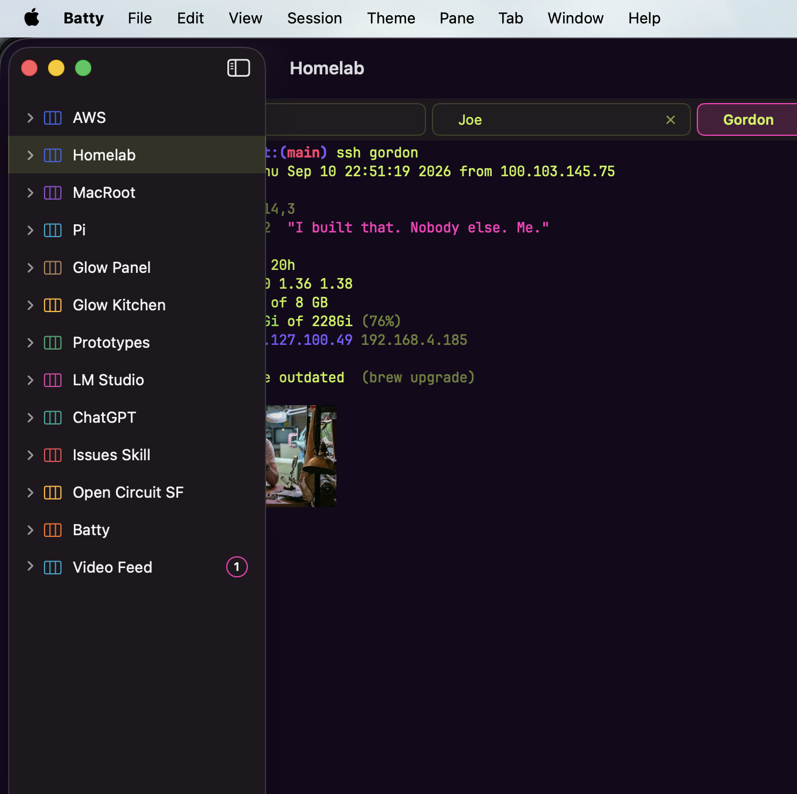

# 0407 — Sidebar renders as a detached floating panel with its own traffic lights over the Detail Area in a full-screen Window, occluding Tab chips and terminal content (observed once, Prod 1.1.0)

| | |
|---|---|
| **Status** | open |
| **Module** | Sidebar / Window |
| **Platform** | macOS |
| **First seen** | 2026-09-11 |

## Description

**One-shot visual report, not currently reproducible.** The Sidebar was drawn as a detached, floating panel — rounded corners, its own drop shadow, its own traffic-light buttons and sidebar-toggle button — overlapping the Window's own content instead of occupying the leading column. The Detail Area behind it was laid out as if the Sidebar column had zero width: terminal text and the Tab chip row extend leftward *underneath* the panel and are clipped at its right edge. The user's words: "It does not repro for me anymore so I cannot give you any other details."

Conditions per the report: the user's MacBook, **Prod 1.1.0** (tag `7658c37`, 2026-08-21 — not Beta), Window in **full screen**, **5 Tabs open in the Pane**. The user also reported: "It did seem to work properly when I reduced the size of the screen. That could have simply triggered layout updates." — they are explicitly hedging that the resize may have been a generic relayout trigger rather than the specific cure. Do not read that as "resizing fixes it."

### What the screenshot shows (verified against the image at filing)

- The macOS menu bar is visible across the top of the frame (Batty's full menu set: File, Edit, View, Session, Theme, Pane, Tab, Window, Help).
- The Sidebar is a floating rounded panel inset from the frame's top and left edges, with a drop shadow, listing this Window's Sessions (AWS, Homelab — selected, MacRoot, Pi, Glow Panel, Glow Kitchen, Prototypes, LM Studio, ChatGPT, Issues Skill, Open Circuit SF, Batty, Video Feed with a badge of 1).
- **The panel carries its own window chrome**: red/yellow/green traffic lights at its top-left and a sidebar-toggle button at its top-right. In macOS full screen a window's traffic lights are normally hidden (revealed only with the auto-revealed titlebar) — visible traffic lights drawn *on the Sidebar panel* is the single strongest anomaly in the capture.
- Behind and around the panel the real Window content is visible: the centered "Homelab" title, the Tab chip row (one chip's left portion hidden behind the panel, a "Joe" chip with a close control, a highlighted "Gordon" chip clipped at the image's right edge), and terminal output from an `ssh gordon` session ("Last login: Thu Sep 10 22:51:19 2026 from 100.103.145.75", uptime/memory/disk figures, a brew-outdated note, an inline image partially occluded).
- **The Detail Area is laid out edge-to-edge under the panel, not beside it.** Terminal lines are clipped mid-word at the panel's right edge (`t:(main) ssh gordon`, `u Sep 10 22:51:19 2026`, `Gi of 228Gi (76%)`) — the missing left halves are underneath the Sidebar. The leftmost Tab chip is likewise mostly occluded.
- What appears to be the Window's own rounded top-left corner is faintly visible behind the panel, below the menu bar.

### What the screenshot cannot settle

- **The capture appears cropped** (the "Gordon" chip is cut at the image's right edge), so neither the full-screen extent nor the reported 5-Tab count can be confirmed from the image — only 3 chips are visible.
- A visible menu bar is consistent with both non-full-screen and full-screen-with-cursor-at-top, so the image alone does not confirm the Window was in full screen at capture time; the full-screen condition rests on the user's report.
- The macOS version is unknown. The panel's styling — inset floating sidebar with rounded corners and traffic lights inside the panel — resembles newer macOS sidebar presentation, but nothing in the capture pins the OS release.
- Whether this is a full-screen *transition* artifact (caught mid-animation), a titlebar-accessory/overlay-sidebar presentation gone wrong, or the Window having partially exited full screen is **not determined by the screenshot alone**. See candidate readings in Notes.

## Steps to reproduce

Not currently reproducible. What the user can report: Window in full screen on the MacBook, Prod 1.1.0, 5 Tabs open in the Pane, Sidebar visible. Reducing the window size coincided with the layout returning to normal (hedged — see Description).

## Expected behavior

With the Sidebar visible, it occupies the leading column of the `NavigationSplitView` and the Detail Area starts at its trailing edge — nothing in the Detail Area is laid out underneath it. In full screen, traffic lights follow the system's normal auto-hide behavior rather than being drawn on the Sidebar as a detached panel.

## Actual behavior

As captured once: the Sidebar floats as a detached panel carrying its own traffic lights and sidebar-toggle button, and the Detail Area (Tab chips, terminal content) is laid out from the Window's left edge underneath it, so the panel occludes the leftmost Tab chip and the left portion of every terminal line.

## Attachments

## Notes

### Code investigation at filing (against `main` tip `f4464ae`)

- The Sidebar is the sidebar column of a plain SwiftUI `NavigationSplitView` in `BattyKit/Sources/BattyKit/Views/RootWindowView.swift` (`RootWindowView.body`): `SessionSidebarView` with `.navigationSplitViewColumnWidth(min: 180, ideal: 220, max: 320)`, `columnVisibility` state driven by the `@SceneStorage` `sidebarHidden` flag and the `.battyToggleSidebar` notification. There is no custom `NSSplitView`/`NSSplitViewController`, no titlebar accessory, and no custom sidebar presentation — the split presentation is entirely the system's.
- **The app has no full-screen handling at all.** Greps for `windowWillEnterFullScreen` / `windowDidEnterFullScreen` / `windowWillExitFullScreen` / `windowDidExitFullScreen`, `toggleFullScreen`, `styleMask`, `collectionBehavior`, and `fullSizeContentView` find nothing in app sources. `WindowDelegate` (`RootWindowView.swift`) handles only close confirmation. Whatever happened is the stock `NavigationSplitView`/`NSWindow` full-screen machinery, unassisted and unconstrained by Batty code.
- The only window-chrome writes in the app are in the private `WindowChromeApplier` (`RootWindowView.swift`, end of file): when a theme palette is active it sets `window.titlebarAppearsTransparent = true` and paints `window.backgroundColor`, from `updateNSView` deferred via `DispatchQueue.main.async`. Unverified whether this interacts with the anomaly, but it is the one place Batty touches titlebar presentation.
- **Prod 1.1.0 vs `main`:** `main` is 122 commits ahead of the tag. The commits since `7658c37` touching `RootWindowView.swift` / `SessionSidebarView.swift` / `SessionDetailView.swift` (`61c5f05`, `4fa53a5`, `e3865c4`, `9b9f782`, `071aea3`) are close-confirmation, `session_destroyed` gating, clipboard-gate, pane-kind gating, and metrics-pane work — none touch the `NavigationSplitView` presentation or window chrome. Nothing on `main` plausibly already fixes this, so it is presumed still live, not merely a 1.1.0 artifact.

### Candidate readings (all unverified — the screenshot alone cannot pick one)

1. **Full-screen transition artifact** — the capture caught AppKit mid-way through the enter/exit-full-screen animation, while the system temporarily hosts the sidebar and titlebar chrome in a detached presentation layer.
2. **`NavigationSplitView` fell into an overlay presentation** — the split view presented the sidebar as an overlay above a full-width detail column (the layout the occlusion pattern matches exactly) instead of the side-by-side layout, and stayed there.
3. **Mixed window state** — the Window partially exited full screen (or full screen and the split view disagreed about state), leaving window chrome attached to the sidebar panel.
4. **OS-version presentation quirk** — a newer macOS sidebar presentation (floating inset panel) misapplied or half-applied in full screen. Depends on the unconfirmed macOS version.

### Evidence that would settle it if it recurs

The user will be the one to catch this next time; the most useful captures, roughly in order:

1. **A full-display screenshot (Cmd-Shift-3), not a window capture or crop** — settles the full-screen extent, menu bar state, and total Tab count in one image.
2. **Does the menu bar auto-hide when the cursor moves away from the top?** Auto-hide confirms the Window really is in full-screen mode at that moment.
3. **Does toggling full screen (the green button or `⌃⌘F`) clear it?** Distinguishes a stuck transition from a stable wrong layout.
4. **Does Cmd-B (hide then show Sidebar) clear it?** Distinguishes a one-time presentation glitch from a persistent split-view state.
5. **Is the floating panel live UI?** Click a different Session row in it — does selection work and does the Detail Area respond, or is it a stale snapshot?
6. **`batty list --json`** (shipped in 1.1.0) — records the true Session/Pane/Tab topology at the moment, to compare against what is drawn.
7. **`sw_vers`** — pins the macOS version.
8. A **screen recording** of entering/leaving full screen with the Sidebar visible, if it starts reproducing.
9. Console.app filtered to the `co.sstools.Batty` subsystem around the event.

## Relation

No prior tracker issue covers Sidebar or window-chrome misplacement in full screen — verified by grep at filing; full-screen mentions in #0042 / #0134 / #0151 / #0309 / #0344 / #0347 / #0387 / #0393 are all incidental. Nearest neighbors, related but distinct: **[#0047](0047.md)** / **[#0048](0048.md)** (closed, 2026-05-11 — Tab chips painting outside their Pane; visually adjacent occlusion of chips, but content leaking *out of* its region rather than chrome floating *over* it, and long since fixed) and **[#0134](0134.md)** (the Bell Feed popover's anchor notes the full-screen/hidden-toolbar edge case — the only prior acknowledgment in the tracker that full screen changes chrome layout).
