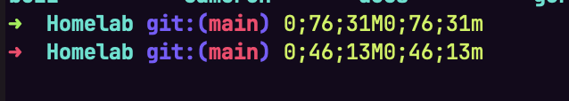

# 0411 — Clicking in a Terminal Session at an idle zsh prompt inserts SGR mouse-report fragments such as `0;76;31M0;76;31m` as literal input

| | |
|---|---|
| **Status** | open |
| **Module** | TerminalSurface / GhosttyKit |
| **Platform** | macOS |
| **First seen** | 2026-09-22 |

## Description

A plain left click inside a Terminal Session, with nothing running but the shell prompt, types garbage into the prompt. User report, verbatim: "Just clicking on a terminal in Batty causes these strange sequences to be printed out. I cannot explain it and we need to fix this bug."

The screenshot shows an oh-my-zsh prompt in a repo named Homelab with this appended after two clicks:

```
➜  Homelab git:(main) 0;76;31M0;76;31m
➜  Homelab git:(main) 0;46;13M0;46;13m
```

Each fragment decodes cleanly as an xterm SGR (mode 1006) mouse report with its `ESC [ <` prefix stripped: `ESC [ < 0 ; 76 ; 31 M` is "button 0 (left) pressed at column 76, row 31" and `ESC [ < 0 ; 76 ; 31 m` is the matching release. The second line is another press/release pair at column 46, row 13. The prefix is missing because ZLE eats it: in the user's zsh, `bindkey '^[[<'` resolves to `undefined-key`, so ZLE consumes `ESC [ <` as an unbound key (beeping) and self-inserts the bytes that follow. The decoding is consistent, but *why* the surface is emitting mouse reports at a bare prompt is not yet known — see Notes for ranked hypotheses.

The trigger is not yet identified. The user has not correlated it with a preceding program, a Tab switch, or a Pane split. Steps below are observed plus suspected; the first job of the implementer is to reproduce and pin the trigger, not to guess a fix.

## Steps to reproduce

Observed:

1. Have a Terminal Session showing an idle zsh prompt (oh-my-zsh, cwd a git repo).
2. Left-click somewhere in the terminal body.

Suspected precondition (unverified — the report has none): earlier in that same Terminal Session, a full-screen program that enables mouse tracking (vim, less with `--mouse`, htop, lazygit, k9s, an agent TUI such as Claude Code, or any of these over `ssh`) exited without emitting `ESC[?1000l ESC[?1006l` — killed, crashed, or an ssh connection that dropped. Ask the user what ran in that Tab before the clicks; the `Homelab` cwd suggests ssh may be involved.

## Expected behavior

A left click at a shell prompt with no mouse-aware program in the foreground focuses the Pane, positions nothing, and types nothing. Mouse reports reach the PTY only while the foreground program has asked for them.

## Actual behavior

Every left click writes an SGR press/release pair into the PTY; the shell shows the tail of each report (`0;COL;ROWM0;COL;ROWm`) as typed text on the command line. Pressing Enter would run that garbage as a command.

## Attachments



## Notes

### What the code says about the click path

Batty does not call `ghostty_surface_mouse_*` itself. The whole path is inside the pinned libghostty-spm (`a2565ccf047c03c74a59dd7c16a8fac7c477852f`, tag 1.5.20260903, Ghostty upstream commit `c4e16970a` of 2026-08-25, re-pinned by #0389/#0397 on 2026-09-03 in `b92cd3c`):

- `AppTerminalView.mouseDown(with:)` — `Sources/GhosttyTerminal/Platform/AppKit/AppTerminalView+Input.swift:141` — calls `makeFirstResponder(self)`, then `sendMousePos` and `sendMouseButton(state: GHOSTTY_MOUSE_PRESS, button: GHOSTTY_MOUSE_LEFT, mods:)`. `mouseUp` at `:154` sends the matching `GHOSTTY_MOUSE_RELEASE`. Modifiers come from `TerminalInputModifiers(from: event.modifierFlags)` (`Metrics/TerminalInputModifiers.swift:16`); the observed button byte `0` means no modifier bits were set, consistent with a plain click.
- `TerminalSurface.sendMouseButton` — `Sources/GhosttyTerminal/Surface/TerminalSurface.swift:71` — is a thin wrapper over `ghostty_surface_mouse_button`, with a `TerminalDebugLog(.input)` line per call.
- The decision to *report* the click to the PTY is Ghostty's, in `src/Surface.zig` at the pinned commit: `isMouseReporting()` (`:3684`) requires **both** `config.mouse_reporting` (default `true`, `src/config/Config.zig:981`; Batty does not override it in `TabRuntime.swift:188-295`) **and** `io.terminal.flags.mouse_event != .none`. `mouseReport` (`:3695`) asserts both. `flags.mouse_event` is per-`Terminal` state, flipped only by DECSET/DECRST 9/1000/1002/1003 in `src/terminal/stream_terminal.zig:1611-1634` and cleared by `fullReset` (`src/terminal/Terminal.zig:4909`, which reassigns `flags` at `:4923`). Nothing resets it when the foreground process exits.

So for a click to produce a report, *that surface's* terminal must currently have `mouse_event != .none`. Batty-side code on the click path — `TerminalClickFocusMonitor` (`BattyKit/Sources/BattyKit/Commands/TerminalClickFocusMonitor.swift:39-69`, a local `NSEvent` monitor that promotes the hit `AppTerminalView` to first responder and returns the event unchanged) — neither writes to the PTY nor sets terminal modes. Batty's only text-injection paths are `tab.terminal.send(...)` in `PasteConfirmation.swift:100` (paste), `ExitDispatcher.swift:28` (`exit\n`), and `UITestDriver.swift:220` (UI tests); none is reachable from a click.

### Ranked hypotheses

1. **Leaked mouse mode from a previous foreground program (most likely; not Batty-specific).** A TUI enabled `?1000h`/`?1006h` and never disabled it — killed, crashed, or the ssh session it was running in dropped. Ghostty keeps `flags.mouse_event` set until the next DECRST or full reset, so every subsequent click at the shell prompt is reported. Ghostty.app behaves identically in this state. If this is the whole story, the "fix" is user-side (`reset`, or `printf '\e[?1000l\e[?1002l\e[?1003l\e[?1006l'`) and the issue becomes a docs/UX question — whether Batty should detect a shell-prompt foreground with mouse mode stuck on and clear it, as some terminals do on shell-integration prompt marks.
2. **Batty-triggered stuck state.** Something Batty does kills or detaches a mouse-mode program without giving it a chance to clean up — e.g. #0289's synchronous surface free, `ExitDispatcher`'s `exit\n` into a running TUI, or a `batty` CLI verb (`pane split -c` with a TUI command, `session close`) — leaving *another* still-alive surface's modes set. Check whether any of these paths can act on a surface other than the one being torn down; the modes are per-`Terminal`, so a leak requires the affected surface itself to have been in the TUI.
3. **Regression in the pinned upstream commit.** The 2026-09-03 re-pin moved from libghostty 1.3.2 (a release) to an upstream `main` commit plus the fork's patch stack. A change in how `mouse_event` is set or cleared (for example around `stream_terminal.zig:1611-1634`, or the alt-screen/DECRST handling a TUI relies on at exit) would land as exactly this symptom. Compare against Ghostty.app on the same machine with the same preceding program.
4. **Focus/first-responder churn producing a spurious press.** `TerminalClickFocusMonitor` promotes the view before AppKit delivers the click, and `AppTerminalView.mouseDown` promotes it again; neither sends a synthetic button event, and the screenshot shows exactly one press and one release per click, so this is unlikely to be the cause on its own. Worth a `TerminalDebugLog(.input)` trace to rule out a double delivery.

Eliminated: output replay. The fork's `ghostty_surface_write_buffer_replay` (patch `0011`) can re-parse a recorded `ESC[?1000h`, but Batty never references the host-managed backend, so its surfaces take `GHOSTTY_SURFACE_IO_BACKEND_EXEC` (`Controller/TerminalController+Surface.swift:90`) and the replay entry point is unused.

### Diagnostics to run first

1. In the affected Tab, run `printf '\e[?1000l\e[?1002l\e[?1003l\e[?1006l'` (or `reset`) and click again. If clicks stop producing text, the surface's mouse mode was stuck on — hypothesis 1 or 2. If they continue, the report is being emitted with `mouse_event == .none`, which contradicts `Surface.zig:3684` and points at hypothesis 3 or a fork-patch interaction.
2. Open a fresh Tab (Cmd-T) that has never run anything but zsh, and click. A clean Tab that reproduces rules out hypothesis 1 outright.
3. Ask the user what ran in the Tab before the clicks (vim/less/htop/lazygit/k9s/claude/ssh) and how it ended. Reproduce deliberately: run `vim`, `:set mouse=a`, then `kill -9` its pid from another Tab, return, click.
4. Repeat step 3 in Ghostty.app. Same result there means the terminal state is behaving as designed and the ticket narrows to whether Batty should mitigate; a Batty-only result narrows it to the fork or Batty's click path.
5. Enable `TerminalDebugLog` for the `.input` category and confirm one `mouseButton state=press` / `release` pair per physical click. It is off by default in libghostty-spm (`Debug/TerminalDebugLog.swift:47`), and Batty's only opt-in, `BATTY_LOG_METAL_LAYER_METRICS`, routes just `.metrics` (`TerminalMetalMetricsLogger.configureGhosttyMetricsLog`, `BattyKit/Sources/BattyKit/Runtime/TerminalMetalMetricsLogger.swift:107-113`, which deliberately excludes `.input` because it would log keystrokes), so a temporary local change or a debugger call is needed.

### Relation

- #0289 (synchronous surface free on close), #0282 (`pane split -c` command Tabs), #0389/#0397 (the libghostty-spm re-pin) are the Batty-side changes most plausibly connected if hypotheses 2 or 3 hold.
- `docs/terminal-pane-requirements.md` §1 names "fire xterm mouse-reporting sequences if the running program requests them" as a required behavior; the fix must not disable mouse reporting wholesale.
