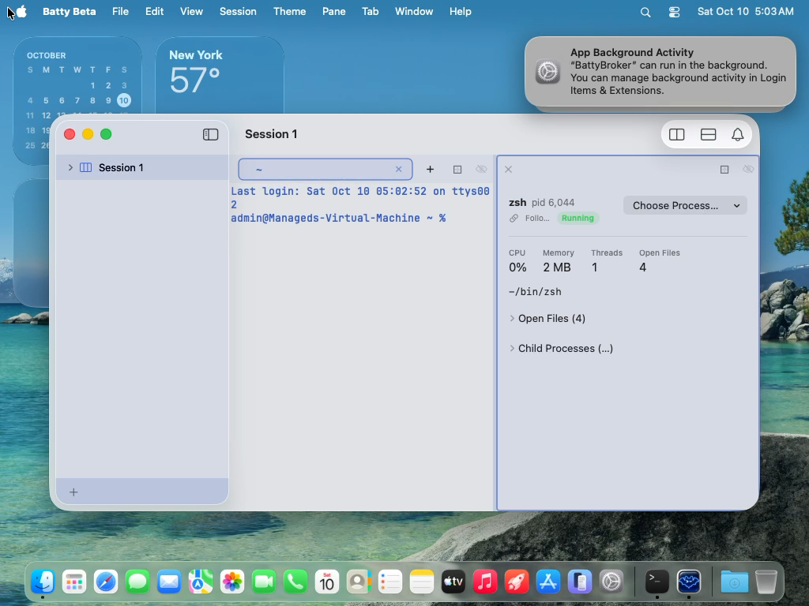

# 0454 — The Process Status view Pane renders PIDs with the locale's grouping separator ("pid 6,044") because `Text("pid \(pid)")` formats the interpolated integer as a localized number instead of an identifier

| | |
|---|---|
| **Status** | resolved |
| **Branch** | issue/0454 |
| **Module** | Pane |
| **Platform** | macOS |
| **First seen** | 2026-10-09 |

## Description

User report, verbatim: "For Process Status the PID should not be formatted with a comma."

The Process Status view Pane's header shows the watched process as `zsh pid 6,044` — the PID has a thousands separator (see the attachment, captured in the Tart VM run `build/ui-tests/20261009-215934-61877`, `screenshots/pick/3-process-status.png`). A PID is an identifier, not a quantity: it is typed into `kill`, `lsof -p`, `batty pane split --pid`, and compared by eye against `ps`/Activity Monitor, none of which group digits. The grouped form reads as a wrong number, and it is also inconsistent with Batty's own "Copy PID" context-menu item, which puts the ungrouped `6044` on the pasteboard.

Same defect, same cause, in every place a view Pane turns an integer identifier into on-screen text with a string-literal `Text` — the full list is under Notes. On macOS PIDs climb past 9,999 within hours of boot, so every one of these sites shows a separator for essentially every real process (only the screenshot's freshly booted VM kept it to one comma).

## Steps to reproduce

1. Launch Batty Beta (any build since #0305's Process Status view landed) and open a Session.
2. Open a Process Status view Pane: Pane ▸ Split Horizontally ▸ Process Status, `Cmd-J`, or `batty-beta pane split --view process-status`.
3. Read the header line next to the process name. With a system-locale of `en_US` (the VM's and the user's), any PID ≥ 1000 shows a comma.
4. Expand "Child Processes (…)" — each child row's `pid …` label groups the same way. Open "Choose Process…" — the trailing PID column in the picker groups too. Expand "Open Files (…)" — the `fd …` label would group a descriptor number ≥ 1000 (rare but possible; descriptor tables commonly go to 10240).
5. Right-click the header ▸ Copy PID and paste anywhere: `6044`, no separator. The two renderings of the same value disagree.

## Expected behavior

Integer identifiers — PIDs, child PIDs, file-descriptor numbers, and the PID column in the System Metrics process table — render verbatim, exactly as `String(pid)` would print them: `pid 6044`, `fd 1024`, `61877`. No grouping separator in any locale. Pasteboard text and on-screen text for the same identifier are character-for-character identical.

## Actual behavior

`pid 6,044` in the header, and the same grouped rendering in the child-process rows, the process picker, the Open Files `fd` label, and the System Metrics PID column. In locales whose grouping separator is `.` or a narrow no-break space (de_DE, fr_FR, …) the PID becomes `6.044` / `6 044`, which is even further from the identifier the user needs.

## Attachments

## Notes

### Cause

`Text("pid \(pid)")` with a string *literal* argument resolves to `Text.init(_ key: LocalizedStringKey, …)`, not `Text.init<S: StringProtocol>(_ content: S)`. `LocalizedStringKey.StringInterpolation` records an interpolated `Int32`/`pid_t` as a `%lld` format argument, and when the key is resolved the number is formatted through the environment locale with grouping on — that is where the comma comes from. `String(pid)` and plain `String` interpolation (`"\(pid)"` assigned to a `String`) never group, which is why the "Copy PID" paths are unaffected. This is standard SwiftUI behaviour, not a regression in Batty; it was simply never noticed because the only automated captures of this Pane were on a freshly booted VM where the PID barely crossed 1,000 (#0451).

### Occurrences (verified by grep across `BattyKit/Sources` and `Batty/` on `main` at `ede30e24`)

Sites that **do** group — all are `Text(<string literal with interpolated pid_t/Int32>)`:

| File | Line | Code | What it labels |
|---|---|---|---|
| `BattyKit/Sources/BattyKit/Views/ProcessStatusPaneView.swift` | 80 | `Text("pid \(pid)")` | Header PID next to the process name (the screenshot) — `pid` is `ProcessStatusPaneContent` snapshot's `pid: pid_t` |
| `BattyKit/Sources/BattyKit/Views/ProcessStatusPaneView.swift` | 213 | `Text("\(process.id)")` | Trailing PID column in the "Choose Process…" picker list — `ProcessInspector.RunningProcess.id: pid_t` |
| `BattyKit/Sources/BattyKit/Views/ProcessStatusPaneView.swift` | 429 | `Text("fd \(fd.id)")` | Open Files disclosure row — `ProcessInspector.OpenFileDescriptor.id: Int32` |
| `BattyKit/Sources/BattyKit/Views/ProcessStatusPaneView.swift` | 461 | `Text("pid \(child.id)")` | Child Processes disclosure row — `ProcessInspector.ChildProcess.id: pid_t` |
| `BattyKit/Sources/BattyKit/Views/SystemMetricsPaneView.swift` | 375 | `Text("\(row.pid)")` | PID column of the System Metrics process table — `ProcessRow.pid: pid_t` (`SystemMetricsSnapshot.swift:36-37`) |

Sites that do **not** group (plain `String` context; listed so the implementer doesn't "fix" them and the reviewer doesn't ask):

- `ProcessStatusPaneView.swift:100` — `copyToPasteboard("\(snapshot.pid)")` (Copy PID).
- `SystemMetricsPaneView.swift:399` — `pasteboard.setString("\(row.pid)", forType: .string)` (Copy PID).
- `BattyKit/Sources/BattyKit/Runtime/ProcessStatusPaneContent.swift:412` and `:460` — `?? "pid \(pid)"` fallback *name* for a process whose executable name is unknown; builds a `String`, which the view then passes to `Text(_ content: S)`, so it stays ungrouped.
- `BattyKit/Sources/BattyKit/Runtime/ProcessMetricsReader.swift:236` — `return "pid \(pid)"`, same `String` fallback.
- `BattyKit/Sources/batty/StatusCommand.swift:49` and `BattyKit/Sources/batty/PaneCommand.swift:130` — CLI `print`/`fputs` output; `String` interpolation.

Checked and found clean: no `.accessibilityLabel`, `.accessibilityValue`, or `.help(...)` in either view mentions a PID; no string-catalog (`.xcstrings`/`.strings`) entries exist for these literals; the Sidebar and Tab titles never show a PID; `LMStudioDashboardView.swift:230` (`"\(Int(pressure * 100))% ctx"`) and `:317` (`inspectorCap`) are genuine quantities under 1,000 and are out of scope.

### Concurrency with #0452 — scope split (binding for the implementer)

`SystemMetricsPaneView.swift` is being reworked right now on branch `issue/0452` (#0452, badge/tile layout). On that branch the same `Text("\(row.pid)")` sits at line 397 (the file shifted by ~22 lines) and the file has 118 changed lines, so touching it from `issue/0454` would guarantee a squash-merge conflict. Therefore:

- **This issue covers the four `ProcessStatusPaneView.swift` sites and the shared helper/test.** Do not edit `SystemMetricsPaneView.swift` on `issue/0454`.
- **The `SystemMetricsPaneView.swift:375` (branch: `:397`) occurrence is fixed on `issue/0452`** as part of that work, using whatever helper this issue introduces if #0454 lands first, or `Text(verbatim: String(row.pid))` if it doesn't. Whichever issue resolves second must confirm in its Verification section that both files are clean (`grep -n 'Text("\\(.*pid' BattyKit/Sources/BattyKit/Views/*.swift` returns nothing).

### Fix direction

Render identifiers verbatim; never let an identifier pass through `LocalizedStringKey`. Either form is fine:

- `Text(verbatim: "pid \(pid)")` — the `verbatim:` initializer takes a `String` and skips localization and number formatting entirely.
- `Text("pid " + String(pid))` / `Text(String(pid))` — the `StringProtocol` overload; equally ungrouped.

Prefer adding a tiny shared helper so the next PID/fd/port label doesn't regress — e.g. a `static func identifier(_ value: some BinaryInteger) -> String { String(value) }` on the existing `SystemMetricsFormatting` enum (`BattyKit/Sources/BattyKit/Runtime/SystemMetricsFormatting.swift`, already the home for `bytes`/`percent`/`celsius`/`rpm`/`loadAverage`), or a dedicated `ProcessIdentifierFormatting` if the reviewer prefers the Process Status view not depend on a System Metrics type. The "Copy PID" pasteboard paths should call the same helper so the on-screen and copied strings are provably the same function of the PID.

Add a unit test next to `BattyKit/Tests/BattyKitTests/SystemMetricsFormattingTests.swift` asserting the helper returns `"6044"` for `pid_t(6044)` and `"61877"` for `61877` (a five-digit PID exercises the grouping boundary `en_US` would hit). A locale-variant test (`de_DE`, where `NumberFormatter` would produce `6.044`) is cheap and documents *why* the helper exists, though `String(Int)` is locale-independent by construction so it mostly guards against someone later "improving" the helper with a formatter. Note that `PaneViewRenderTests.swift` records that `accessibilityChildren()` on an un-windowed `NSHostingView` returned no descendants, so asserting the rendered `Text` string through AX from a unit test is not a proven path; the helper-level test plus the grep above is the realistic regression guard, and the user's visual check on a long-running host (PID well past 10,000) is the sign-off.

### Related

- #0305 (resolved) — Process Status view; the header is its §3.1 and the Open Files / Child Processes disclosures its §3.4 (`docs/design/process-status-view.md`, mirrored by the `MARK` comments in the view).
- #0314 (resolved) — System Metrics view; the process-table PID column.
- #0452 (in flight on `issue/0452`) — owns the `SystemMetricsPaneView.swift` occurrence per the scope split above.
- #0451 — the capture-quality issue that explains why this went unseen until a human looked at a Pane with a real PID.

## Resolution

Added `ProcessIdentifierFormatting.identifier(_:)` (`BattyKit/Sources/BattyKit/Runtime/ProcessIdentifierFormatting.swift`), a locale-independent `String(value)`. The four `ProcessStatusPaneView.swift` sites (header pid, picker PID column, Open Files `fd`, Child Processes `pid`) now use `Text(verbatim:)` with the helper, and the "Copy PID" pasteboard path calls the same helper. `SystemMetricsPaneView.swift` is untouched per the scope split; its occurrence is fixed on `issue/0452`.

## Verification

- `./build.sh` succeeded; `./build.sh unit` succeeded, including new `ProcessIdentifierFormattingTests` (6044, 61877, fd 10240, de_DE-formatted value differs from the helper's output).
- `grep -n 'Text("pid\|Text("\\(' ProcessStatusPaneView.swift` returns nothing.

## Gotchas

- Not verified visually: the rendered Pane on a host with a PID past 10,000 is the user's sign-off.
- The `SystemMetricsPaneView.swift` PID column is not fixed here; whichever of #0452/#0454 resolves second must confirm both files are clean.

Review notes (reviewer round 1, approve; non-blocking): the de_DE test documents why the helper exists rather than testing the view; nothing prevents a future `Text("pid \(x)")` elsewhere, so the grep in Verification is the guard. The System Metrics PID column is fixed on issue/0452 with `Text(verbatim:)`.

#0454 Review: approve

## Work log

| Date | Model | Input | Output | Cache read | Cache write | Cost |
|---|---|---|---|---|---|---|
| 2026-10-09 | claude-sonnet-5-5 | 10 | 100 | 198,677 | 33,215 | $0.19 |
| 2026-10-09 | claude-opus-5-5 | 8 | 35 | 153,363 | 34,410 | $0.29 |

**Total: $0.48**
