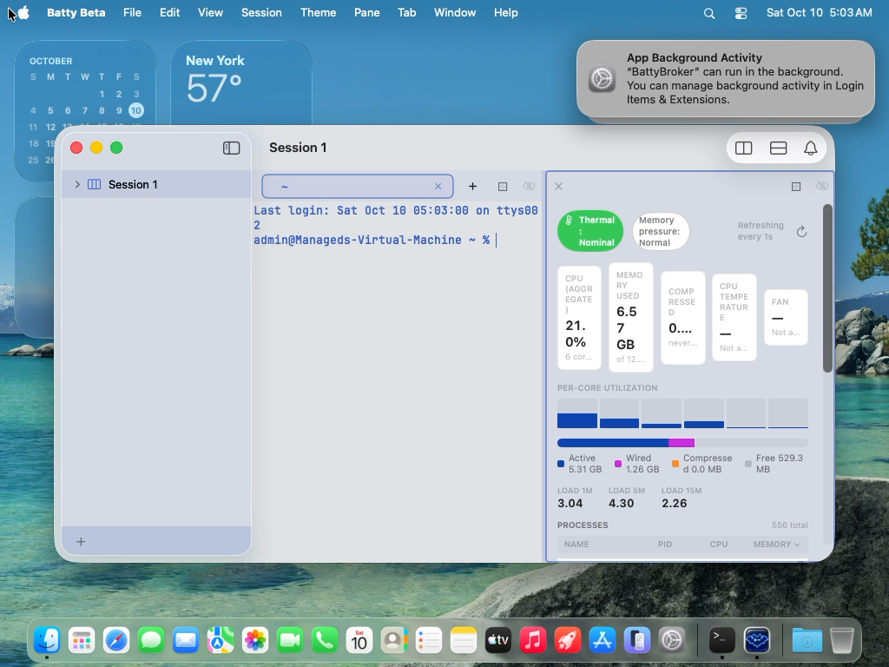

# 0455 — The System Metrics CPU Temperature and Fan tiles say "Not available on this Mac" whenever the SMC path comes up empty, which misdescribes a virtual machine that has no AppleSMC at all and leaves no way to show a temperature on Apple Silicon generations whose SMC keys the five-key candidate list does not cover

| | |
|---|---|
| **Status** | resolved |
| **Branch** | issue/0455 |
| **Module** | Pane |
| **Platform** | macOS |
| **First seen** | 2026-10-09 |

## Description

The user, reviewing the System Metrics view Pane, reported: "For System Metrics it states this Mac does have CPU temp. That does not seem true. I am sure there is a way to get the temp." The CPU Temperature tile (and the Fan tile next to it) render `—` with the sub-line "Not available on this Mac" whenever `SMCThermalReader` returns nil.

**The premise was checked before filing, and the headline finding is not the one the report assumes.** The user's Mac is a Mac mini M4 Pro (`sysctl machdep.cpu.brand_string` = `Apple M4 Pro`, `hw.model` = `Mac16,11`), and on it the reader's candidate list *does* resolve: an ad-hoc probe using the identical 80-byte struct-method protocol read `Tp09 = 77.7 °C` (and `Tp0T`, `Tp01`, `Tp05`, `Tp0D`, `Tp0b`, `Tp0f`, `Tp0n`, `Tp0v`, `Tp1t`, `Te05`, `Tg05`, `TW0P`, `FNum = 1`, `F0Ac = 998 RPM`) unprivileged, and read the same keys again when compiled, ad-hoc signed with `--options runtime` (`flags=0x10002(adhoc,runtime)`) and re-run — so the Hardened Runtime flag alone does not block the read, which partially closes the caveat `docs/design/system-metrics-view.md` §1.4 has carried since #0314 (the signed *notarized bundle* is still unverified).

What the user actually looked at is the Tart VM capture from today's #0451 gallery run (`build/ui-tests/20261009-215934-61877/screenshots/pick/5-system-metrics.png`, attached below): both tiles show `—` / "Not a…". The guest's own log says why (`build/ui-tests/20261009-215934-61877/app-warnings.log:57`, repeated for every pane show in the run):

```
Batty Beta[5244:497a] [co.sstools.Batty.beta:SMCThermalReader] smc: connection failed — AppleSMC service not found
```

A Virtualization.framework guest has no `AppleSMC` service — `IOServiceGetMatchingService` returns 0 before any key is probed — so "Not available on this Mac" is literally false there: it is not a Mac, and nothing was found *absent*; the sensor bus is missing. The copy collapses three different situations into one sentence:

1. **No SMC service** (`SMCConnectionFailure.serviceNotFound`) — a virtual machine. `kern.hv_vmm_present` is the sysctl the VM runner itself uses to prove a guest is virtualized (`tools/run-ui-tests-vm.sh:358`).
2. **SMC present, no candidate key resolved** (`SMCTemperatureKeyCache.Resolution.unavailable`) — a real Mac whose temperature keys the list does not name.
3. **SMC present, connection could not be opened** (`SMCConnectionFailure.openFailed`) — the always-exceptional case #0353 logs at `.error`.

The second situation is the real exposure for release. `cpuTemperatureCandidates = ["Tp09", "Tp0T", "Tp01", "Tp05", "TC0P"]` (`BattyKit/Sources/BattyKit/Runtime/SMCThermalReader.swift:302`) was verified on exactly one machine — this M4 Pro, which the design doc and #0314/#0351 call "the Mac mini M4" — and SMC temperature key names change across Apple Silicon generations. Per the key table in exelban/stats (`Modules/Sensors/values.swift`, fetched 2026-10-09; treat as a reference to re-verify, not a spec):

| Family | CPU-core temperature keys | Overlap with Batty's list |
|---|---|---|
| M1 | E: `Tp09`, `Tp0T`; P: `Tp01`, `Tp05`, `Tp0D`, `Tp0H`, `Tp0L`, `Tp0P`, `Tp0X`, `Tp0b` | `Tp09`, `Tp0T`, `Tp01`, `Tp05` |
| M2 | E: `Tp1h`, `Tp1t`, `Tp1p`, `Tp1l`; P: `Tp01`, `Tp05`, `Tp09`, `Tp0D`, `Tp0X`, `Tp0b`, `Tp0f`, `Tp0j` | `Tp09`, `Tp01`, `Tp05` |
| M3 | E: `Te05`, `Te0L`, `Te0P`, `Te0S`; P: `Tf04`, `Tf09`, `Tf0A`, `Tf0B`, `Tf0D`, `Tf0E`, `Tf44`, `Tf49`, `Tf4A`, `Tf4B`, `Tf4D`, `Tf4E` | **none** |
| M4 | E: `Te05`, `Te0S`, `Te09`, `Te0H`; P: `Tp01`, `Tp05`, `Tp09`, `Tp0D`, `Tp0V`, `Tp0Y`, `Tp0b`, `Tp0e` | `Tp09`, `Tp01`, `Tp05` |
| M5 | `Tp00`, `Tp04`, `Tp08`, `Tp0C`, `Tp0G`, `Tp0K`, `Tp0O`, `Tp0R`, `Tp0U`, `Tp0X`, `Tp0a`, `Tp0d`, `Tp0g`, `Tp0j`, `Tp0m`, `Tp0p`, `Tp0u`, `Tp0y` | **none** |
| Intel | `TC0D`, `TC0E`, `TC0F`, `TC0H`, `TC0P`, `TCAD`, per-core `TC<n>c`/`TC<n>C` | `TC0P` |

So on an M3-family Mac (and, if that table holds, M5) every candidate comes back `0x84` key-not-found, the cache settles on `.unavailable`, and the tile says "Not available on this Mac" for a Mac that has a dozen readable die sensors. The same key also *means different things* across families (`Tp09` is an efficiency core on M1 and performance core 3 on M2/M4), so even where the list resolves, "CPU Temperature" is one arbitrary core, not a CPU reading.

## Steps to reproduce

1. On the host M4 Pro: `batty-beta pane split --view system-metrics` (or Pane → Split → System Metrics) and read the CPU Temperature tile. Expected to show `Tp09` (unverified inside the running Beta: no `SMCThermalReader` lines appear in the host's unified log for the last three days, so the pane has not been shown there recently — confirm before assuming).
2. In the Tart VM (`./build.sh ui BattyUITests/CLIViewPaneTests/testSplitSystemMetricsRendersLiveSamples`, or the #0451 gallery capture) read the same tile: `—` / "Not available on this Mac", with `smc: connection failed — AppleSMC service not found` in `app-warnings.log`.
3. On an M3-family Mac (none available here): expected `—` / "Not available on this Mac" with a `.notice` line `smc: no cpu temperature key resolved — all candidates definitively absent; last outcomes: Tp09=absent:keyNotFound(smcResult=0x84), …`.

## Expected behavior

- On current Apple Silicon (M1 through M4 families, including Pro/Max) and on Intel, the CPU Temperature tile shows a plausible °C value that moves under load, and the Fan tile shows RPM where the machine has a fan.
- The value represents the CPU, not whichever single core's key happened to be first in a list — an aggregate (max or mean) over the CPU die/core sensors, with the sub-line saying what was aggregated (e.g. "max of 14 die sensors" / "mean of 8 cores via SMC").
- When no reading is possible the sub-line says which of the three situations applies: "Virtual machine — no thermal sensors" for a guest (`serviceNotFound`, or `kern.hv_vmm_present == 1`), "No CPU sensor found" for a real Mac where nothing resolved, and the existing once-per-transition log line for `openFailed`. "Not available on this Mac" should not be the copy for a VM.
- The VM suite's capture of this Pane shows the virtual-machine wording, so a design review from VM screenshots is not misread as a sensor bug.

## Actual behavior

- VM: `—` / "Not available on this Mac" for both tiles (attachment).
- Any Mac whose keys are outside `["Tp09", "Tp0T", "Tp01", "Tp05", "TC0P"]`: the same copy, with the real die sensors unread.
- Where a key does resolve, the tile reports one core (`Tp09`), labelled as if it were the CPU.

## Attachments



## Prior decisions behind the reader (what was decided, and why)

- **#0314 (design + implementation, resolved 2026-08-21).** The availability spike initially concluded SMC reads fail unprivileged on Apple Silicon and removed temperature from the design; review reversed it — the failure was a 76-byte Swift struct where the driver expects 80 (`kIOReturnBadArgument`, not a permission code) plus native-order key packing. With both fixed the spike read `Tp09`/`Te05`/`Tg05`/`TW0P`/`FNum`/`F0Ac`/`F0Mx` on this machine. A second reversal dropped the persistent connection: open+close measured ~0.054 ms vs ~0.129 ms per key read, so the reader opens and closes per tick. Two caveats were carried forward explicitly rather than resolved: (1) not re-verified inside the signed, notarized, hardened-runtime bundle; (2) key names are model-specific, so a fixed list "cannot be expected to resolve on every Mac" and phase 2 needs "either a per-model key table … or a runtime discovery pass (`kSMCGetKeyCount`/`kSMCGetKeyFromIndex`, not spiked here)". Neither was built; #0314 shipped the five-key best-effort list and named both as future work. `ProcessInfo.thermalState` was kept as the coarse 4-state chip alongside the numeric tile. `powermetrics` was confirmed root-only. `ioreg` showed 70 `AppleARMPMUTempSensor` nodes as device metadata with no property value, and the doc records that this says nothing about other access paths. **IOHID was never evaluated** — no issue, design doc, or source file mentions `IOHIDEventSystemClient` (grep over `issues/`, `docs/`, `BattyKit/`, `Batty/`: zero hits).
- **#0350 (resolved 2026-09-23).** The whole ~6.5 ms sweep, including the synchronous IOKit round trip, moved off the main actor onto the `SystemMetricsSampler` actor; only the finished snapshot is published on the main actor, with a generation guard so a sweep completing after hide is discarded. Any new sensor path must run on that actor, never the main actor.
- **#0351 (resolved 2026-09-23).** `SMCTemperatureKeyCache` caches which key answered (or that none does) per pane show: probes return `.value` / `.definitivelyAbsent` (`smcResult == 0x84`, or wrong type/size) / `.transientFailure`; `.unavailable` is cached only when every candidate is definitively absent, bounded at three inconclusive walks; a resolved key failing three ticks triggers one re-walk. The issue itself said list curation "is secondary to not re-walking it", so the list stayed as it was. The cache is deliberately per-show, not per-process, because #0350 rebuilds the sampler on every show.
- **#0353 (resolved 2026-09-23).** `FailureLogGate` rate-limits each failure cause to once per transition: connection-open failures (`serviceNotFound` / `openFailed`) at `.error`, fan-count failures separately from a real 0-fan reading, and key-resolution transitions once via `resolutionTransition`, with a persisted `.notice` naming every candidate's last outcome when the cache settles on `.unavailable`. The VM log line quoted above is exactly this gate firing — the diagnosis in this issue is possible because of #0353.

## Verified on this M4 Pro (2026-10-09, ad-hoc probes in the scratchpad, not committed)

- SMC: `#KEY` = 1728 keys. All five Batty candidates except `TC0P` resolve as `flt`/4 bytes, in the 75–88 °C range under the current load; `TC0P` is `0x84`. Enumeration by index (selector 8, `kSMCGetKeyFromIndex`) is available and unprivileged — the approach macmon uses on M2 and later.
- IOHID: `IOHIDEventSystemClientCreate` + `SetMatching(["PrimaryUsagePage": 0xff00, "PrimaryUsage": 5])` + `CopyServices` returns **70 services** (the same count as the design doc's `AppleARMPMUTempSensor` nodes). `IOHIDServiceClientCopyEvent(service, 15, 0, 0)` + `IOHIDEventGetFloatValue(event, 15 << 16)` reads every one, unprivileged, under the Hardened Runtime flag. Names on this chip are `PMU tdie1` … `PMU tdie14` (62–68 °C, three services per name), `PMU tdev1` … `tdev8`, `PMU tcal`, `NAND CH0 temp`. **There are no `pACC MTR Temp Sensor` / `eACC MTR Temp Sensor` names on this M4 Pro** — those are the M1-era names Stats and macmon match for CPU; macmon's HID path would find no CPU sensor here, which is why macmon prefers SMC enumeration when any `Tp`/`Te`/`Ts` key exists and only falls back to HID. One service (`PMU tdev2`) reports `-9201.14`, so a plausibility filter (macmon: `0 < t <= 150`) is mandatory.
- The three-per-name duplication means the service list must be deduplicated or aggregated by name, not counted.

## Approaches to evaluate (the implementer decides; trade-offs only)

**(a) IOHID thermal sensor services** (private but exported IOKit symbols: `IOHIDEventSystemClientCreate`, `IOHIDEventSystemClientSetMatching`, `IOHIDEventSystemClientCopyServices`, `IOHIDServiceClientCopyProperty("Product")`, `IOHIDServiceClientCopyEvent(kIOHIDEventTypeTemperature = 15)`, `IOHIDEventGetFloatValue(15 << 16)`), as used by Stats and macmon.
- For: works unprivileged across Apple Silicon generations without a per-chip table; sensor names are self-describing enough to pick CPU die sensors (`PMU tdie*` on M4 Pro, `pACC`/`eACC MTR Temp Sensor*` on M1-era chips); gives a real per-die aggregate rather than one core; covers the M3/M5 gap where the SMC list has zero overlap.
- Against: private API (declared via `@_silgen_name`, no header) — technically allowed for an unsandboxed, notarized, non-App-Store app, but it can change without notice and must fail soft; the CPU-die name pattern itself varies by generation (`PMU tdie` vs `pACC MTR`), so a name table is still needed, just a smaller one; no fan data at all (fans stay on SMC); Intel Macs expose different (or no) HID thermal services, so Intel still needs the SMC `TC*` keys; one bogus reading per sweep must be filtered; cost per sweep (70 `CopyEvent` calls) is unmeasured and needs the same measure-before-design discipline #0314 applied to SMC.

**(b) SMC only, made model-aware** — either a per-family key table keyed off `machdep.cpu.brand_string` / `hw.model`, or runtime enumeration (`#KEY` count + read-key-by-index, selector 8) picking `Tp*`/`Te*`/`Tf*`/`Ts*` keys of type `flt ` whose value is plausible, as macmon does.
- For: stays on the public-ish path #0314 already proved and the hardened-runtime check in this issue re-proved; reuses `SMCTemperatureKeyCache`, `FailureLogGate`, and the `.definitivelyAbsent`/`.transientFailure` machinery from #0351/#0353 almost unchanged; fans come from the same connection; Intel is covered by the `TC*` family; enumeration needs no table at all.
- Against: a static table rots with every new chip (the Stats table already lists M5 and M6 keys that differ again) and has to be maintained from third-party sources; enumeration costs ~1728 index reads on first walk (~0.14 ms each ≈ 250 ms, acceptable once per show but must be off the main actor and bounded); prefix-matching `Tp*`/`Te*` sweeps in non-core sensors with overlapping names, so an aggregate may include sensors that aren't CPU; neither variant tells you which key is which core, only that it's a `T` key with a sane value.

**(c) Both: IOHID first for the CPU aggregate, SMC fallback for CPU where HID names don't match, SMC always for fans.** Most robust coverage (Apple Silicon via HID or SMC, Intel via SMC), at the cost of two code paths to test, two sets of name/key heuristics, and a sub-line that must say which source produced the number.

Constraints that apply to any approach: sampling runs on the `SystemMetricsSampler` actor (#0350), never the main actor; failures log once per transition through `FailureLogGate` (#0353); no root, no `powermetrics`; the per-tick open/close finding from #0314 §6 should be re-measured for whichever path is added rather than assumed; the app is unsandboxed with Hardened Runtime and notarized (`Batty/Batty.entitlements` carries only `allow-jit` and `allow-dyld-environment-variables`) — private API is not blocked by that, but a symbol that vanishes must degrade to the "No CPU sensor found" state, never crash.

## Acceptance

- On the user's M4 Pro the CPU Temperature tile shows a plausible °C value that changes under load (e.g. `yes > /dev/null` for 10 s), with a sub-line naming the source and aggregation.
- Unit tests cover sensor selection and aggregation with injected readings (name → value lists, including the `-9201` outlier, duplicates by name, the empty list, and a list with only non-CPU names) — pure functions, no IOKit, no sleeps (AGENTS.md "Asynchronous tests").
- The VM shows a distinct unavailable state whose wording says it is a virtual machine, and the `CLIViewPaneTests` system-metrics capture reflects it.
- The design doc's caveat (1) is updated with the hardened-runtime finding recorded here; caveat (2) is either closed or restated to match what shipped.
- Whichever source is chosen, `SMCThermalReaderTests.readIsInternallyConsistentOnWhicheverMachineRunsThis` and the `SMCTemperatureKeyCache` tests from #0351 still pass unchanged.

## Notes

- Verified code locations: `BattyKit/Sources/BattyKit/Runtime/SMCThermalReader.swift` (`cpuTemperatureCandidates` at :302, `openConnection` at :358 — the `serviceNotFound` branch is the VM path); `BattyKit/Sources/BattyKit/Views/SystemMetricsPaneView.swift:170-179` (both "Not available on this Mac" sub-lines); `BattyKit/Sources/BattyKit/Runtime/SystemMetricsSampler.swift:52-77` (cache and gates owned by the actor, `SMCThermalReader.read` called from the sweep). `SMCThermalReading` carries no "why unavailable" field, so the view cannot currently distinguish the three cases even though the reader knows — that is the shape change the copy fix needs.
- The attached capture also shows the tile sub-lines truncating to "Not a…" at that width; #0452 (landed on `main` as `1c2442da`) addressed the tile layout and that run was built from a worktree that may predate it — not part of this issue.
- The third-party key tables above were fetched from `exelban/stats` and `vladkens/macmon` on 2026-10-09 and are summarized, not copied; the implementer should re-read the current sources (and their licences) before lifting any table, and must not treat them as verified for any chip this repo has not probed.
- Scratch probes (`smcprobe.swift`, `hidprobe.swift`) used for the findings above were not committed; the IOHID one is ~30 lines and worth re-creating as the first step of a spike.
- No issue is filed for the signed-notarized-bundle re-verification; this issue's hardened-runtime finding narrows it, and the acceptance criterion on the user's own machine (running the signed Beta) closes the rest.

## Real-hardware evidence (user's M4 Pro, Beta built from main dfad5cba, signed, Hardened Runtime)

The running Beta showed no temperature. Unified log across 4 launches:

```
smc: fan count read failed — shortReply(bytes=0)
smc: no cpu temperature key resolved — gave up after 3 inconclusive walk(s) of transient failures; last outcomes: Tp09=transient:shortReply(bytes=0), Tp0T=..., Tp01=..., Tp05=..., TC0P=absent:keyNotFound(smcResult=0x84)
```

**Root cause.** `SMCThermalReader.call` sized the returned payload from the *reply's* `dataSize` field (offset 28). A readBytes (selector 5) reply on current macOS comes back with that field 0 (it does not echo `keyInfo.dataSize`), so every existing key decoded as a 0-byte payload and was classed `shortReply(bytes=0)`; only `TC0P` (absent, 0x84) was classified correctly. The standalone probe passed because it took `prefix(4)` of the full 32-byte payload and used the size from the earlier key-info call. Fix: the reader now returns all 32 payload bytes and callers truncate to the size the key-info call reported (`SMCThermalReader.payload(_:requestedSize:)`, unit tested). Host check after the fix: `FNum` = 1 and `F0Ac` = 1000 RPM read through the in-app reader code.

## Resolution

**Approach chosen: (c), HID first, SMC fallback, SMC always for fans.**
- `HIDThermalReader` reads vendor thermal services (usage page 0xff00 / usage 5) through the private IOHID event-system client. Symbols are resolved with `dlsym` (not linked), so a missing symbol degrades to a logged `.symbolsMissing` and the SMC fallback, never a load failure or crash.
- `CPUTemperatureAggregation` (pure) keeps only CPU die sensors (`PMU tdie*`, `pACC`/`eACC MTR Temp Sensor*`), drops implausible values (`0 < t <= 150`, so the `-9201.14` outlier goes), folds duplicates by name, and takes the max (it tracks the busiest core, which is what moves under load). Sub-line: "max of N die sensors".
- Why HID over SMC enumeration: no per-chip key table to rot, and it covers M3/M5 where the old five-key list had zero overlap. SMC enumeration was not built; instead the SMC fallback list was widened to the M1/M2/M4 `Tp*`, M3 `Te05`/`Tf*`, M5 `Tp00..` and Intel `TC0*` keys, used only when HID yields no CPU sensor (Intel). Fallback remains a single key (`SMCTemperatureKeyCache`, #0351 semantics unchanged), labelled "SMC key X". Fans stay on the existing SMC path.
- Unavailable copy is now `ThermalUnavailableReason`: virtual machine (`kern.hv_vmm_present == 1`, checked first so a guest no longer logs a bogus connection `.error`), "No CPU sensor found", and "Thermal sensors unreachable" (SMC open failed on real hardware; the #0353 log line still fires). Fan sub-line says "Virtual machine — no fan sensors" in a guest.
- HID failures log once per transition at `.notice` through `FailureLogGate<HIDThermalFailure>` owned by the sampler actor (#0350/#0353).
- Cost: the first call builds the HID client and a per-name die-sensor service list (about 17 ms); later ticks reuse it via `HIDThermalReader.Session` held on the sampler actor (discarded with the sampler on hide) and measure about 10 ms per full `read` including SMC fan reads. The session resets if a tick returns no events.

**Host result on the M4 Pro:** aggregate 70.2 C ("max of 14 die sensors"), fan 1000 RPM.

## Verification

- `./build.sh` and `./build.sh unit` pass (1780 tests incl. `CPUTemperatureAggregationTests`: M4 Pro names with the -9201 outlier and triplicates, M1-style cluster sensors, duplicates, empty, non-CPU-only, plausibility bounds, reason resolution, payload sizing; `SMCThermalReaderTests` and the #0351 cache tests pass; the consistency test now also asserts detail/reason).
- VM: `testSplitSystemMetricsRendersLiveSamples` passed (run 20261009-225543-17030); still shows CPU Temperature "Virtual machine — no thermal sensors" and Fan "Virtual machine — no fan sensors", both wrapping cleanly within the #0452 tiles.

## Gotchas

- Real-hardware sign-off is the user's: open the running Beta's System Metrics pane (Cmd+E), expect a CPU Temperature tile near the idle die temperature with "max of 14 die sensors", rising under `yes > /dev/null`, and Fan showing RPM. Check `log show --predicate 'subsystem BEGINSWITH "co.sstools.Batty" AND category == "SMCThermalReader"'` for no `shortReply` lines.
- M1/M2/M3/M5 and Intel are unverified (no hardware); HID name patterns for them come from third-party sources.
- Signed notarized bundle still unverified for IOHID reads (Hardened Runtime ad-hoc and a Development-signed Debug build were checked).

## Review round 1 follow-ups

- SMC fallback now decodes Intel types: `sp78` (signed 8.8) temperatures and `fpe2` (unsigned 14.2) fan speeds, alongside `flt`; pure big-endian decoders `SMCFixedPoint` with known-byte-pattern tests. Intel remains unverified on hardware.
- `ThermalUnavailableReason.resolve` is now what `read` uses to build every reason; the fan tile gets its own `fanUnavailableReason` ("Fan sensors unreachable" when HID worked but the SMC would not open).
- `cpuTemperatureKey` documented, with `SMCThermalReading.hidSource` replacing the bare "HID" literal.
- VM path logs one `.info` line per process; `SetMatchingFn` returns Void; the `PMU tdie` comment now says it was observed on an M4 Pro only.

Review notes: round 1 request-changes (Intel sp78/fpe2 not decoded, blocking; `resolve` unused in production; per-tick HID cost; fan reason; "HID" placeholder; silent VM path; SetMatchingFn signature), all addressed in 4b271c11. Round 2 approve. Non-blocking follow-ups: an empty HID probe is not cached, so machines without die-sensor names rebuild the HID client every tick before falling back to SMC; the one-service-per-name dedupe drops the other copies of each name. Unverified on hardware: M1/M2/M3/M5 and Intel; notarized Release bundle IOHID reads. User sign-off: the CPU Temperature tile on the M4 Pro.

#0455 Review: approve

## Work log

| Date | Model | Input | Output | Cache read | Cache write | Cost |
|---|---|---|---|---|---|---|
| 2026-10-09 | claude-sonnet-5-5 | 70 | 613 | 2,786,781 | 265,928 | $1.84 |
| 2026-10-09 | claude-opus-5-5 | 42 | 253 | 1,584,427 | 97,433 | $1.41 |

**Total: $3.25**
