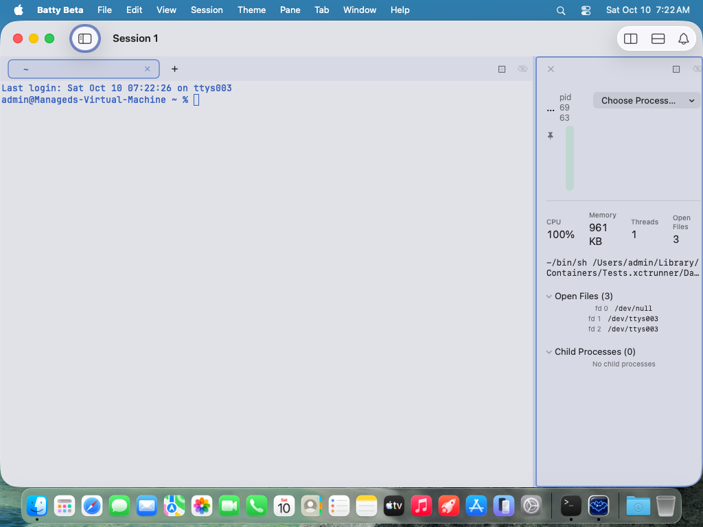
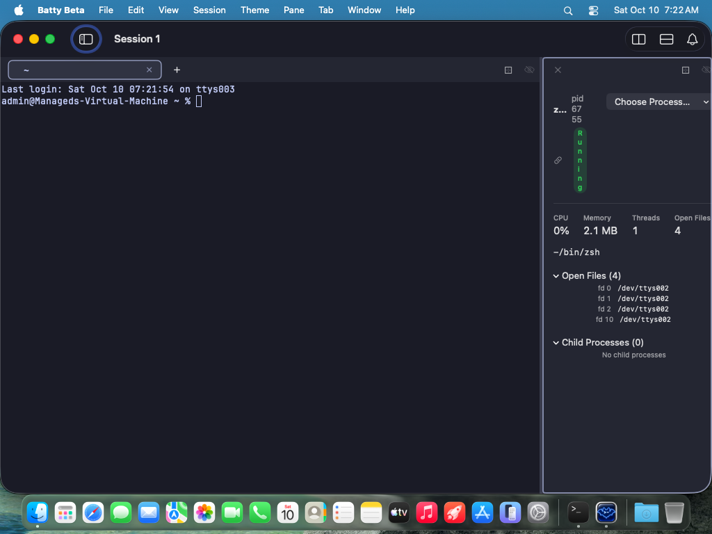
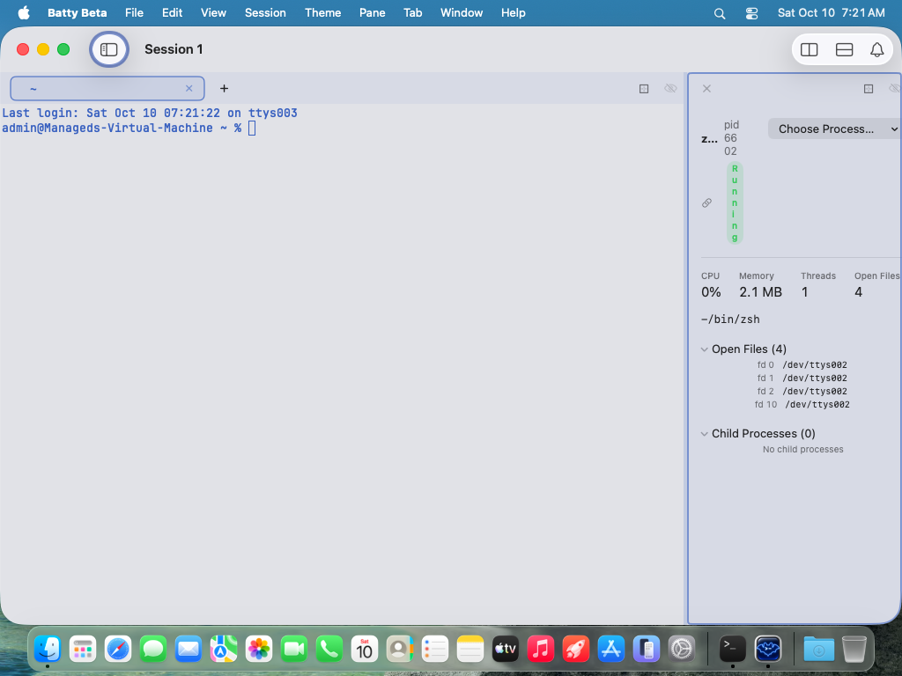
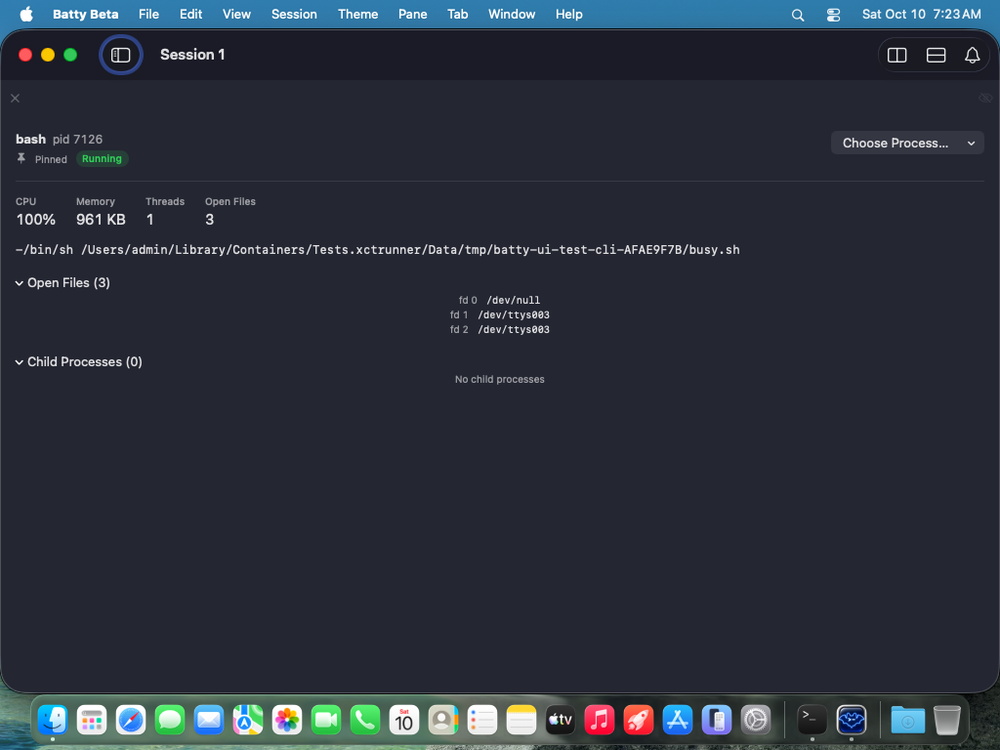

# 0456 — The Process Status view Pane's header collapses at narrow widths: the process name truncates to an ellipsis, the pid wraps digit by digit, the Running chip becomes a tall one-letter-per-line green bar, the pin and link icons float with no label, the Choose Process picker keeps its full width, and the stats row wraps values and labels

| | |
|---|---|
| **Status** | open |
| **Module** | Pane |
| **Platform** | macOS |
| **First seen** | 2026-10-10 |

## Description

At the view-gallery's narrow width — a view Pane 240 points wide, which `BattyUITests/ViewGalleryTests` produces by dragging the Split divider to 76% of a 1024-point window (`BattyUITests/ViewGalleryTests.swift:163-186`) — the Process Status view Pane (`BattyKit/Sources/BattyKit/Views/ProcessStatusPaneView.swift`) renders its header as rubble. In the captures from Tart VM run `20261010-001532-68681` on `main` at `efb83178` (Light and Dark, both the pinned-pid and following-a-tab variants): the process name is reduced to "…" or "z…", "pid 7126" is broken into three lines ("pid" / "71" / "26"), the green "Running" chip is a tall capsule one glyph wide — the letters R/u/n/n/i/n/g stacked vertically in the following variant, an empty green bar in the pinned variant — the pin or link icon floats below the name with its "Pinned"/"Following …" text gone, the "Choose Process…" button sits at its full width on the right and squeezes everything else into a 40-point column, and the CPU / Memory / Threads / Open Files row wraps its values and labels ("961" / "KB", "Open" / "Files"). The same `Capsule` chip recipe without a line limit also exists in `LMStudioDashboardView.statusPill` (`BattyKit/Sources/BattyKit/Views/LMStudioDashboardView.swift:150-156`).

This is the Process Status counterpart of #0452, which gave System Metrics single-line badges (`StatusBadge`), a `ViewThatFits` status row, and an adaptive tile grid. #0452's review recorded this exact follow-up ("`ProcessStatusPaneView` `chip` and `LMStudioDashboardView` `statusPill` are still capsules, so shapes now differ between views"). The user is reviewing the view Panes' UI/UX for this release and has flagged layout breakage of this kind as release-blocking polish; priority high. Design/UX work: the final visual sign-off is the user's, so the resolution sets `resolved`, never `closed`.

## Steps to reproduce

1. Commit, then run the gallery in the VM: `tools/run-ui-tests-vm.sh BattyUITests/ViewGalleryTests` (the runner exports `BATTY_UI_GALLERY=1` when the filter names this class, `tools/run-ui-tests-vm.sh:402-406`; the class skips otherwise).
2. Export the captures: `tools/export-ui-screenshots.sh build/ui-tests/<run-id>/UITests.xcresult`.
3. Open `gallery.process-status.pid.narrow.{light,dark}.png` and `gallery.process-status.following.narrow.{light,dark}.png`, and compare with the `.large.` captures of the same views.

Manually: split a terminal Pane with `batty-beta pane split --view process-status` (or Pane > Split > Process Status), then drag the Split divider until the view Pane is about 240 points wide. `SplitTree.updateRatio` clamps the ratio to 0.05–0.95 (`BattyKit/Sources/BattyKit/Model/SplitTree.swift:523-526`) and nothing imposes a point minimum, so the Pane can be made narrower still.

## Expected behavior

Acceptance criteria — the same treatment #0452 gave System Metrics:

1. **Single-line status chip through the shared `StatusBadge`** (`BattyKit/Sources/BattyKit/Views/StatusBadge.swift`: `lineLimit(1)` + `fixedSize`, tinted translucent fill, 6-point radius). `chip(_:color:)` is replaced by it for all four run states ("Running", "Exited", "Permission Unavailable", "Unavailable"), so a chip never wraps and never becomes a tall pill. `LMStudioDashboardView.statusPill` ("Generating"/"Idle") gets the same replacement so the three views share one badge shape.
2. **Adaptive header.** A `ViewThatFits` (or custom `Layout`) chooses between the current wide layout — identity on the left, "Choose Process…" on the right — and a narrow layout that stacks the picker below the identity block. The picker never squeezes the identity: when both cannot share a row, the picker moves down, it does not shrink the name.
3. **Name and pid are never broken mid-token.** The pid text gets `fixedSize()`/`lineLimit(1)` so "pid 7126" is always one piece; the name keeps `lineLimit(1)` and truncates with a tail ellipsis only after the pid has its full width, and shows at least several characters at 240 points (not "…" alone). The mode indicator keeps its icon and label together: "Pinned" / "Following <tab>" on one line, truncating the tab title if needed, never dropping the label while leaving the icon floating.
4. **Stats as an adaptive grid.** The CPU / Memory / Threads / Open Files tiles use `GridItem(.adaptive(minimum:))` or a `ViewThatFits` (four across when there is room, two by two when there is not), with `lineLimit(1)` on both the label and the value, so "961 KB" and "Open Files" are never split and no tile is pushed past the Pane's right edge.
5. **Unchanged where it already works:** the command line row (`lineLimit(2)`) and the Open Files / Child Processes disclosures already fit at 240 points and should stay as they are.
6. **Verified in the gallery, both widths, both appearances:** `gallery.process-status.{pid,following}.{narrow,large}.{light,dark}` all look right — no mid-token breaks, no tall chips, nothing clipped at the right edge (the clipping itself is tracked in #0457; this issue's layouts must not reintroduce it). `./build.sh` and `./build.sh unit` pass.
7. `docs/swiftui-observation-rules.md` is binding: the layout choice is made by `ViewThatFits`, adaptive grid items, or a custom `Layout` — never by writing `@State` from `GeometryReader`/`onGeometryChange`. `@Environment(\.paneAllottedSize)` (`BattyKit/Sources/BattyKit/Views/SplitContainerView.swift:34-37`, computed purely in `DraggableSplitView.body` at `:167-179`) may be read in `body` to branch on width without any state write; it is `nil` for an unsplit Pane, which then has the whole window.

## Actual behavior

From the attached captures (view Pane at x=782–1021 of the 1024-pixel, 1x VM display; outline columns 780–781 and 1022–1023):

- `pid.narrow.dark` / `pid.narrow.light` (pinned `bash`, pid 7126 / 6963): name "…"; "pid" / "71" / "26" on three lines; a tall, empty green capsule about 10 points wide and 90 points tall; a lone pin icon below it, no "Pinned" text; "Choose Process…" full width on the right; stats row "CPU 100%", "Memory 961 / KB", "Threads 1", "Open / Files 3". Large capture of the same state: "bash  pid 7126", "Pinned  Running", four tiles on one row.
- `following.narrow.dark` / `following.narrow.light` (following a `zsh` Tab, pid 6755 / 6602): name "z…"; "pid" / "67" / "55"; "Running" rendered one letter per line inside the capsule; a lone link icon, no "Following …" text; "Open Files" at the right edge of the Pane, the tile partly outside it.

## Attachments

## Notes

Causes, verified against `BattyKit/Sources/BattyKit/Views/ProcessStatusPaneView.swift` on `efb83178`:

1. **The picker refuses to shrink.** `chooseProcessMenu` (`:171-197`) is a `Menu("Choose Process…")` with `.menuStyle(.button)` and `.fixedSize()` at `:192`. In the header `HStack(alignment: .top, spacing: 8)` (`:73-93`) it sits after `Spacer(minLength: 12)` (`:91`), so at 240 points minus the content `.padding(16)` (`:63`) — 208 points — the identity `VStack` (`:74-90`) is left with roughly 40 points.
2. **Name.** `Text(content.snapshot?.name ?? …).font(.headline).lineLimit(1)` (`:76-78`): `lineLimit(1)` with no minimum width truncates to a bare ellipsis.
3. **Pid.** `Text(verbatim: "pid " + …)` (`:80-82`) has no `lineLimit` or `fixedSize`, so it wraps at the space and then digit by digit.
4. **Chip.** `chip(_:color:)` (`:160-167`) is a `Text` with 6/2-point padding and a `Capsule()` background and no `lineLimit`/`fixedSize`; the text wraps one glyph per line and the capsule follows its height. `StatusBadge` (added by #0452) exists to replace exactly this and is used only by System Metrics so far.
5. **Mode indicator.** `modeIndicator` (`:120-135`): the `Label("Pinned", systemImage: "pin.fill")` has no `lineLimit`; `Label("Following …")` has `lineLimit(1)` (`:131`). Both lose their title at this width and leave the icon alone in the `HStack(spacing: 8)` at `:86-89`.
6. **Stats.** `metricsRow` (`:233-240`) is a fixed `HStack(spacing: 20)` of four `metricTile`s (`:247-256`) whose caption and `.title3` value carry no `lineLimit`; three 20-point gutters plus the tiles' intrinsic minimums exceed the 208 points available, so labels and values wrap and the last tile crosses the Pane edge.
7. **LM Studio.** `LMStudioDashboardView.statusPill` (`LMStudioDashboardView.swift:150-156`) is the same capsule recipe (`.caption2.weight(.semibold)`, 6/2 padding, `Capsule()`, no `lineLimit`). It only appears next to a loaded model with a `ps` entry, so the VM gallery (no LM Studio installed) never shows it; the fix is to switch it to `StatusBadge` on the same grounds, not to reproduce it.

Related: #0452 (System Metrics, resolved — the pattern to copy: `StatusBadge`, `ViewThatFits` status row, `GridItem(.adaptive(minimum: 128))` tiles); #0457 (filed with this issue — view-Pane content wider than the Pane and clipped on the right, which the narrow Process Status captures also show in their Pane chrome); #0451 (the gallery that produced the evidence).
