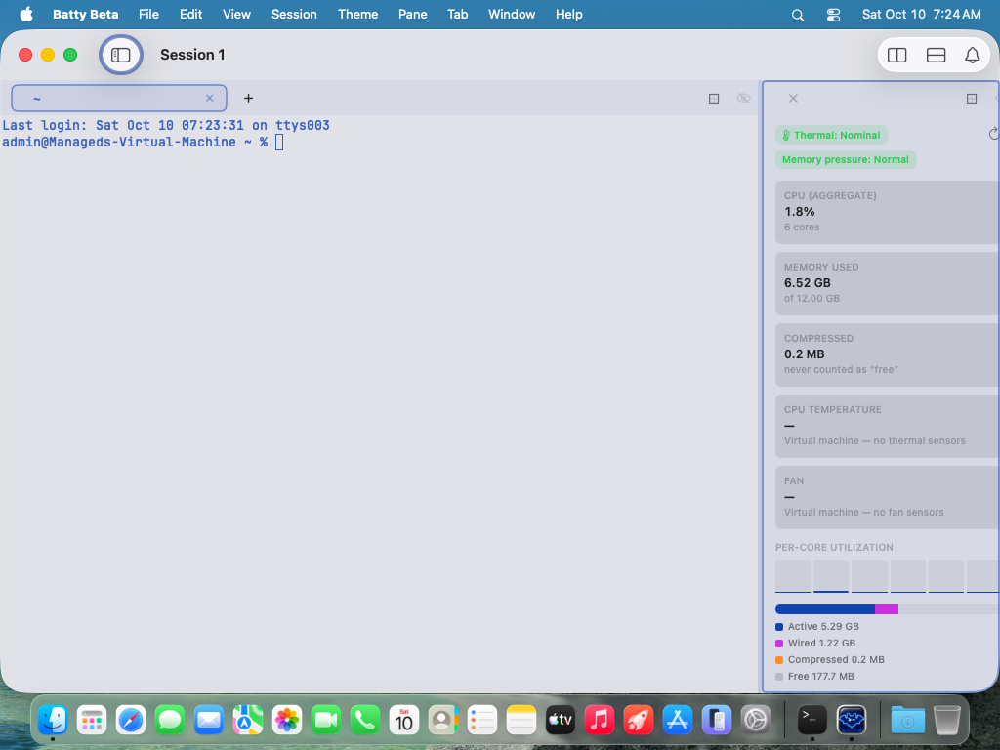
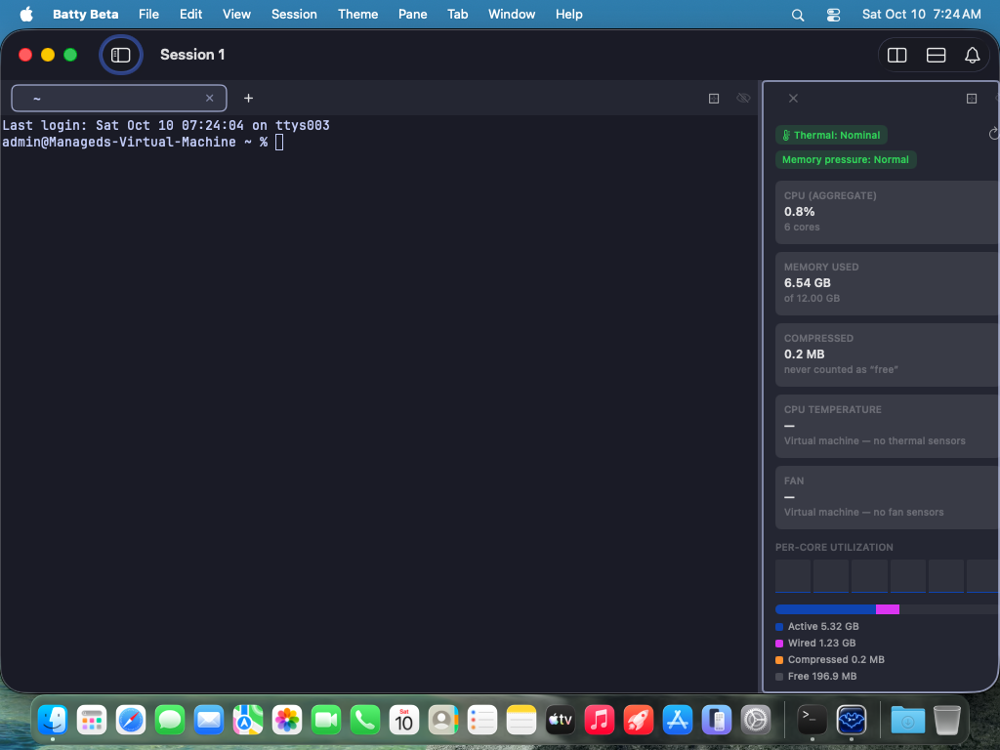
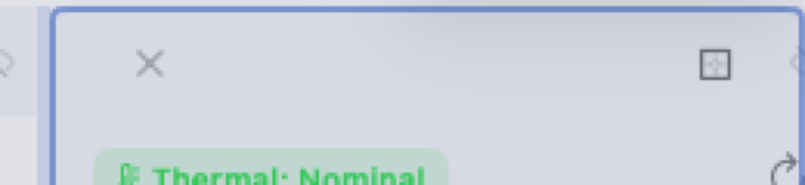
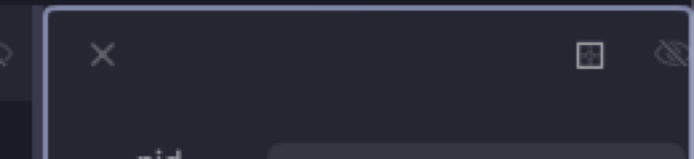
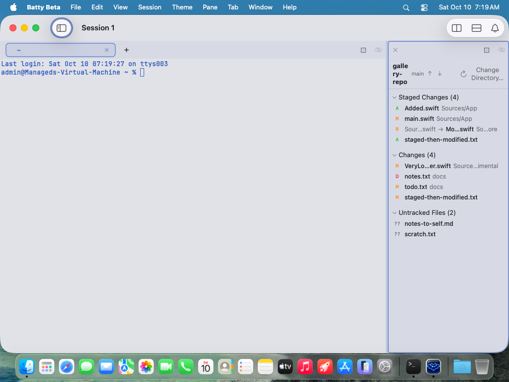
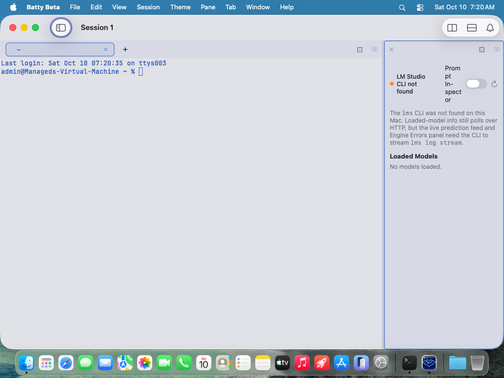
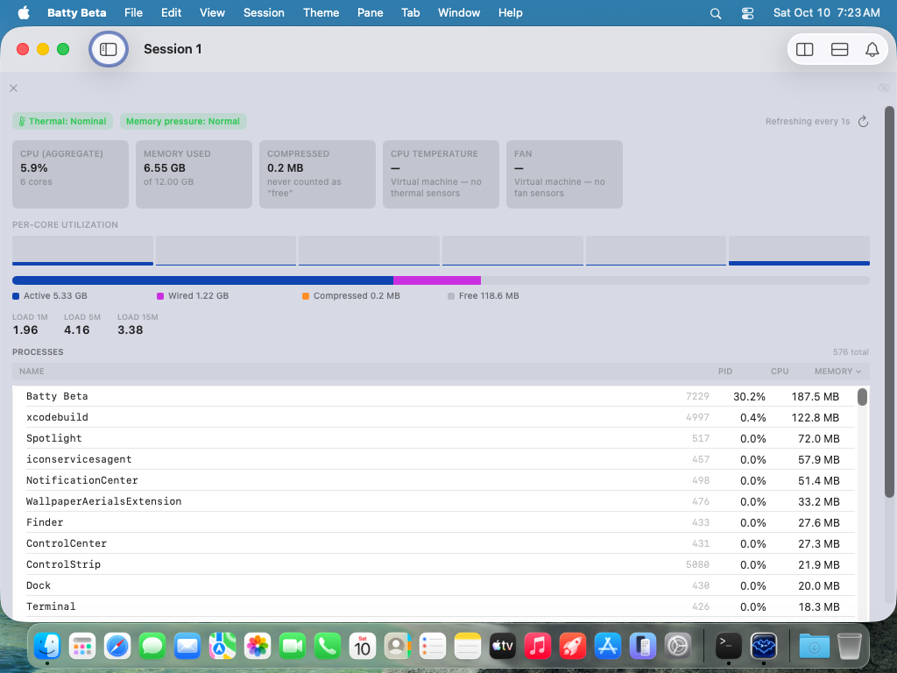

# 0457 — At narrow widths the view Panes lay their content out wider than the Pane and it is clipped on the right: System Metrics loses its tiles' right edge, its refresh button, its sixth per-core bar and the Pane chrome's hide toggle, Process Status loses part of its hide toggle and last stat tile, and Git Status and LM Studio fit only by breaking words

| | |
|---|---|
| **Status** | resolved |
| **Branch** | issue/0457 |
| **Module** | Pane |
| **Platform** | macOS |
| **First seen** | 2026-10-10 |

## Description

In the view-gallery captures from Tart VM run `20261010-001532-68681` (`main` at `efb83178`), every narrow capture puts the view Pane at 240 points (x=782–1021 of the 1x 1024×768 guest display; `BattyUITests/ViewGalleryTests.setNarrow` drags the divider to 76% of the window, `BattyUITests/ViewGalleryTests.swift:163-186`). Two of the four views lay out wider than that and are cut off at the Pane's right edge: System Metrics (Light and Dark) runs its stat tiles past the edge with no right margin, its refresh button and sixth per-core bar are cut, and the Pane chrome's hide (eye) toggle is reduced to a sliver; Process Status (all four narrow captures) has the eye toggle partly cut and its "Open Files" tile crossing the edge. The other two fit, but only by breaking words: Git Status wraps the repository name mid-word ("galle" / "ry-" / "repo"), puts "Change Directory…" on two lines and drops the ahead/behind counts; LM Studio wraps "LM Studio CLI not found" onto three lines and the "Prompt Inspector" switch label onto five ("Prom" / "pt" / "In-" / "spect" / "or").

The cut itself happens in `PaneView`'s #0261 clamp-and-clip (`BattyKit/Sources/BattyKit/Views/PaneView.swift:119` `.frame(width: allottedSize?.width, …, alignment: .topLeading)` and `:131` `.clipped()`), which is working as designed — the focus outline sits exactly on the allotted frame in every capture. The defect is upstream: each view's content reports an intrinsic minimum width larger than the Pane, the non-terminal shell's header row (`PaneView.swift:402-416`) is laid out at that wider width because it shares the shell's `VStack`, and the clip removes whatever ended up outside — including the chrome's own controls.

The user is reviewing the view Panes' UI/UX for this release and has flagged layout breakage (#0452) as release-blocking polish; priority high. Design/UX: final visual sign-off is the user's, so the resolution sets `resolved`, never `closed`. #0456 (filed with this issue) covers the Process Status header's own collapse; this issue is about content never exceeding the Pane's width and the chrome never being clipped, across all four views.

## Steps to reproduce

1. Commit, then run `tools/run-ui-tests-vm.sh BattyUITests/ViewGalleryTests` and export with `tools/export-ui-screenshots.sh build/ui-tests/<run-id>/UITests.xcresult`.
2. Compare each `gallery.<view>.narrow.<appearance>.png` with its `.large.` counterpart; look at the top-right corner of the view Pane (the drag handle and eye toggle) and the right edge of the content.

Manually: split a terminal Pane with any view (`batty-beta pane split --view system-metrics`, or Pane > Split > …) and drag the Split divider until the view Pane is about 240 points wide. There is no floor: `SplitTree.updateRatio` clamps to 0.05–0.95 (`BattyKit/Sources/BattyKit/Model/SplitTree.swift:523-526`), `SplitLayout.placeSubviews` proposes exactly `usable * ratio` (`BattyKit/Sources/BattyKit/Views/SplitContainerView.swift:254-274`), and nothing converts that into a point minimum for either arm.

## Expected behavior

Acceptance criteria:

1. **Content always fits the allotted width.** Down to a stated minimum, every view's content reports an intrinsic width no larger than the Pane: no tile, bar, button, table column or text runs past the right edge, and the content's trailing padding is visible on the right the way the leading padding is on the left. Proposed minimum: **220 points** — just under the gallery's 240-point narrow capture, so the gallery proves it with margin. Below the minimum the view may degrade (hide secondary text, collapse to a single column, stack controls) but must still never exceed the width, and must never break a word mid-token to get there.
2. **Pane chrome is never clipped.** The close button, drag handle and hide (eye) toggle in `PaneView.nonTerminalShell` are fully visible at every width the Split can produce, independent of what the content does. Either the content can no longer force the shell wider (criterion 1 at every width), or the shell is restructured so the header row is sized by the allotted width rather than by the content (for instance by giving `content()` an explicit `.frame(maxWidth: .infinity)` clipped to the shell, or by laying the header out from `paneAllottedSize`) — the implementer picks; the header must not depend on the content behaving.
3. **"Fits" means whole tokens.** Git Status: the repository name truncates with an ellipsis (or the header stacks) rather than breaking mid-word; the ahead/behind counts keep their numbers or are dropped as whole labels; "Change Directory…" stays on one line (icon-only, or moved to its own row, when the row is too narrow). LM Studio: the connection pill stays on one or two whole-phrase lines, and the "Prompt Inspector" switch label is never broken mid-word — label and switch move to their own row, or the label is shortened/hidden, when the header is too narrow.
4. **Decide the Split floor, and document the decision.** Either view Panes get a point-based minimum width in the Split (so the divider cannot make a view Pane narrower than its content handles — a `minWidth` applied in `SplitLayout`/`DraggableSplitView` or a clamp in `updateRatio` expressed from the container length), or the floor is explicitly declined in the resolution with the reason, and criterion 1's "degrade gracefully below the minimum" is what covers the 0.05 case. This is the user's call; the issue asks that it be made consciously, since #0452 left it open ("the implementer may propose a `minWidth` for view Panes but it is not required by this issue").
5. **No right-edge clipping in any gallery narrow capture**, Light and Dark, for all four views and all Git Status variants (`gallery.git-status.{,merge-conflict.,not-a-repo.}narrow.*`, `gallery.process-status.{pid,following}.narrow.*`, `gallery.system-metrics.narrow.*`, `gallery.lm-studio-dashboard.narrow.*`), and the large captures unchanged. `./build.sh` and `./build.sh unit` pass.
6. `docs/swiftui-observation-rules.md` is binding: no `GeometryReader`/`onGeometryChange` writes to `@State` to pick a layout. Use `ViewThatFits`, adaptive `GridItem`s, a custom `Layout`, or read `@Environment(\.paneAllottedSize)` (`SplitContainerView.swift:34-37`, set purely in `DraggableSplitView.body` at `:167-179`; `nil` for an unsplit Pane) in `body`.

## Actual behavior

Per view, from the attached captures (view Pane x=782–1021):

- **System Metrics** (`system-metrics.narrow.light` / `.dark`): the five stat tiles start at x≈796 (the 14-point leading padding is honoured) and run to the Pane edge and beyond — no trailing padding, the rounded right corners are gone. The status row's refresh button is cut at the right edge. Six per-core bars are drawn and the sixth is cut. In the Pane chrome the drag handle is pushed right and the eye toggle is a sliver; the close button sits about 17 pixels further right than in the Git Status capture (eyeballed from a 4x crop, attached). The memory bar and legend fit (the bar is `GeometryReader`-sized). The process list is below the fold in this capture, so its behaviour at this width is unverified.
- **Process Status** (`process-status.{pid,following}.narrow.{light,dark}`): the eye toggle is partly cut; the close button sits about 7 pixels right of where Git Status draws it; the stats row's last tile ("Open Files") touches or crosses the right edge. The header's own collapse is #0456.
- **Git Status** (`git-status.narrow.{light,dark}`): nothing clipped; the chrome is intact. The header wraps instead: "galle" / "ry-" / "repo", branch "main" with bare up/down arrows (the "2" and "1" counts of the large capture are gone), "Change" / "Directory…" on two lines. The merge-conflict variant wraps "gallery-" / "conflict" at the hyphen and "Change" / "Directory…" likewise; the not-a-repo variant fits (centered, middle-truncated path).
- **LM Studio** (`lm-studio-dashboard.narrow.{light,dark}`): nothing clipped; "LM Studio" / "CLI not" / "found" on three lines next to the dot, "Prom" / "pt" / "In-" / "spect" / "or" beside the switch, refresh button intact.

## Attachments

## Notes

Causes, verified against the sources on `efb83178`. A view Pane at 240 points gives the content 240 minus its own horizontal padding: 212 points in System Metrics (`.padding(.horizontal, 14)`, `SystemMetricsPaneView.swift:55`), 208 in Process Status (`.padding(16)`, `ProcessStatusPaneView.swift:63`), 220 in Git Status's header (`.padding(.horizontal, 10)`, `GitStatusPaneView.swift:165`), 216 in LM Studio (`.padding(12)`, `LMStudioDashboardView.swift:47`).

1. **System Metrics — the process table's fixed trailing columns.** `processListHeader` (`BattyKit/Sources/BattyKit/Views/SystemMetricsPaneView.swift:345-357`) is an `HStack(spacing: 8)` of the NAME button at `.frame(maxWidth: .infinity)` plus three fixed frames of 60, 56 and 76 points (`:348-350`), with `.padding(.horizontal, 8)` (`:354`): 192 + 24 of gutters + 16 of padding = 232 points before the NAME button's own text, so the header alone is roughly 260 points — wider than the 212 available — and, being a child of the content `VStack` (`:47-57`), it sets the `VStack`'s width. `processRow` (`:389-414`) repeats the same 60/56/76 columns inside the `List`, which takes the proposed width and middle-truncates the name (`:394-395`), so the rows themselves are not the overflow source. #0452's Notes flagged these columns as the secondary item to check at narrow widths. The stat grid `GridItem(.adaptive(minimum: Self.tileMinWidth))` (`:165`, `tileMinWidth = 128` at `:189`) is *not* the overflow at 240 points — one 128-point column fits in 212 — but it becomes one below 128 + 28 = 156 points, so the minimum in criterion 1 has to cover it too (or the tiles need a smaller floor below the chosen minimum). The refresh button and per-core bars are not independently oversized: they fill the row width the `VStack` was given, which is why they are cut rather than wrapped.
2. **Process Status — the stats row.** `metricsRow` (`ProcessStatusPaneView.swift:233-240`) is a fixed `HStack(spacing: 20)` of four `metricTile`s (`:247-256`) with no `lineLimit`; the tiles' intrinsic minimums plus 60 points of gutters exceed the 208 available by roughly 15 points, which matches the partly-cut eye toggle. The header `HStack` (`:73-93`) with the `fixedSize()` picker (`:192`) is what crushes the identity block (#0456) but, by itself, still fits the 208 points once the identity has collapsed.
3. **Git Status — fits by wrapping.** `headerRow` (`GitStatusPaneView.swift:127-167`): `Text(snapshot.repoName).font(.headline)` (`:131-132`) has no `lineLimit`, the ahead/behind `Label`s (`:183-196`) have none, and `Button("Change Directory…").buttonStyle(.borderless)` (`:162-163`) lets its title wrap. Nothing here has a `fixedSize`, so the row never exceeds the Pane — at the cost of mid-word breaks.
4. **LM Studio — fits by wrapping.** `header` (`LMStudioDashboardView.swift:54-71`): `connectionPill`'s `Text(text).font(.callout.weight(.medium))` (`:83-86`) and `Toggle("Prompt Inspector", …).toggleStyle(.switch).controlSize(.small)` (`:58-61`) have no `lineLimit`; the switch itself is fixed-size, so the label absorbs all the compression.
5. **Where the cut happens.** `PaneView.nonTerminalShell` (`PaneView.swift:402-427`) is `VStack(spacing: 0) { HStack { paneCloseButton; Spacer(minLength: 0); paneDragHandle; paneEyeButton }.frame(height: 36); content() }`. The header `HStack` has no width of its own; it takes the `VStack`'s, and the `VStack` takes the widest child — the content's `ScrollView`, whose vertical-only scrolling does not absorb horizontal overflow. `PaneView.body` then clamps the whole shell to the allotted size (`:119`, `alignment: .topLeading`) and clips (`:131`), per #0261, so the focus outline and the sibling Pane stay correct while the trailing part of the header — the eye toggle — is cut off. The close button sitting a few pixels further right in the overflowing views than in the fitting ones (about 7 pixels in Process Status, 17 in System Metrics, eyeballed from the 4x crops) suggests the overflow is being distributed to both edges rather than anchored at the leading edge as the `.topLeading` comment at `:115-118` intends; the implementer should confirm the mechanism (a `ScrollView` centering over-wide content, or the `.frame` alignment not applying to an oversized child) before relying on either, since a leading-anchored overflow and a centered one call for different fixes to the shell.
6. **No point minimum anywhere.** `SplitTree.updateRatio` (`SplitTree.swift:523-526`) clamps 0.05–0.95; `SplitLayout.sizeThatFits` returns the proposal and `placeSubviews` proposes `usable * ratio` to each arm (`SplitContainerView.swift:250-290`); `DraggableSplitView` computes `leftLength`/`rightLength` the same way (`:168-171`). `PaneView` for terminal Panes has `chipMinWidth`/`barChromeWidth` constants (`PaneView.swift:31-40`) for its tab strip, but nothing analogous exists for a view Pane's content.

Related: #0452 (System Metrics badges and tiles, resolved; left the Split floor and the process-table columns open), #0456 (Process Status header collapse, filed with this issue), #0261 (the clamp-and-clip in `PaneView` that makes the symptom a clip instead of a bleed into the neighbouring Pane), #0451 (the gallery that produced the captures).

## Resolution

- `PaneView.nonTerminalShell`: the header row takes `maxWidth: .infinity` and `content()` is wrapped in `.frame(minWidth: 0, maxWidth: .infinity, alignment: .topLeading).clipped()`, so the content's intrinsic width no longer sizes the shell. The chrome (close, drag handle, eye) is laid out at the allotted width regardless of content; over-wide content clips at the leading-anchored edge.
- System Metrics: process table columns narrowed (PID 48, CPU 44, Memory 62, spacing 6, padding 6) so header and rows need about 184 points plus a flexible NAME column; the stat grid, bars and status row now fit 240 points.
- Git Status: header is a `ViewThatFits` of full row, row with icon-only Change Directory (folder, keeps the "Change Directory…" accessibility label and help), and a stacked variant; repo name is single-line and tail-truncates only in the stacked variant; branch, ahead/behind and badges never wrap.
- LM Studio: header is a `ViewThatFits` of one row, or pill + refresh on one row with the Prompt Inspector switch on its own row; the switch label is `fixedSize` single-line; the connection text wraps only at word boundaries (max two lines).
- Process Status: needed no further change after #0456 (verified in captures).
- Split floor decision: DECLINED. No point-based minimum for view Pane splits. Reasons: criterion 1's graceful degradation plus the shell clip now keep the chrome intact at every width including the 0.05 ratio; a floor would change split math shared with terminal Panes (and `updateRatio` is container-length independent), adding behaviour and test surface for a case that no longer breaks. Revisit if a user-visible content collapse is reported below about 150 points.

## Verification

- `./build.sh` and `./build.sh unit` pass.
- Tart VM `20261010-011414-1353` ViewGalleryTests: 7/7 pass; all four views' narrow (Light and Dark) and large captures read in `build/ui-tests/20261010-011414-1353/screenshots/`: no right-edge clipping, chrome intact, no mid-word breaks.
- `CLIViewPaneTests` 12/12 (`20261010-012424-4913`), `PaneFocusTests` 8/8 (`20261010-012845-6497`), `SplitDividerDragTests` 1/1 (`20261010-013121-7422`).

## Gotchas

- The System Metrics process table is below the fold in the narrow gallery capture, so its narrow rendering was not seen visually; column widths were reduced by arithmetic (about 184 points of fixed columns against 212 available).
- Below about 156 points of Pane width the stat grids still force one 128-point column and clip (by design, never bleeding into the neighbour).
- The 44 pt CPU column tail-truncates per-process values of 1000% or more.
- Review round 1: the stacked Git Status header now puts branch/ahead-behind and the stash/Worktree badges on separate lines (branch middle-truncates); `testGitStatusWorktreeWithStash` captures it.
- Visual sign-off is the user's.

Review notes: round 1 request-changes (stacked Git Status header still overflowed for worktree/stash/long-branch repos), fixed with a three-line stacked header and a worktree-with-stash gallery fixture. Round 2 request-changes (fixture comment claimed "behind"; test didn't assert its state), fixed in 25d893d5. Round 3 approve. Non-blocking: the behind-count wait (`label == '1'`) searches the whole app; scoping it to `git-status.snapshot` would tighten it. Split point-minimum for view Panes declined (see Resolution). User visual sign-off pending.

#0457 Review: approve

## Work log

| Date | Model | Input | Output | Cache read | Cache write | Cost |
|---|---|---|---|---|---|---|
| 2026-10-10 | claude-sonnet-5-5 | 70 | 584 | 2,324,306 | 341,062 | $1.99 |
| 2026-10-10 | claude-opus-5-5 | 58 | 397 | 1,872,792 | 178,946 | $2.07 |

**Total: $4.06**
