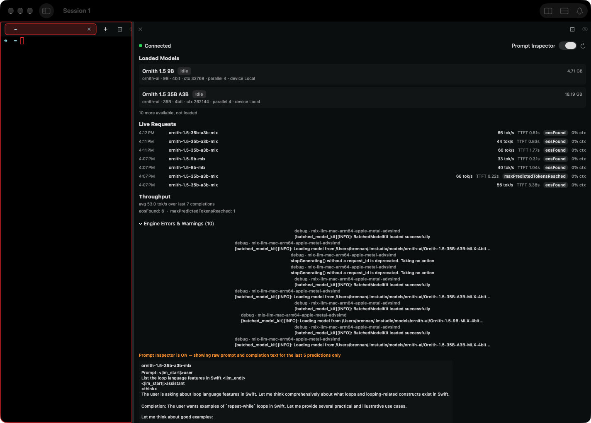

# 0458 — The LM Studio Dashboard view Pane centers its Engine Errors & Warnings entries, counts debug-level engine log lines as errors and warnings, misaligns the Live Requests columns from row to row, and shows raw API stop-reason names such as eosFound and maxPredictedTokensReached

| | |
|---|---|
| **Status** | resolved |
| **Branch** | issue/0458 |
| **Module** | Pane |
| **Platform** | macOS |
| **First seen** | 2026-10-10 |

## Description

Four presentation defects in the LM Studio Dashboard view Pane (`BattyKit/Sources/BattyKit/Views/LMStudioDashboardView.swift`), all seen by the user on 2026-10-10 in Batty Beta 1.2.0 (built from `main` at `f39dcbbb`) against a live, connected LM Studio server with two models loaded, seven completed requests, the Engine Errors & Warnings disclosure expanded and the Prompt Inspector on (attached capture, view Pane about 1,100 points wide). They are filed as one issue because every one of them is a change to this view's own files and they are all targeted at the 1.2.0 release.

1. **Engine Errors & Warnings entries are horizontally centered.** Each entry is two lines — `debug · mlx-llm-mac-arm64-apple-metal-advsimd` over the message — and each pair is centered in the Pane with ragged left and right edges, while every other section of the view (and every other view Pane) is leading-aligned.
2. **The section is titled "Engine Errors & Warnings (10)" but none of the ten entries is an error or a warning.** All ten are `debug`-level lines whose messages are informational: "[batched_model_kit][INFO]: BatchedModelKit loaded successfully", "[batched_model_kit][INFO]: Loading model from /Users/…/Ornith-1.5-35B-A3B-MLX-4bit…", "stopGenerating() without a request_id is deprecated. Taking no action". The count in the title implies ten problems that do not exist.
3. **Live Requests rows do not line up as columns.** The time and model name sit at the left, a wide empty gap follows, and the stats are pushed to the far right as a right-aligned cluster. Because the cluster's width depends on the stop-reason badge text, the one row whose badge is `maxPredictedTokensReached` (wider than `eosFound`) draws its tok/s and TTFT values to the left of every other row's — the "columns" shift row by row.
4. **Raw API enum names are shown to users.** The stop-reason badge on each row reads `eosFound` or `maxPredictedTokensReached`, and the Throughput section's tally line reads "eosFound: 6  ·  maxPredictedTokensReached: 1" — the `stats.stopReason` string straight from the `lms log stream --json` event.

Design/UX polish for the 1.2.0 release: the final visual sign-off is the user's, so the resolution sets `resolved`, never `closed`.

**Out of scope (deferred to 1.3.0, note in the resolution, do not fix here):** the "0% ctx" column that reads 0% on every row; renaming the "Live Requests" section; the Prompt Inspector box's width. #0459 (filed with this issue) is the same centered-disclosure defect class as item 1 in the Process Status view — a separate issue because the files differ.

## Steps to reproduce

With LM Studio running on this Mac with at least one model loaded (the `lms` CLI at `~/.lmstudio/bin/lms`):

1. Split a terminal Pane with the LM Studio view: `batty-beta pane split --view lm-studio-dashboard` (or Pane > Split > LM Studio Dashboard).
2. Send a few chat completions to the server from any client, including at least one with a small `max_tokens` so one completion stops with `maxPredictedTokensReached` and the others with `eosFound`.
3. Expand "Engine Errors & Warnings".

Items 1, 3 and 4 are visible immediately; item 2 needs a model load (or any engine activity) so the runtime stream has emitted lines.

## Expected behavior

Acceptance criteria:

1. **Engine log entries are leading-aligned.** Every entry in the Engine Errors & Warnings disclosure starts at the same left edge as the section titles above it, at every Pane width. The same treatment the Git Status view's disclosures already get: its rows are greedy (`fileRow`'s `HStack` ends in `Spacer(minLength: 0)`, `BattyKit/Sources/BattyKit/Views/GitStatusPaneView.swift:341`), so `DisclosureGroup`'s content never gets the chance to center them (attached Git Status gallery capture for comparison).
2. **Only warnings and errors count as warnings and errors.** The disclosure shows only entries at warning or error severity, and the number in its title counts only those; informational and debug lines are not listed under that title. The `runtime`-only sourcing stays exactly as it is (`LMStudioDashboardPaneContent.makeRuntimeStreamProcess` spawns `lms log stream -s runtime`, `BattyKit/Sources/BattyKit/Runtime/LMStudioDashboardPaneContent.swift:47-48`; `-s server` is never subscribed because it leaks full request and completion bodies at its default `info` level — `docs/design/lmstudio-dashboard-view.md` §1.8, lines 375-399, and `LMStudioLogEvent.swift:24-28`). This issue changes what is *shown* from that stream, never what is *subscribed*. See Notes for the open design question on what "severity" can be read from the events and the alternative (rename the section to "Engine Log") if it cannot be read reliably — the implementer raises that with the user through the orchestrator before coding the filter if the data does not support it.
3. **Live Requests is a fixed-column table.** Columns — time, model, tok/s, TTFT, stop reason, ctx — align across every row regardless of the badge text or value widths (a `Grid` with one `GridRow` per completion, or `.frame(width:alignment:)` columns, implementer's choice). The numeric columns are trailing-aligned or monospaced-digit so "66 tok/s" and "133 tok/s" line up. The table must still obey #0457's rules at narrow widths: nothing runs past the Pane's right edge, no mid-word wrapping, and secondary columns (ctx, then TTFT) may be dropped as whole columns — via `ViewThatFits` or a width read from `@Environment(\.paneAllottedSize)` in `body`, never from a `GeometryReader`/`onGeometryChange` write to `@State` (`docs/swiftui-observation-rules.md` is binding). The model name is the one column that truncates (tail ellipsis), as it already does (`.lineLimit(1)`, `LMStudioDashboardView.swift:224`).
4. **Stop reasons are plain words.** A single mapping function (a `static` on the view or a small `enum` with a `displayName`, reachable from `BattyKitTests`) turns every stop reason the code knows into a short human phrase — for example `eosFound` → "Finished", `maxPredictedTokensReached` → "Hit token limit" — and turns any unknown string into something readable rather than the raw camel-case identifier (for example split on case boundaries and capitalize: `contextLengthReached` → "Context length reached"). Both the row badge (`LMStudioDashboardView.swift:235-241`) and the Throughput tally (`:295-299`) use it. The raw value stays available through the existing "Copy Stats as JSON" context-menu item (`:252-254`), which must keep copying the untranslated `stats` block. The badge should become a `StatusBadge` (`BattyKit/Sources/BattyKit/Views/StatusBadge.swift`, which `statusPill` at `:167-169` already uses) so it never wraps and matches the other views' badge shape (#0456's rule).
5. **Verified:** `./build.sh` and `./build.sh unit` pass with new unit tests for the stop-reason mapping (every known value, plus the unknown-value fallback), for the Throughput tally string, and for the engine-log severity filter (a fixture of `debug`/`info`/`warn`/`error` lines yields only the warning and error entries, and the count matches). The Tart VM gallery (`tools/run-ui-tests-vm.sh BattyUITests/ViewGalleryTests`, `testLMStudioDashboardDisconnected` at `BattyUITests/ViewGalleryTests.swift:421`) still produces `gallery.lm-studio-dashboard.{large,narrow}.{light,dark}` with no regression — it can only show the disconnected state, so see Gotchas for how the connected layout is verified.

## Actual behavior

From the attached capture (`0458/lm-studio-connected-full-window.png`, 1425×1021, the view Pane on the right):

- Engine Errors & Warnings: ten entries, each a centered two-line block; the long "Loading model from /Users/brennan/.lmstudio/models/…" messages are wider so their left edges sit further left than the short "stopGenerating() …" ones — a ragged, centered column.
- Every one of the ten reads `debug · mlx-llm-mac-arm64-apple-metal-advsimd` on its first line, and the message carries its own `[INFO]` tag or is a deprecation notice. Title: "Engine Errors & Warnings (10)".
- Live Requests: seven rows; time at x≈335, model at x≈407, then nothing until the stats cluster ends flush at the right edge (x≈1414). Six rows show "NN tok/s  TTFT N.NNs  [eosFound]  0% ctx"; the 4:07 PM `ornith-1.5-35b-a3b-mlx` row shows "66 tok/s  TTFT 0.22s  [maxPredictedTokensReached]  0% ctx" with its tok/s starting about 100 points left of the other rows'.
- Throughput: "avg 53.0 tok/s over last 7 completions" then "eosFound: 6  ·  maxPredictedTokensReached: 1".

## Attachments

Comparison for criterion 1 — the Git Status view's disclosures with leading-aligned rows: `issues/0457/git-status-narrow-light.png` (narrow) or `build/review-screenshots/gallery-final/gallery.git-status.large.light.png` on the user's machine (gitignored).

## Notes

Causes, verified against the sources on `f39dcbbb`:

1. **Centered entries** — `engineErrorsSection` (`LMStudioDashboardView.swift:305-324`) is a `DisclosureGroup` whose content is a bare `ForEach` of `VStack(alignment: .leading, spacing: 1)` blocks (`:312-319`). `.leading` there only aligns the two `Text`s *within* each block; nothing makes the block itself as wide as the Pane, so `DisclosureGroup`'s content container positions each block at its intrinsic width, centered. The fix is a `.frame(maxWidth: .infinity, alignment: .leading)` on each block (or one greedy container around the `ForEach`), the way Git Status's rows are greedy via `Spacer(minLength: 0)` (`GitStatusPaneView.swift:341`). Process Status has the identical defect — #0459.

2. **Debug lines counted as errors** — `handleRuntimeStreamLine` (`LMStudioDashboardPaneContent.swift:708-723`) inserts *every* `.runtimeLog` event into `engineErrors` (`:719`) with no severity check, and the view titles the section with `content.engineErrors.count` (`LMStudioDashboardView.swift:306`). The parser keeps the event's `level` as a free string (`LMStudioLogLineParser.parse`, `LMStudioLogEvent.swift:96-104`, `level: eventData["level"] as? String` at `:100`; `LMStudioEngineLogEntry.level: String?` at `LMStudioDashboardTypes.swift:76`). The cap is `engineErrorCap = 50` (`:95`).

   **What severity data is actually available — the design question.** The reference only types the field as `"level": "<LogLevel>"` (`issues/0313/lmstudio-realtime-api.md:93`) and enumerates no values. The values seen in real data so far: `debug` on every one of the ten runtime entries in the user's capture — including lines whose *message* carries `[INFO]`, i.e. the engine's own severity tag is inside the message text while the envelope says `debug`; `debug` and `info` on `server.log` lines (`docs/design/lmstudio-dashboard-view.md:380-381`); `error` only in a synthetic unit-test fixture (`BattyKit/Tests/BattyKitTests/LMStudioLogEventParsingTests.swift:71`). No genuine engine error has been captured, so it is unknown whether one arrives as `level: "error"` or as `level: "debug"` with `[ERROR]` in the message. `lms log stream --help` on the user's Mac offers no level option (`--filter` applies to the `model` source only, values `input`/`output`), so any filter is client-side. The design doc's own note that `-s runtime`'s content was never verified (`:403-411`) still stands.

   Proposed filter, pending the user's answer: an entry counts as a warning/error if *either* its `level` (lowercased) is one of `warn`, `warning`, `error`, `fatal`, *or* its message contains a bracketed `[WARN]`/`[WARNING]`/`[ERROR]`/`[FATAL]` tag (case-insensitive). Under that rule the capture shows "(0)" and the disclosure body reads "None." (`:308`). Keep every entry in `engineErrors` (the model's ring is cheap and the raw list is useful for debugging); filter in the view or expose a filtered computed property on the content object so a unit test can assert it. **Alternative if the user would rather see engine activity:** rename the section "Engine Log (N)", show everything, and put the level in a `StatusBadge` per entry so warnings and errors stand out — then the count is honest without a filter. The implementer should put both options to the user (through the orchestrator) with the capture as evidence before coding, unless the user has already chosen on this issue.

3. **Misaligned columns** — `completionRow` (`LMStudioDashboardView.swift:216-257`) is an `HStack(spacing: 8)`: a fixed 64-point time (`:218-221`), the model name (`:222-224`), `Spacer(minLength: 4)` (`:225`), then tok/s (`:226-229`), TTFT (`:230-234`), the stop-reason capsule (`:235-241`) and ctx (`:242-246`), each at its intrinsic width. The `Spacer` pushes the trailing group flush right, so each row's stat positions are "right edge minus that row's own badge and value widths" — hence the shift on the `maxPredictedTokensReached` row. Only the time column has a width.

4. **Raw stop reasons** — `Text(stopReason)` at `:236` renders `record.stats?.stopReason` verbatim (`LMStudioPredictionStats.stopReason: String?`, `LMStudioLogEvent.swift:15`), and the tally at `:279-283`/`:296` keys on the same raw string. The two values in the user's capture, `eosFound` and `maxPredictedTokensReached`, are also the two in the design doc's live transcripts (`docs/design/lmstudio-dashboard-view.md:181`, `:204`). No other stop-reason value appears anywhere in this repository; the lmstudio-js SDK's `LLMPredictionStopReason` type is believed to also define `userStopped`, `modelUnloaded`, `failed`, `stopStringFound`, `toolCalls` and `contextLengthReached`, but that list is **not verified against anything in this repo** — the implementer must confirm it against the installed SDK/CLI (or LM Studio's docs) before writing the map, and the unknown-value fallback must make the map safe whatever the real list turns out to be.

Related: #0313 (the view and its privacy constraints), #0456 (`StatusBadge` and the no-mid-word-wrap rule), #0457 (narrow-width rules: content never wider than the Pane, no `GeometryReader` layout writes), #0459 (sibling: Process Status disclosures centered).

## Resolution

- **Engine log alignment:** every entry and the empty-state text use `.frame(maxWidth: .infinity, alignment: .leading)`.
- **Severity filter:** the section is "Engine Errors & Warnings (N)" and shows and counts only entries whose level is warn, warning or error, or whose message carries `[WARN]`, `[WARNING]` or `[ERROR]` (case-insensitive). With none it reads "No errors or warnings." `engineErrors` still keeps every runtime line, and the runtime-source-only subscription is unchanged. An entry's header shows its derived severity (`displaySeverity(level:message:)`).
- **Stop reasons:** all eight values of the installed LM Studio app's `llmPredictionStopReasonSchema` map to plain words ("Finished", "Hit token limit", "Stopped by user", "Model unloaded", "Failed", "Stop string found", "Tool calls", "Context length reached"); unknown values split on camelCase, underscore, hyphen and space and are sentence-cased. Badges and the Throughput tally share the labels; the tally sorts by count then label.
- **Live Requests:** a `Grid` in the new `LMStudioCompletionTable.swift` with five `ViewThatFits` layouts: full, noContext, minimal, noTime, modelAndBadge. Measured floors with the widest badge and a 38-character model name: 396, 332, 282, 234 and 180 points. The model column has `idealWidth: 100`, so column drops follow the stat columns, not the name length. "Copy Stats as JSON" still copies raw `stats`.
- Formatting, filter and tally logic is in `LMStudioDashboardFormatting.swift`. `handleRuntimeStreamLine` now emits the existing `lineApplied` test event, so runtime-line tests await it instead of polling.

## Verification

- `./build.sh` and `./build.sh unit` pass (1800 tests in 197 suites), including `LMStudioDashboardFormattingTests`, `LMStudioCompletionTableLayoutTests` (leanest layout's floor is at most 196 points: #0457's 220-point content-fit width minus 12 points of padding each side) and `runtimeStreamKeepsEveryLineButWarningsAndErrorsFiltersThem`.
- The reviewer independently rebuilt the layouts and measured 287, 234 and 180 points for minimal, noTime and modelAndBadge.

## Gotchas

- **LM Studio is not available in the Tart VM**, so the gallery can only capture `testLMStudioDashboardDisconnected` (`BattyUITests/ViewGalleryTests.swift:421`) — the "No server" state with no Live Requests, Throughput or Engine Errors sections at all (`LMStudioDashboardView.swift:38-45` renders them only when `connected`/`reconnecting`). The connected layout cannot be screenshot in the VM. Verification therefore rests on: (a) unit tests for the pure pieces — stop-reason mapping, tally string, severity filter — which must be factored out of `body` into testable functions; (b) for the engine-log filter at the model level, a test that feeds `runtime.log` fixture lines through `content.makeRuntimeStreamProcess` the way `parsesAPredictionInputThenOutputIntoRecentCompletions` feeds the model stream (`BattyKit/Tests/BattyKitTests/LMStudioDashboardPaneContentTests.swift:373-406`, a `/bin/sh -c printf … ; exec sleep 60` process) — note that **`emitLineApplied()` fires only from `handleModelStreamLine` (`LMStudioDashboardPaneContent.swift:518-520`), not from `handleRuntimeStreamLine`**, so a runtime-line test has no completion signal to await today; add one (emit the same event, or a dedicated `runtimeLineAppliedEventsForTesting()`), per AGENTS.md's no-sleep rule, rather than polling `engineErrors`; (c) the column layout and alignment are confirmed by the user on the host against the live server (the attached capture is the before; the implementer should describe exactly what to look for), or, if the implementer wants a picture in the review, a `#Preview` fed by a fixture `LMStudioDashboardPaneContent` whose `recentCompletions`/`engineErrors` are populated — note those are `public private(set)` (`:130`), so a preview needs a test-only seam or the stream-process injection above.
- The Prompt Inspector was on in the capture; it has no bearing on these four defects, and its contents are never to be logged or attached anywhere — the capture here shows only a short, user-authored test prompt.
- `.clipped()` and `.frame(minWidth: 0, maxWidth: .infinity, alignment: .topLeading)` in `PaneView.nonTerminalShell` (`BattyKit/Sources/BattyKit/Views/PaneView.swift:419-421`, #0457) will silently clip a `Grid` that is wider than the Pane — so a fixed-column table that does not adapt will *look* fine at the capture's 1,100 points and fail at the gallery's 240. Check the narrow gallery capture even though it is the disconnected state, and reason about the connected width budget explicitly in the resolution.
- The connected layout was not seen: LM Studio is not available in the VM. On the host, check that Live Requests columns line up (including a "Hit token limit" row), badges and the tally use plain words, the engine section reads "(0)" with "No errors or warnings." at the leading edge, and narrow Panes show fewer columns rather than clipping.
- `.contextMenu` and `.accessibilityIdentifier` sit on each `GridRow` and likely apply per cell: right-click a row's text and also the gap between cells to check "Copy Stats as JSON" appears. The row accessibility id may repeat on every cell; nothing queries it today.
- The camelCase fallback merges acronyms ("HTTPError" becomes "Httperror"); all eight known values are mapped explicitly.
- Visual sign-off is the user's.

Review notes: round 1 request-changes (the narrowest layout's floor was 240 to 287 points against a 196-point budget, so it clipped), fixed with noTime and modelAndBadge fallbacks and a floor test; non-blocking fixes for the model column's ideal width, the test-hook comment, a real tally merge test and derived severity. Round 2 approve; the test comment's #0457 wording was corrected in 9ac123de. Non-blocking: the layout suite takes about 17 seconds.

#0458 Review: approve

## Work log

| Date | Model | Input | Output | Cache read | Cache write | Cost |
|---|---|---|---|---|---|---|
| 2026-10-10 | claude-sonnet-5-5 | 44 | 298 | 1,294,645 | 88,040 | $0.72 |
| 2026-10-10 | claude-opus-5-5 | 46 | 212 | 1,476,592 | 91,907 | $1.32 |

**Total: $2.04**
