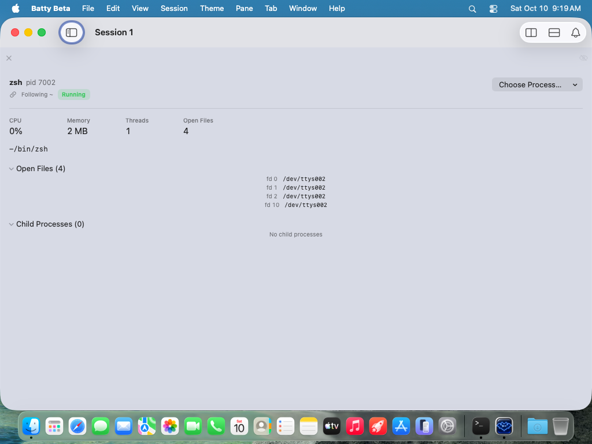
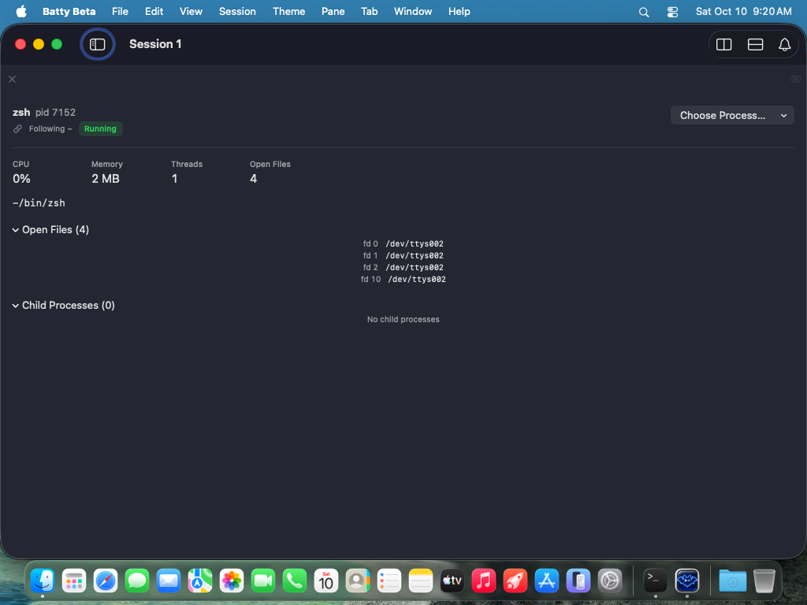

# 0459 — The Process Status view Pane centers the rows inside its Open Files and Child Processes disclosures instead of aligning them to the leading edge

| | |
|---|---|
| **Status** | resolved |
| **Branch** | issue/0459 |
| **Module** | Pane |
| **Platform** | macOS |
| **First seen** | 2026-10-10 |

## Description

In the Process Status view Pane (`BattyKit/Sources/BattyKit/Views/ProcessStatusPaneView.swift`), the rows inside the "Open Files (N)" and "Child Processes (N)" disclosures are horizontally centered in the Pane: in the attached gallery captures from Tart VM run on `main` at `f39dcbbb` (Batty Beta 1.2.0, Light and Dark, following-the-terminal variant, view Pane the full 1,000-point window width) the four `fd 0 /dev/ttys002 … fd 10 /dev/ttys002` rows float in the middle of the Pane at x≈460-566, and the "No child processes" placeholder sits at x≈466-558, while the disclosure titles, the stats row, the command line and every other element of the view hug the left edge at x=16. The user flagged it on 2026-10-10 while reviewing the view Panes for the 1.2.0 release.

This is the same defect class as item 1 of #0458 (the LM Studio Dashboard's Engine Errors & Warnings entries are centered for the same reason) — filed separately because the files differ and the two can land independently. Design/UX polish: the final visual sign-off is the user's, so the resolution sets `resolved`, never `closed`.

## Steps to reproduce

1. Commit, then run the gallery in the VM: `tools/run-ui-tests-vm.sh BattyUITests/ViewGalleryTests` and export with `tools/export-ui-screenshots.sh build/ui-tests/<run-id>/UITests.xcresult`.
2. Open `gallery.process-status.following.large.{light,dark}.png` (and the `.pid.` variants, which the gallery also expands — `expandDisclosures`, `BattyUITests/ViewGalleryTests.swift:366` and `:397`).

Manually: split a terminal Pane with `batty-beta pane split --view process-status` (or Pane > Split > Process Status) and expand "Open Files" and "Child Processes".

## Expected behavior

Acceptance criteria:

1. Every row inside both disclosures — the `fd N  path` rows, the `name  pid N  … Watch this instead` rows, and the "Loading…" / "Not available" / "No open files" / "No child processes" placeholders — starts at the same left edge as the disclosure's own title text (indented by the disclosure's standard content inset, as the Git Status view's file rows are), at every Pane width.
2. The "Watch this instead" button in a child-process row stays at the trailing edge of the row (that row is already greedy because of its `Spacer`, `ProcessStatusPaneView.swift:476`; it must not regress).
3. Nothing else about the rows changes: fonts, the `textSelection(.enabled)` on the path (`:447`), the single-line truncation of long paths (`:446`), and the #0456 narrow-width behaviour of the rest of the view.
4. **Verified in the gallery:** `gallery.process-status.{following,pid}.{large,narrow}.{light,dark}` show the disclosure rows leading-aligned; the narrow captures (240-point Pane) still show no right-edge clipping (#0457's criterion 5). `./build.sh` and `./build.sh unit` pass. A UI assertion in `ViewGalleryTests` (or `CLIViewPaneTests`) that the first `fd` row's frame `minX` is within a few points of the "Open Files" disclosure label's `minX` would catch a regression without a human reading the capture — the rows need an accessibility identifier (for example `process-status.fd.<id>`) for that; the implementer decides whether to add it.

## Actual behavior

From the attached captures (1024×768 1x VM display, view Pane x=0-1023):

- Light: "Open Files (4)" title at x≈29; its four rows at x≈460-566, centered. "Child Processes (0)" title at x≈29; "No child processes" at x≈466-558, centered.
- Dark: identical positions.

## Attachments

## Notes

Cause, verified against the sources on `f39dcbbb`: `disclosures` (`ProcessStatusPaneView.swift:407-421`) is two `DisclosureGroup`s whose bodies are `openFilesDisclosureBody` (`:424-451`) and `childProcessesDisclosureBody` (`:454-484`). The outer `VStack(alignment: .leading, spacing: 14)` (`:41`) with `.frame(maxWidth: .infinity, alignment: .leading)` (`:64`) makes each `DisclosureGroup` full-width, but the *content* of a `DisclosureGroup` is laid out by the group's own container, which centers children that are narrower than it. The Open Files row is an `HStack` of two `Text`s with no `Spacer` and no frame (`:440-448`), and the placeholders are bare `Text`s (`:427`, `:431`, `:435`, `:457`, `:461`, `:465`), so they take their intrinsic width and are centered. The child-process row (`:470-481`) has a `Spacer()` at `:476`, which is why "Watch this instead" reaches the trailing edge — but with zero children the placeholder `Text` at `:465` is centered like the others, as the capture shows.

The Git Status view avoids this: `fileGroup` (`BattyKit/Sources/BattyKit/Views/GitStatusPaneView.swift:317-329`) puts its rows in a `VStack(alignment: .leading)` (`:321`) and each `fileRow`'s `HStack` ends in `Spacer(minLength: 0)` (`:341`), so every row is as wide as the group. The fix here is the same shape: a `.frame(maxWidth: .infinity, alignment: .leading)` on each row and placeholder (or one leading-aligned greedy `VStack` wrapping each disclosure body), nothing more. #0456's acceptance criterion 5 said these disclosures "already fit at 240 points and should stay as they are" — they fit, but they were centered then too; this issue narrows that "unchanged" to width behaviour only.

Related: #0458 (sibling — LM Studio Dashboard's Engine Errors & Warnings entries, same cause, `LMStudioDashboardView.swift:312-319`), #0456, #0457, #0451 (the gallery that produced the captures).

## Resolution

- `ProcessStatusPaneView`: every Open Files and Child Processes placeholder (Loading, Not available, No open files, No child processes) and each fd row gets `.frame(maxWidth: .infinity, alignment: .leading)`; the fd row also ends in `Spacer(minLength: 0)`, like Git Status's `fileRow`, and is exposed as `process-status.fd.<id>` (`.accessibilityElement(children: .contain)`). The child-process row keeps its `Spacer` and "Watch this instead" button and gains the same leading frame.
- Rows now start at the view's content origin (x = 16, the `.padding(16)` every element in the view uses), under the disclosure chevron. This matches Git Status's file rows and LM Studio's engine entries (#0458): macOS `DisclosureGroup` does not indent its content.
- `ViewGalleryTests.assertOpenFilesRowsLeadingAligned`, called at large and narrow widths in `testProcessStatusFollowingTheTerminal`, asserts the first fd row's `minX` is 16 points (within 4) from the Process Status view's `minX`. A centered regression is about 460 points off at large width and about 53 at narrow.

## Verification

- `./build.sh` and `./build.sh unit` pass.
- VM run `20261010-175750-64011`: `ViewGalleryTests` 8 tests, 0 failures.
- Reviewer read the final-run captures (`following.narrow.light`, `pid.narrow.dark`, and the large ones): fd rows and "No child processes" start at the same x as the chevrons, stats and command line; nothing clipped on the right.

## Gotchas

- Everything here is verifiable in the VM: Process Status needs no external service, and the gallery already expands both disclosures (`expandDisclosures`, `ViewGalleryTests.swift:366`/`:397`). Run the gallery after the fix and attach the before/after captures to the resolution.
- `DisclosureGroup`'s centering of narrow content is a macOS SwiftUI behaviour, not something in this codebase — do not "fix" it by replacing `DisclosureGroup`; the expansion flags are bound to the content object on purpose (`:396-405`, review of #0305) and must keep working.
- Criterion 1's premise was wrong: it asked for rows at "the same left edge as the disclosure's own title text … as the Git Status view's file rows are", but Git Status's rows sit at the chevron edge, not the title edge (about 12 points further left). #0459 matches Git Status and #0458, the consistent choice. If title-edge alignment is wanted, that is a new issue covering all three views.
- Criterion 2 ("Watch this instead" stays at the trailing edge) was checked only in code; no gallery state has child processes.
- Visual sign-off is the user's.

Review notes: round 1 approve. Non-blocking findings applied before merge: scope the assertion to the Process Status view (a visible sidebar's disclosure triangle would otherwise match first), check narrow width too, and anchor on the view's own 16-point padding instead of the macOS chevron's hit area (the triangle's frame starts about 22 points left of the content and could shift between macOS releases). Re-check approve.

#0459 Review: approve

## Work log

| Date | Model | Input | Output | Cache read | Cache write | Cost |
|---|---|---|---|---|---|---|
| 2026-10-10 | claude-sonnet-5-5 | 84 | 1,490 | 2,211,485 | 577,415 | $2.85 |
| 2026-10-10 | claude-opus-5-5 | 32 | 141 | 770,036 | 138,242 | $1.25 |

**Total: $4.10**
