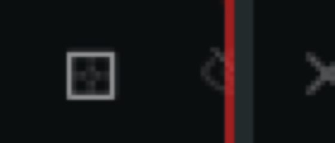
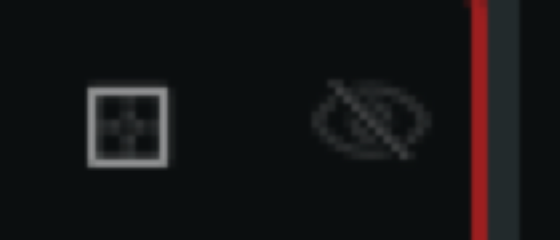

# 0460 — At narrow Pane widths the terminal Pane's header clips its hide toggle at the Pane's right edge so only the left half of the eye icon shows; #0457 fixed this only for non-terminal view Panes

| | |
|---|---|
| **Status** | open |
| **Module** | Pane / Tabs |
| **Platform** | macOS |
| **First seen** | 2026-10-10 |

## Description

When a terminal Pane is narrow, the hide toggle at the right end of its header — the `eye.slash` button after the Pane drag handle (the dotted square, `squareshape.split.2x2.dotted.inside`) — is cut off by the Pane's right edge: only its left half is drawn and the focus outline runs straight through it. Seen by the user on 2026-10-10 in Batty Beta 1.2.0 (`main` at `f39dcbbb`) with a one-tab terminal Pane about 318 points wide on the left of a Split and an LM Studio Dashboard view Pane on the right (attached full-window capture and 4x crops). When the same Pane is wide, the toggle is fully visible with its trailing padding intact.

#0457 fixed exactly this class — chrome clipped because the header row was sized by the content rather than by the allotted width — but only in `PaneView.nonTerminalShell` (`BattyKit/Sources/BattyKit/Views/PaneView.swift:402-433`: the header row got `.frame(maxWidth: .infinity)` at `:413` and `content()` was wrapped in `.frame(minWidth: 0, maxWidth: .infinity, alignment: .topLeading).clipped()` at `:419-421`). The terminal arm, `terminalBody` (`:195-340`), has its own header `HStack` (`:197-238`) that received no equivalent change.

Release-blocking polish for 1.2.0 (the user has flagged chrome clipping as such in #0452/#0457). Design/UX: the final visual sign-off is the user's, so the resolution sets `resolved`, never `closed`.

## Steps to reproduce

1. In a Session with one terminal Pane and one tab, split it: `batty-beta pane split --view lm-studio-dashboard` (any sibling will do — a second terminal Pane too).
2. Drag the Split divider left until the terminal Pane is about 300-330 points wide.
3. Look at the right end of the terminal Pane's tab bar: "+" button, drag handle, then the eye.

The toggle is clipped at every single-tab width below roughly 334 points by the arithmetic in Notes; between about 312 and 334 points a sliver-to-half of it shows, and below 312 points it is almost entirely gone. More tabs make it worse (the chip budget is shared, see Notes). The Split has no point floor (`SplitTree.updateRatio` clamps the ratio to 0.05-0.95, `BattyKit/Sources/BattyKit/Model/SplitTree.swift:523-526`; #0457 explicitly declined a floor), so the Pane can be made narrower still.

## Expected behavior

Acceptance criteria:

1. **The terminal Pane's header trailing controls are fully visible at every width the Split allows.** The drag handle (`paneDragHandle`, `:463-491`) and the hide toggle (`paneEyeButton`, `:499-515`) — and the "+" button — are never clipped at the Pane's right edge; the eye keeps its 4-point trailing padding (`:513`) inside the Pane. The tabs give way first: chips compress toward `chipMinWidth` (`:40`), and when even that does not fit the tab strip is what gets clipped (it already is — `SlidingTabBar` is `.clipped()` at `:222` — but today its *reported* width still pushes the controls out).
2. **The header is sized by the allotted width, not by the tab strip.** Whatever the implementer chooses — fixing the reservation in `chipMaxWidth` (`:63-74`) so it accounts for the eye button and `SlidingTabBar`'s real chrome, giving the `SlidingTabBar` a `.frame(minWidth: 0, maxWidth: .infinity)` / `.layoutPriority` so it yields to the fixed-size controls, or both — the controls must not depend on the chip arithmetic being exactly right, since `SlidingTabBar` lives in a separate package (`BattyKit/Package.swift:34`, `.package(path: "../../SlidingTabs")`) whose padding constants can change under this code. Prefer the structural fix, and correct the constants anyway so the chips are budgeted honestly.
3. **No terminal behaviour changes.** The terminal host is AppKit and persistent (`docs/view-hierarchy.md` §3-4, lines 140-326): the `AppTerminalView` is placed at the frame `TerminalPlaceholderView` reports and is never reparented; the header is SwiftUI above it. This fix must stay inside the header row's layout. It must not add overlays, gestures, drag handlers or event routing over the terminal body (`docs/terminal-pane-requirements.md`, §3-6, lines 38-81: pointer input, scroll, keyboard, IME, file/text drop all belong to Ghostty's NSView and the AppKit z-order constraint in §5 makes any overlay a hazard), must not change the `ZStack` of `TerminalPlaceholderView`s (`:240-332`), and must not write `@State` from layout callbacks beyond the existing `paneWidth` probe (`:165-168`; `docs/swiftui-observation-rules.md` is binding). Run the §6 manual checklist of `docs/terminal-pane-requirements.md` on the host before marking the feature complete: click-to-focus, text selection by drag, scroll wheel, typing, a file drop and a text drop onto the narrow Pane, and IME composition.
4. **Covered by a UI test in the Tart VM.** `BattyUITests/TabChipRenderingTests.testTabBarWidthDoesNotExceedPaneWidth` (`:76-104`) does not catch this: it runs an unsplit Pane (no drag handle, whole window width) and compares only the `tab-bar.<id>` element's `maxX` against `pane-terminal.<id>`'s — the bar is `.clipped()` so its frame passes while the eye button outside it is cut. Add a test (in `TabChipRenderingTests`, `SplitDividerDragTests`, or `ViewGalleryTests`) that splits, drags the divider until the terminal Pane is about 300 points wide (the `setNarrow` recipe at `BattyUITests/ViewGalleryTests.swift:166-186` drags by raw coordinates), then asserts that `pane-eye-button.<id>` (`:514`) and `pane-drag-handle.<id>` (`:476`) both exist, are hittable, and have `frame.maxX <= pane-terminal.<id>.frame.maxX` (`BattyScreen.terminalPane`, `BattyUITests/Support/BattyCLIHarness.swift:324-326`). Repeat with three tabs. A gallery capture of the narrow terminal Pane header (the gallery currently captures only the view Panes, `ViewGalleryTests.swift:5-12`) is a welcome extra for the user's review but is not the regression guard.
5. `./build.sh` and `./build.sh unit` pass; the new UI test passes in the VM (`tools/run-ui-tests-vm.sh BattyUITests/<Class>`), and the existing `TabChipRenderingTests`, `SplitDividerDragTests` and `PaneFocusTests` still pass there.

## Actual behavior

From the attachments (1425×1021 capture at 1x; the terminal Pane spans x≈2-318):

- Narrow (`0460/terminal-header-narrow-eye-clipped-4x.png`, 4x crop of the header's right end): drag handle fully drawn, then the eye glyph cut vertically at the Pane edge with roughly its left 40-50% visible, the red focus outline drawn over the cut, then the sibling Pane's close "×" immediately to the right.
- Wide (`0460/terminal-header-wide-eye-visible-4x.png`, same Pane after widening): drag handle, a gap, the whole `eye.slash` glyph, then a margin before the focus outline.
- The full-window capture (`0460/full-window-narrow-terminal-pane.png`) shows the context: one tab chip "~" at its 220-point cap, "+", drag handle, half an eye, divider.

## Attachments

## Notes

Mechanism, verified against the sources on `f39dcbbb` and `SlidingTabs` as checked out at `/Users/brennan/Developer/brennanMKE/SlidingTabs` (the implementer should confirm the arithmetic by measurement — the constants are exact, the sum is derived):

- **The terminal header has no width of its own.** `terminalBody` (`PaneView.swift:195-340`) is `VStack(spacing: 0) { HStack(spacing: 0) { SlidingTabBar(…).clipped(); if hasSiblingPanes { paneDragHandle.padding(.trailing, 8) }; paneEyeButton }; ZStack { … } }`. Unlike `nonTerminalShell`'s header (`:413`), the `HStack` at `:197` has no `.frame(maxWidth: .infinity)`, so its width is the sum of its children. `PaneView.body` then clamps the whole thing to the allotted size with `.frame(width: allottedSize?.width, …, alignment: .topLeading)` (`:119`) and `.clipped()` (`:131`) — #0261's leading-anchored clamp — so whatever overflows is cut at the trailing edge, which is where the eye sits. `.clipped()` on the `SlidingTabBar` at `:222` clips the bar's *drawing* but does not reduce its *reported* width.
- **`SlidingTabBar` reports chips plus 58 points.** Its body (`SlidingTabBar.swift:108-145`) is an `HStack(spacing: 0)` of the chip strip — an inner `HStack(spacing: spacing)` with `.fixedSize(horizontal: true, vertical: false)` (`:111-116`) inside `.padding(.horizontal, horizontalPadding)` (`:134`) — then `AddButton` (22 points, `:359`) with `.padding(.trailing, horizontalPadding)` (`:137-139`), then `Spacer(minLength: 0)` (`:142`). With the defaults `horizontalPadding = 12` (`:90`) and `spacing = 6` (`:87`) that is 24 + 22 + 12 = 58 points of chrome around the chips; the `Spacer` lets the bar grow but never shrink below that.
- **`chipMaxWidth` budgets 86 points of chrome, not 114.** `PaneView.chipMaxWidth` (`:63-74`) computes `available = paneWidth - barChromeWidth - (hasSiblingPanes ? dragHandleWidth : 0)` with `barChromeWidth = 56` (`:34`; its comment counts 2×12 + 22 = 46 "plus a small layout buffer", missing the "+" button's own 12-point trailing padding) and `dragHandleWidth = 30` (`:37`, 22 + 8, correct), then `perChip = available / count - 6`, clamped to `60…220` (`:40-41`). It never reserves the eye button's 22 + 4 = 26 points (`:508`, `:513`). So the header's intrinsic width is `chips + 58 + 30 + 26`, and when the chips are not at a clamp, `chips = paneWidth - 92`, i.e. the header is `paneWidth + 22` — a constant 22-point overflow at every width where the chips are actually being budgeted. At the capture's ≈318 points with one tab, `perChip = 226` hits the 220 cap, so the header is 220 + 114 = 334 and the overflow is 16 points: the eye's 22-point frame spans about 308-330, of which 308-318 is visible — the "left half" in the crop. A single tab fits only from 334 points up; below 312 the 22-point overflow leaves about 4 points of the eye's frame.
- `paneWidth` is the clamped width (the `onGeometryChange` at `:165-168` reads the frame after `:119`), so the budget's input is right; only the reservation is wrong, and even a right reservation would still leave the controls at the mercy of the package's padding — hence criterion 2's preference for a structural fix as well.
- #0457's declined Split floor (its Resolution) is unaffected: this issue asks that the chrome survive any width, as #0457's criterion 2 asked for view Panes.

Related: #0457 (the view-Pane half of this fix, `nonTerminalShell`), #0261 (the clamp-and-clip that turns the overflow into a clip), #0253/#0047 (earlier tab-bar overflow into the neighbouring Pane — the clamp comment at `:106-123` and `TabChipRenderingTests` cite them), #0127 (the drag handle), #0334 (eye button re-hosted in the non-terminal header).

## Gotchas

- UI tests run only in the Tart VM (`tools/run-ui-tests-vm.sh`; AGENTS.md "UI test automation"), never on the host. The VM runs a 1024×768 display, so "about 300 points" needs a Split of a window that is at least ~600 wide — the gallery's divider drag (`ViewGalleryTests.setNarrow`) already handles the coordinate math and can be copied.
- What the VM cannot verify: the §6 checklist of `docs/terminal-pane-requirements.md` (drops, IME, selection, scroll) is a manual host check — the UI suite's `DragDropTests` covers file drops, but not after this specific layout change on a narrow Pane; state in the resolution's Verification which items were run by hand.
- `TabChipRenderingTests.testTabBarWidthDoesNotExceedPaneWidth` passing is not evidence for this issue (see criterion 4). Do not widen its `+ 2` tolerance.
- The `SlidingTabs` package is a path dependency; a fix that edits it must be committed there as well, and this issue's resolution must say so — but prefer keeping the fix in `PaneView` so Batty does not depend on a package change to be correct.
