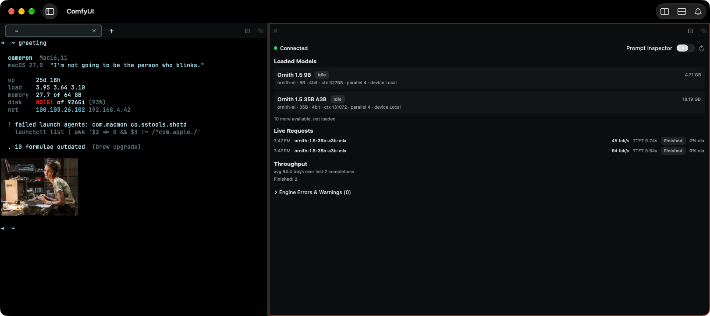
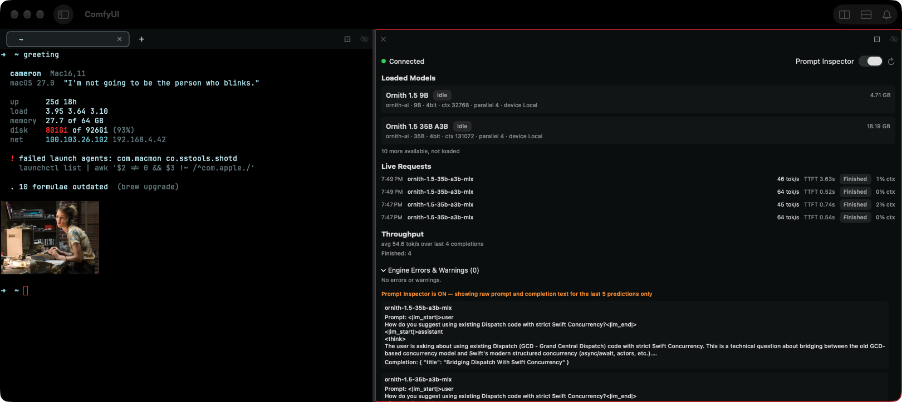

# 0461 — At wide Pane widths the LM Studio Dashboard view Pane's Live Requests rows stretch the model column so each row's tok/s, TTFT, stop-reason badge and ctx sit about 600 points away from its time and model name, and its Throughput section repeats the completion count as a redundant "Finished: N" line

| | |
|---|---|
| **Status** | open |
| **Module** | Pane |
| **Platform** | macOS |
| **First seen** | 2026-10-10 |

## Description

Two layout polish defects in the LM Studio Dashboard view Pane, both seen by the user on 2026-10-10 in Batty Beta 1.2.0 (built from `main` at `04a7458b`, i.e. with #0458's Live Requests `Grid` and plain-word stop reasons already in) against a live, connected LM Studio server with two models loaded. Both are changes to this view's own files and both target the 1.2.0 release. Follow-up to #0458, which fixed the row-to-row column misalignment but left the table stretched across the whole Pane.

1. **Live Requests rows read as two clusters at opposite edges of the Pane.** In a view Pane about 1,000 points wide, each row's time and model name sit at the far left and its tok/s, TTFT, stop-reason badge and ctx sit flush against the far right, with roughly 600 points of empty space between them. The columns *do* now line up row to row (#0458 item 3), but the eye has to travel the full width of the Pane to connect "7:47 PM ornith-1.5-35b-a3b-mlx" with "45 tok/s TTFT 0.74s Finished 2% ctx", so the rows are hard to scan as units.
2. **Throughput shows "Finished: N" on its own line under "avg X tok/s over last N completions".** When every completion stopped with `eosFound` — the normal case — that second line repeats the count already given in the line above it and already visible as the Finished badge on every row. In both attached captures the section reads "avg 54.4 tok/s over last 2 completions / Finished: 2" and "avg 54.6 tok/s over last 4 completions / Finished: 4".

Design/UX polish for the 1.2.0 release: the final visual sign-off is the user's, so the resolution sets `resolved`, never `closed`.

**Out of scope (unchanged from #0458, deferred to 1.3.0):** the "0% ctx" column, renaming the "Live Requests" section, the Prompt Inspector box's width.

## Steps to reproduce

With LM Studio running on this Mac with at least one model loaded (the `lms` CLI at `~/.lmstudio/bin/lms`):

1. Split a terminal Pane with the LM Studio view: `batty-beta pane split --view lm-studio-dashboard` (or Pane > Split > LM Studio Dashboard) and widen the view Pane to roughly 1,000 points.
2. Send two or more chat completions to the server from any client, letting them run to their natural end so they stop with `eosFound`.
3. Look at the Live Requests rows and at the Throughput section.

## Expected behavior

Acceptance criteria:

1. **A Live Requests row reads as one unit at every Pane width.** At wide widths the stat columns (tok/s, TTFT, badge, ctx) sit directly after the model column, with the `Grid`'s 8-point column spacing between them, instead of being pushed to the Pane's right edge. The model column still truncates long identifiers with a tail ellipsis and still has enough room to show a typical identifier such as `ornith-1.5-35b-a3b-mlx` in full. Implementer's choice how: cap the model column's growth (a finite `maxWidth` in place of `.infinity` at `BattyKit/Sources/BattyKit/Views/LMStudioCompletionTable.swift:50`) so the `Grid` becomes intrinsically sized and the surrounding `VStack(alignment: .leading)` (`LMStudioDashboardView.swift:189`) keeps it at the leading edge, or give the model column a generous ideal width and move the stretch into an empty trailing column after ctx. Whatever the approach, the table's leading edge stays at the Pane's leading edge (no centering), and the whole table is still never wider than the Pane (#0457).
2. **The narrow-width fallbacks do not regress.** `LMStudioCompletionTable`'s five `ViewThatFits` layouts (`full`, `noContext`, `minimal`, `noTime`, `modelAndBadge`, `LMStudioCompletionTable.swift:6-8` and `:21-27`) keep their current floors: the existing floor test `leanestLayoutFitsTheNarrowestPaneEvenWithTheLongestBadge` (`BattyKit/Tests/BattyKitTests/LMStudioCompletionTableLayoutTests.swift:32-38`, budget 196 points at `:12`) still passes, and the column-drop order is still driven by the stat columns, not by the model name's length (#0458's `idealWidth: 100` decision, `issues/0458.md` Resolution).
3. **The stretch is proven by a unit test, not only by eye.** Add a test to `LMStudioCompletionTableLayoutTests` that hosts the `.full` layout the way `floorWidth` does (`:27-30`, `NSHostingController.sizeThatFits`) but proposes a wide size (e.g. 1,000 × 1,000 points) and asserts the fitted width is bounded well below the proposal — today `maxWidth: .infinity` makes the model column absorb the whole proposal, so this test fails on `main` and passes once the column is capped. Pick the bound from the chosen cap plus the fixed columns' measured widths and say in the test why it is that number, the way the floor test cites #0457 for 196.
4. **Throughput does not repeat the completion count.** When every completion in the tally stopped with `eosFound`, the Throughput section shows the "avg X tok/s over last N completions" line and nothing else — no "Finished: N". When other stop reasons are present they are still reported with their counts, using the plain-word names from `LMStudioDashboardFormatting.stopReasonDisplayName` (`BattyKit/Sources/BattyKit/Views/LMStudioDashboardFormatting.swift:21`), because "1 hit token limit" or "2 failed" is information the row badges only give one row at a time. Implementer's choice whether the non-Finished reasons stay on a second line ("Hit token limit: 1  ·  Failed: 2") or are folded into the average line; either way "Finished" itself is not listed. Update the `stopReasonTallyText` tests in `BattyKit/Tests/BattyKitTests/LMStudioDashboardFormattingTests.swift` (`tallyUsesDisplayNamesMostFrequentFirst` at `:32`, `tallyMergesReasonsThatShareADisplayName` at `:37`, `tallyBreaksTiesByLabel` at `:47`) to the new contract and add a case for the all-`eosFound` input returning no tally text (or whatever the chosen signature returns for "nothing to add").
5. **Verified:** `./build.sh` and `./build.sh unit` pass, including the new wide-width test in `LMStudioCompletionTableLayoutTests` and the updated `LMStudioDashboardFormattingTests`. The Tart VM gallery (`tools/run-ui-tests-vm.sh BattyUITests/ViewGalleryTests`, `testLMStudioDashboardDisconnected` at `BattyUITests/ViewGalleryTests.swift:429`) still produces `gallery.lm-studio-dashboard.{large,narrow}.{light,dark}` with no regression — it can only show the disconnected state (see Gotchas on #0458), so the connected layout is covered by the unit tests above and the user's host check.

## Actual behavior

From the attached captures (both 1620×724, the view Pane on the right, about 1,000 points wide):

- Live Requests, two rows then four rows: time at x≈625, model name ending at x≈790, then nothing until "45 tok/s" starts at x≈1396 and "2% ctx" ends flush at x≈1607. The gap between the model name and the first stat is about 600 points on every row. The columns themselves line up row to row.
- Throughput: "avg 54.4 tok/s over last 2 completions" over "Finished: 2" (first capture); "avg 54.6 tok/s over last 4 completions" over "Finished: 4" (second capture). Every row's badge already reads "Finished".

## Attachments

The second capture has the Prompt Inspector on; it has no bearing on either defect, and the prompt text it shows is a short, user-authored test question, as in #0458's capture.

## Notes

Causes, verified against the sources on `04a7458b`:

1. **Stretched model column** — `LMStudioCompletionTable.grid(_:)` (`LMStudioCompletionTable.swift:31-88`) builds a `Grid(alignment: .leading, horizontalSpacing: 8, verticalSpacing: 4)` (`:36`). Every stat cell is `.fixedSize()` (time `:44`, tok/s `:56`, TTFT `:64`, ctx `:73`) and the badge is a `StatusBadge` (`:93`), so they are rigid; the model cell is the only flexible one, `.frame(minWidth: 40, idealWidth: 100, maxWidth: .infinity, alignment: .leading)` (`:50`). `Grid` hands all width the Pane proposes beyond the rigid columns' sum to the flexible column, so the model column grows to fill the Pane and pushes the stat columns to the right edge. The `idealWidth: 100` only governs the `ViewThatFits` decision (`:21-27`), which proposes the ideal size when choosing a layout; once a layout is chosen the Pane's full width is proposed and `maxWidth: .infinity` takes it. Capping `maxWidth` leaves `minWidth: 40` and `idealWidth: 100` untouched, so the floor test (which proposes 1 × 1000, `LMStudioCompletionTableLayoutTests.swift:29`) and the `ViewThatFits` ordering should be unaffected — confirm by running the layout suite. The table sits in `liveRequestsSection`'s `VStack(alignment: .leading, spacing: 6)` (`LMStudioDashboardView.swift:189-211`, via `completionTable(_:)` at `:214-216`), so an intrinsically sized `Grid` will stay leading-aligned without any further change.

2. **Redundant tally** — `throughputSection` (`LMStudioDashboardView.swift:220-243`) computes `average` over `recentCompletions.compactMap(\.stats?.tokensPerSecond)` (`:221-222`) and renders "avg %.1f tok/s over last %d completions" (`:229`), then unconditionally renders `stopReasonTallyText` (`:223-225`, `:237-241`) which `LMStudioDashboardFormatting.stopReasonTallyText` builds from every stop reason, "Finished" included (`LMStudioDashboardFormatting.swift:42-53`). The tally was introduced by #0458 item 4 to replace the raw "eosFound: 6 · maxPredictedTokensReached: 1" text; it was never filtered. Note that `samples.count` (rows with `tokensPerSecond`) and the tally's total (rows with `stopReason`) are both derived from the same `recentCompletions` but could differ if a record carries one stat and not the other — if the implementer folds non-Finished counts into the average line, keep that in mind rather than asserting the two totals match.

Related: #0458 (parent of this follow-up: `Grid`, `ViewThatFits` fallbacks, stop-reason names, tally; its Gotchas describe why the connected layout cannot be captured in the VM), #0457 (content never wider than the Pane; the 220-point content-fit minimum behind the 196-point floor budget), #0456 (`StatusBadge`), #0313 (the view and its privacy constraints).
