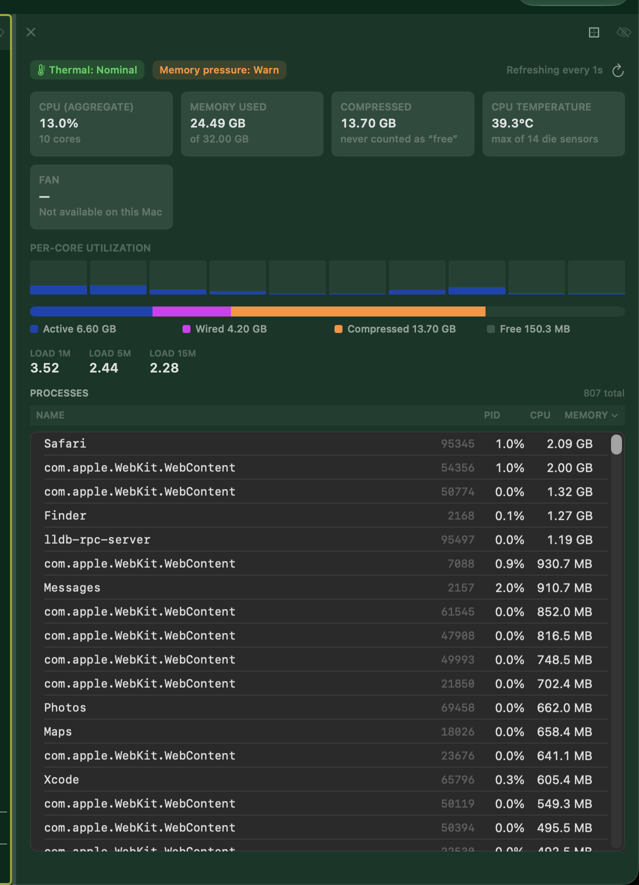

# 0515 — System Metrics Pane's PROCESSES table draws a gray system background instead of the Theme's colors

| | |
|---|---|
| **Status** | resolved |
| **Module** | Pane / Theme |
| **Platform** | macOS |
| **First seen** | 2026-10-14 |
| **Closed** | 2026-10-14 |
| **Branch** | issue/0515 |
| **Target release** | 1.3.1 (fix on `main`, then cherry-pick to `release/1.3`) |

## Description

In a System Metrics Pane, the PROCESSES table body ignores the active Theme. The cards, per-core bars, header strip and the Pane background all sit on the Theme's chrome background. The table body is an opaque neutral dark-gray box with gray row separators and a gray border. Under a dark green Theme it reads as a foreign gray panel in the middle of the Pane. The column header row above it (NAME / PID / CPU / MEMORY) is themed correctly.

## User report (2026-10-14, verbatim)

> It appears the System Metrics uses gray for the processes instead of using the theme colors.

## Steps to reproduce

1. Select a non-default dark Theme with a tinted background (the report uses a dark green one).
2. Open a System Metrics Pane (Command Palette, or `batty-beta split --kind system-metrics`).
3. Wait for the first sample and look at the PROCESSES section.

## Expected behavior

The table body, its rows, row separators and border use the active Theme's colors and match the cards above them. Text stays readable. This holds for light and dark Themes, and for a Session whose Theme is a Session-level override (`SessionRuntime.localThemeName`).

## Actual behavior

The table body is filled with the system's opaque table background (dark gray under Dark Aqua). Separators are the system separator gray. The border is a neutral `Color.primary` stroke.

## Root cause (verified on main `609d6ff3`)

`BattyKit/Sources/BattyKit/Views/SystemMetricsPaneView.swift`:

- **:385-393, `processList`.** This is `List(sortedRows) { … }.listStyle(.plain)`. On macOS a SwiftUI `List` is backed by an `NSTableView` inside an `NSScrollView`. That draws its own opaque content background (the system `controlBackgroundColor`), and nothing hides it. The view has no `.scrollContentBackground(.hidden)` and no `.listRowBackground(…)`, so the Pane's themed background (`PaneView.swift:434`, `themeChrome?.chromeBackground`) never shows through. This is the gray box.
- **:419, `.listRowSeparator(.visible)`.** The separators use the system separator color. No `.listRowSeparatorTint(…)` is set, so they are gray rather than the Theme's `divider`.
- **:392, `.overlay(RoundedRectangle(cornerRadius: 7).strokeBorder(Color.primary.opacity(0.08)))`.** The border is a neutral system-primary stroke, not the Theme's `divider`.
- **:361, the header row.** It uses `.background(Color.primary.opacity(0.04))`, which is translucent. That is why it shows the themed Pane background through it and looks right. The cards (`:211`, `.fill(.quaternary)`) look right for the same reason.

`SystemMetricsPaneView` does not read `@Environment(\.themeChrome)` at all today. The Pane looks themed only because `PaneView.nonTerminalShell` (`PaneView.swift:434`) paints `themeChrome?.chromeBackground` behind it and every other element is translucent. `List` is the one opaque element.

The fix has a precedent in this codebase. `SessionSidebarView.swift:142-143` hides the `List`'s background when a Theme is active and paints the Theme's chrome background instead:

```swift
.scrollContentBackground(themeChrome?.chromeBackground == nil ? .automatic : .hidden)
.background(themeChrome?.chromeBackground ?? Color.clear)
```

The same approach applies here. Read `themeChrome` from the environment. Hide the scroll content background when a Theme is active, and use `themeChrome.divider` for the separators (`.listRowSeparatorTint`) and the border. Keep today's system look when `themeChrome` or a slot is `nil`, which is what happens with no Theme selected. The row text should use `themeChrome.chromeForeground` and `chromeMutedForeground` (PID column, permission-denied rows) when present, so contrast stays right if a light Theme is active while the system appearance is dark, or the reverse. Today the text uses the system `.primary` and `.tertiary`.

Session-level overrides need no extra work. `\.themeChrome` is injected window-wide at `RootWindowView.swift:47`, and `AppStateStore.applyActiveSessionTheme` updates it to the selected Session's effective Theme (see `docs/themes.md` §9). The fix must still be checked against a Session with a local override.

## Other non-terminal Panes (audited, not in scope unless broken)

- **Process Status Pane** (`ProcessStatusPaneView.swift`): no `List` or `Table`. Its content is a `ScrollView` with `DisclosureGroup`s, and its backgrounds are translucent (`:445` `Color.secondary.opacity(0.1)`, and semantic orange and red tints at `:487`, `:501`, `:525`). It shows the same kind of problem as the System Metrics table, but does not have that problem itself.
- **Git Status Pane** (`GitStatusPaneView.swift`): no `List` or `Table`. One system color: the diff peek at `:520` uses `.background(Color(nsColor: .textBackgroundColor).opacity(0.5))`. At 50% alpha it blends with the themed background, so it is tinted toward the system text background rather than an opaque gray box. Not the reported bug. The implementer should check it under a strongly tinted Theme. If it reads as off-Theme, file it as a separate issue rather than widening this fix.
- **LM Studio Dashboard** (`LMStudioDashboardView.swift`, `LMStudioCompletionTable.swift`): translucent `.quaternary` fills only (`:163`, `:294`). No opaque system backgrounds.
- **Related, not this bug:** `SystemMetricsPaneView` uses the system `Color.accentColor` for the per-core bars (`:242`), the Active segment of the memory bar (`:258`, `:271`) and nothing from the Theme. That is why the bars render system blue under a green Theme. The user did not report it, so it is out of scope here. Note it in Gotchas if the implementer touches nearby code, and leave it as a separate decision for the user.

## Acceptance criteria

- With a Theme active, the PROCESSES table body shows the Theme's chrome background (no opaque system gray). Row separators and the table border use the Theme's `divider`. Row text uses the Theme's foreground and muted foreground.
- With no Theme (`ThemeChrome` palette `.default`, all `nil`), the table keeps its current system appearance.
- Works for a dark Theme, a light Theme, and a Session with a Session-level override that differs from the global Theme.
- If the color choice is pulled into a pure helper (for example a small struct mapping `ChromePalette?` to the table's background, separator, border and text colors, with `nil` fallbacks), it is unit tested in `BattyKitTests`. Tests cover a themed palette (non-default values, checked against the derived `ChromePalette` slots) and the `.default` fallback. No sleeps; see AGENTS.md "Asynchronous tests".
- If feasible, a VM UI test or gallery capture (`tools/run-ui-tests-vm.sh`, `tools/export-ui-screenshots.sh`) shows the themed table under at least one dark Theme and one light Theme. Attach the captures under `issues/0515/`.
- `./build.sh` and `./build.sh unit` pass.
- Visual sign-off is the user's. Mark `resolved`, not `closed`, and record anything that could not be verified in `## Gotchas`.

## Release

This targets **1.3.1**. Following AGENTS.md "Release branches": fix on `main` through the normal `issue/0515` workflow, squash-merge to `main`, then `git cherry-pick -x` the squash commit onto `release/1.3` (cut from the `v1.3.0` tag). Record the `release/1.3` commit in `## Work log`.

Other 1.3.1 cherry-pick candidates at filing time: `git log v1.3.0..main --oneline` lists one commit, `609d6ff3 #0514 File Session reminders…`, which files an issue (feature work for `main`) and is not a fix. Issues #0507-#0513 are on the unmerged branch `issue/0507-0513-review-883c427` and are not on `main` yet.

## Attachments



## Notes

- Read `docs/swiftui-observation-rules.md` before changing the view. This change is read-only use of `@Environment(\.themeChrome)` in `body`, with no observed-state writes.
- `ThemeChromeTests.swift` already covers `ChromePalette` derivation. New tests belong next to it or in a System Metrics view test file.

## Review

### Round 1 (reviewer, Opus): approve pending VM

Reviewed `git diff main...HEAD` (`078bf0cf..5e6e4132`). `./build.sh unit` passes on the branch.

**What is right**

- **Table.** `processList` hides the scroll content background only when `tableBackground` is non-nil. It paints `chromeBackground` behind the List, the same pattern as `SessionSidebarView.swift:142-143`. Separators use `.listRowSeparatorTint(colors.separator)`. A `nil` tint keeps the system color. The border uses `divider`, or falls back to the old `Color.primary.opacity(0.08)`.
- **Text.** Row text uses `chromeForeground`. The PID column and permission-denied rows use `chromeMutedForeground`. Each falls back to `.primary` / `.tertiary` through `AnyShapeStyle`.
- **Bars.** The per-core bars, the memory bar's Active segment and its legend swatch use `palette.accent`. They fall back to `Color.accentColor`. The orange (80%+ bars, Compressed) and purple (Wired) colors stay semantic. The orchestrator's scope decision is recorded in Gotchas.
- **No Theme.** `ChromePalette.default` gives `nil` for every optional slot. In that case the modifiers resolve to `.automatic`, `Color.clear`, the default separator tint, the old border, `.primary` / `.tertiary` and `Color.accentColor`. Apart from the clip, that is the pre-change look. `noThemeKeepsSystemLook` covers both `nil` and `.default`.
- **Clip.** I accept the new `.clipShape(RoundedRectangle(cornerRadius: 7))`. Before the change, the opaque system background filled square corners outside the 7pt rounded border. With a hidden background and a Theme active, the clip keeps the themed fill inside the border. With no Theme, the only visible difference is that the corners are rounded to match the border, which was the intended look. It is noted in Gotchas.
- **Contrast.** The slots come from the theme's own fg/bg. Row text is `fg` on `bg` shifted 6% toward fg. Muted text is a 60/40 fg/bg blend. Separators are `fg` at 18% alpha. None of these depend on the system appearance, so a light Theme under dark appearance (a Session-level override) stays readable in the table.
- **Session overrides.** The view reads `@Environment(\.themeChrome)`. The only call site is `PaneView.swift:459`, inside the window-wide injection at `RootWindowView.swift:47`. `applyActiveSessionTheme(for:)` (`ThemePreference.swift:206`) resolves `session.localThemeName` first, so an override reaches this view with no extra wiring.
- **Observation rules.** `colors` is a computed read of `themeChrome?.palette`. Nothing in `body` or its helpers writes observed state. The `@State` sort fields are written only from the header `Button` actions, which are event-origin and unchanged.
- **Tests.** The tests are not vacuous. The themed tests use non-default palettes. They assert each slot equals the derived `ChromePalette` slot, and they assert inequality against the system fallbacks and between the dark and light palettes. Mutation check: I changed `separator = palette?.divider` to `palette?.chromeMutedForeground`, and `darkThemeUsesPaletteSlots` failed. I then reverted the change. There are no sleeps.
- **Comments.** I grepped the claims. The `SystemMetricsColors` doc comment ("a `nil` slot means keep the system look") matches the optional slots. `border` and `accent` are non-optional and carry their fallbacks directly. The Gotchas line about reverting the accent by changing `SystemMetricsColors.accent` is accurate.

**Non-blocking notes**

1. The PROCESSES column header (`.tertiary` on `Color.primary.opacity(0.04)`), the card labels and the section titles still use system hierarchical styles. Under a Session-level override whose luminance is opposite to the system appearance (a light Theme in dark mode), those labels can lose contrast against the themed Pane background. This was true before the change and is outside the reported bug. Gotchas records it. If the user sees it, it is a candidate follow-up issue.
2. View wiring (`scrollContentBackground`, separator tint, clip) has no unit coverage. Only the color mapping is tested. The acceptance criteria accept this. VM and gallery captures plus the user's visual sign-off cover the rest.
3. `.background(colors.tableBackground ?? Color.clear)` paints the same color that `PaneView.nonTerminalShell` already paints behind the Pane. It is redundant but harmless, and it keeps the List correct if it is ever hosted outside that shell.

No blocking findings. Approval is pending the VM UI run and the user's visual sign-off under a dark Theme, a light Theme and a Session-level override.

## Gotchas

- Not verified visually: no VM run was done. `ViewGalleryTests.testSystemMetrics` exists but has no Theme axis (it only varies light/dark system appearance), so a themed capture needs a gallery change to select a Theme; not added here. Visual sign-off under a dark and a light Theme, and under a Session-level override, is the user's.
- Orchestrator decision (user may revert): the per-core bars and the Active segment of the memory bar (and its legend swatch) now use `ChromePalette.accent` when a Theme is active, falling back to `Color.accentColor` with no Theme. This goes beyond the reported bug. Revert by changing `SystemMetricsColors.accent` back to `Color.accentColor`. The orange/purple memory segments and the orange 80%+ core bars stay semantic.
- The cards, header strip and section labels still use the system `.tertiary`/`.quaternary` styles; they were not reported and are translucent. Only the table body, its row text, separators and border were themed.
- With no Theme the table keeps the system look, except the List is now clipped to the 7pt rounded border shape.
- Color derivation is the pure `SystemMetricsColors` (`Views/SystemMetricsColors.swift`), tested in `SystemMetricsColorsTests`.
- The Git Status diff peek (`.textBackgroundColor` at 50%) was not checked under a tinted Theme.

## Resolution notes

> 🟢 Resolved 2026-10-14. The System Metrics PROCESSES table now follows the active Theme. Its List background is hidden and the Theme's chrome background is painted instead. Separators and the border use the Theme's divider color, and the rows use the Theme's foreground and muted colors. Under a Theme, the per-core bars and the Active part of the memory bar use the Theme's accent. With no Theme, the pane looks the same as before. This ships in 1.3.1: the fix is cherry-picked to `release/1.3`.

Owed to the user: a visual check under a dark Theme, a light Theme and a Session-level Theme override. The gallery has no Theme axis.

## Verification

- `./build.sh unit` passes with 2510 tests. `SystemMetricsColorsTests` covers dark, light and no-Theme palettes and catches mutation.
- VM (Tart, muted) at `9e777b9a`:
  - `20261014-183000-54228`: PaneMenuViewTests, NonTerminalPaneCloseTests and CLIViewPaneTests. 18 tests, 0 failures.
  - `20261014-183630-60085`: `ViewGalleryTests/testSystemMetrics`, with captures in light and dark appearance. 0 failures.

## Work log

| Date | Model | Input | Output | Cache read | Cache write | Cost |
|---|---|---|---|---|---|---|
| 2026-10-14 | claude-opus-5-5 | 36 | 3,764 | 995,713 | 54,712 | $0.55 |
| 2026-10-14 | claude-sonnet-5-5 | 34 | 248 | 996,249 | 59,648 | $0.25 |
| 2026-10-14 | claude-opus-5-5 | 24 | 188 | 616,611 | 66,312 | $0.46 |
| 2026-10-14 | claude-sonnet-5-5 | 16 | 126 | 813,663 | 277,656 | $0.78 |

**Total: $2.04**
