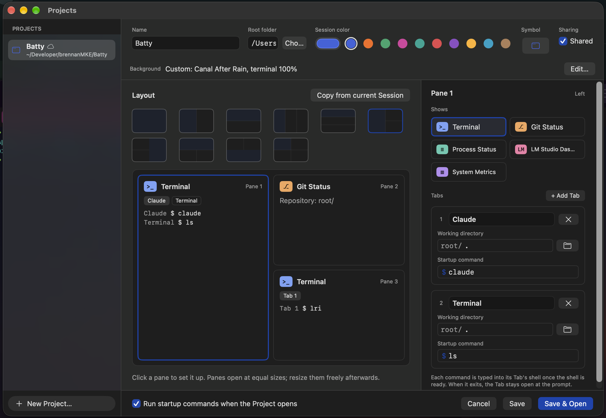
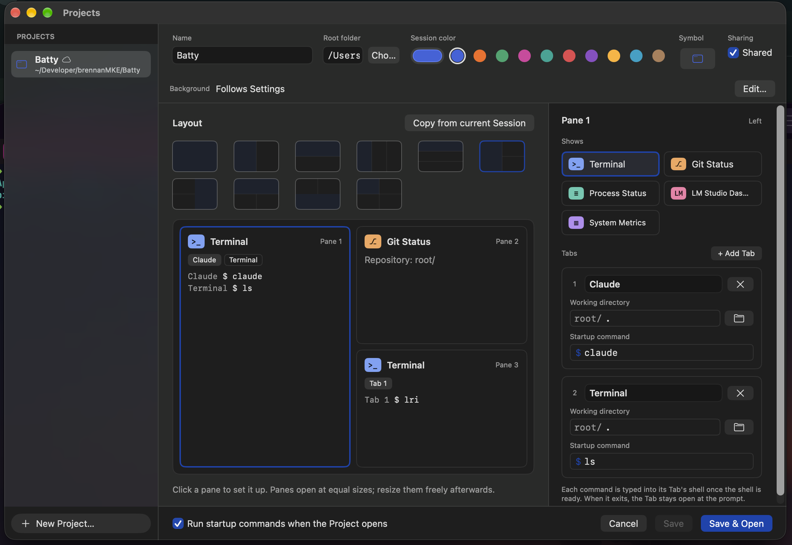

# 0585 — A Project can store only one terminal background for the whole Session, so its Tabs can't each have their own background image and opacity

| | |
|---|---|
| **Status** | open |
| **Module** | Projects / Tabs / Theme |
| **Platform** | macOS |
| **First seen** | 2026-11-11 |

## Description

The Project Editor has one **Background** row for the whole Project (#0540). A Project with several Terminal Panes and Tabs can't give any of them its own image or opacity. The user:

> "I should be able to set the background image and opacity for each terminal, not just at the project level. There are multiple terminal panes and tabs."

The screenshots show the case: a Shared Project with three Panes. Pane 1 is a Terminal Pane with Tabs "Claude" (`claude`) and "Terminal" (`ls`), Pane 2 is Git Status, Pane 3 is a Terminal Pane with "Tab 1". The only background control is the Project-level row ("Custom: Canal After Rain, terminal 100%" in one shot, "Follows Settings" in the other).

**User decision (2026-11-11):** the per-terminal background attaches to **each Tab** in the Project definition. Each Tab card in the Project Editor's Pane inspector gets its own background image and opacity. The Project-level background stays, as the default for every Tab that sets none. Theme stays Project-level only; that is [#0584](0584.md), not this issue.

## Expected behavior

- Each Tab card in the Pane inspector (`TabCard` in `ProjectEditorView.swift`) has a Background control: a summary ("Follows Project" when unset) and an **Edit…** that opens the same sheet the Project row uses (`BackgroundOverrideSettingsView`), for image, fit, position, image opacity and terminal opacity.
- A Tab with no background of its own follows the Project's background, which follows Settings when it has none. A Tab that sets one uses it, complete, the way every override is complete today.
- Opening the Project gives each Terminal Session its Tab's value. The other Tabs still follow the Project's value.
- Save as Project, Update Project and Copy from current Session have a defined rule for per-Tab values (see Notes).
- Shared Projects sync the per-Tab settings like the Project's, and keep image paths as device state (see Notes).
- A Project with no per-Tab backgrounds encodes byte-identically to today. Older Batty versions ignore the new key and drop it on their next save, as they do for `background`.

## Actual behavior

- `ProjectTab` (`BattyKit/Sources/BattyKit/Model/Project.swift`) has only `title`, `workingDirectory` and `startupCommand`. The only background field is `Project.background: TerminalBackgroundSettings?`.
- `ProjectEditorView`'s `TabCard` has title, working directory and startup command, nothing else. `ProjectBackgroundRow` is the only background control.
- `ProjectTreeBuilder.build` creates each Tab as `TabRuntime(titleOverride:workingDirectory:)` with no background. `WindowRuntime.addProjectSession` seeds the Project's value as the **Session** override (`session.setBackgroundOverride(background)`, plus `projectBackgroundSeed`), so it reaches every Terminal Tab in the Session.

## Attachments

## Notes

### Premise check: the runtime has no per-Tab background

The runtime supports a background override at two levels, **Session** (#0376, `SessionRuntime.backgroundOverride`) and **Pane** (#0374, `PaneRuntime.backgroundOverride`, the Sidebar gear). There is **no per-Tab override**. `TabRuntime` stores `paneBackgroundOverride` and `sessionBackgroundOverride`, but they are mirrors that `PaneRuntime.setBackgroundOverride` fans out to every Tab in the Pane. The chain is `TerminalBackgroundSettings.effective(pane:session:appWide:)`, which is `pane ?? session ?? appWide`.

So a per-Tab Project value has no runtime level to seed. This issue needs a new **Tab** level, or the planner must pick another mapping and say why. Things the planner has to settle:

- **Chain order.** The natural order is `tab ?? pane ?? session ?? appWide`. But then the Sidebar's Pane gear wouldn't visibly change a Tab with its own value, and the gear shows "custom" or "following" for the Pane only. Either the Pane sheet clears or overrides the Tabs' own values (and says so), or the Tab wins and the UI shows it. This needs a decision.
- **Where it's set at runtime.** The user asked only for the Project Editor. There may be no runtime UI to set or clear a Tab's background (no Tab-chip menu item), so a Project-seeded Tab value can't be cleared in that Session. The planner should decide whether that's acceptable or whether a Tab-chip context-menu item is in scope.
- **Every render path must carry it.** `TabRuntime.init`, `attachContext`, `setBackgroundOverrides`, `refreshAppWideBackground` and `refreshAppearance` all pass pane and session through `.effective`. #0372 and #0538 explain why a value that only some of these carry gets wiped on the next appearance change. Add `appearanceChangeKeepsTabOverride`-style tests.
- **Image references.** Removing a background image and cleanup list its users through `AppStateStore+BackgroundImages.swift` and `AppStateStore+Quit.swift` (Session and Pane overrides). A Tab level has to be added to both, or Remove won't find a Tab that uses the image.

### Where the Project value lives and how it's applied

- Model: a new optional `background: TerminalBackgroundSettings?` on `ProjectTab`, with tolerant decoding like `Project.background`, so a bad value doesn't fail the Project.
- Open: `ProjectTreeBuilder.slot(for:)` builds the Tabs, so it could pass each Tab's checked value. Each stored path has to go through the same `TerminalBackgroundImageImporter.inspect` check `addProjectSession` runs on the Project's image, before any surface exists. On `.missing` or `.rejected`, drop the image and keep the opacity, and never fail the open (#0540). The Sidebar's `projectBackgroundImageProblem` should cover a Tab image problem too.
- Editor: `ProjectEditorViewModel` adopts the Project-level sheet as a `BackgroundOverrideTarget` (`backgroundOverride`, `setBackgroundOverride`, `inheritedBackground`). A Tab target needs its own conformer keyed by slot and Tab index, whose `inheritedBackground` returns the Project's value. #0540's rules apply: async import must not be lost on Save, the dirty check comes through `ProjectDraft`'s `Equatable`, and no `onChange` writes (`docs/swiftui-observation-rules.md`). Tab reorder and removal in the editor must carry or drop the value with its Tab.
- Image storage and retention: Project images live in the Project backgrounds folder (`ProjectBackgroundLibrary`). Its keep-set (`ProjectBackgroundLibrary.swift:81`, `ProjectStore.swift:197`) reads only `project.background?.imagePath`, so a Tab-only image would be **deleted by cleanup**. Every place that reads `project.background?.imagePath` needs reviewing for Tab paths.
- Startup-trust hash: the approval hash covers each command's Pane, Tab, directory and text. A background change must not re-prompt for trust, so the hash must not include it.

### Save as Project / Update Project / Copy from current Session

- **Save as Project / Update Project** (`SaveSessionAsProject.captureBackground`) capture the Session override into `Project.background` today. A Pane's own override isn't captured, and the editor notes "A Pane's own background isn't saved." With per-Tab fields, a Pane override can be saved: write it into every Tab of that Pane. A runtime Tab override (if added) maps to its Tab directly. The note then goes away or narrows. Images go through `store.projectBackgrounds.adopt(path:)` per Tab, as the Session image does now.
- **Update Project's seed rule** (#0540, `projectBackgroundSeed`): Update writes the Project background only if the user changed it after opening, so it can't overwrite the Project with an unchanged seed. Per-Tab values need the same guard. Otherwise opening and then updating would turn seeded values into Pane overrides, or copy the Project's value onto every Tab.
- **Copy from current Session** (`SessionProjectCapture`, which builds `ProjectTab(title:workingDirectory:startupCommand: nil)`) is documented as layout, Pane kinds and Tabs only and leaves backgrounds alone (#0540 decisions table). Keep it that way unless the planner says otherwise, and say so in the plan.

### Shared Projects (#0501, #0551, #0554)

- **Definition vs device state.** `ProjectSyncRecord` syncs `layout: ProjectLayout` whole, and `ProjectTab` is inside it. If a background goes on `ProjectTab`, **its image path syncs with the layout** unless it is stripped. That breaks #0501's rule that a path is device state: the path would name a file the other Mac doesn't have, and publishing it would overwrite that Mac's own image. `ProjectSyncBackground` strips the path for the Project-level value only. The settings without the path (fit, position, opacities) are definition and should sync.
- **Merging back this Mac's paths.** `Project.replacingDefinition(with:)` keeps this Mac's Project image path by copying it onto the incoming background. For Tabs there's no stable Tab id in `ProjectTab`, only slot and Tab index, and a remote layout edit can add, remove or reorder Tabs. The planner must decide how a Tab's local path survives a remote change. Options include keying by slot and index, dropping the path when the layout shape changes, or adding a Tab id to the definition.
- **Image transport.** #0551 publishes **one** image per Project: `Project.sharedImage` is a single `.named(digest:name:)`, the record has one set of `imageDigest`/`imageName`/`imageRemoved` keys, and `SharedProjectImages` has one `WorkItem` per Project. It sits behind `FeatureFlags.sharedProjectImages`, which is off in Prod until #0554. A per-Tab image needs per-Tab digests in the definition and a work item per image. Or it ships with Tab images staying local (each Mac picks its own, as the Project image did before #0551), while Tab opacities sync. The planner should choose. The second option is smaller and matches #0540's original shape. If Tab images sync, they go behind the same flag.
- Record size: `ProjectBackgroundSyncTests.aBackgroundAddsLittleToARecord` bounds one background at 300 bytes. Several Tabs with backgrounds multiply that, and iCloud key-value storage has per-key limits. Bound it in a test.

### Docs to update when worked

- Concepts.md §Project: Tabs gain an optional background in "Contains". "Shared or local" must say which per-Tab parts are definition and which are device state.
- Concepts.md §Tab: add a Background bullet if a runtime Tab level is added. §Pane's "Background override" bullet describes the chain and changes with it.
- `docs/design/projects-sharing.md`: the definition / device-state table.

### Related

- #0540: Project-level background, the model this extends. Its decisions table chose "Whole Project, no `ProjectPane` field". This issue reverses that for Tabs, by user decision.
- #0374: Pane override and gear. #0376: Session override. #0372: background umbrella.
- #0584: Project Theme. A sibling Projects-appearance issue; Theme stays Project-only.
- #0501, #0551, #0554: sharing, image sync, and its flag.

## User decisions (2026-11-11)

- **Pane background menu vs a Tab's own background:** the Pane's background menu applies to every Tab in that Pane, replacing their own backgrounds. The most recent action wins.
- **Shared Projects:** in the user's words, "The selection can be synced but another Mac can download it. It should be handled like an LRU Cache." The Tab's background *selection* syncs as part of the Project definition; a Mac that doesn't have the image downloads it when needed, and downloaded images are kept in a bounded, least-recently-used cache rather than kept forever.
- **Runtime control:** yes. A Tab chip's context menu gets Background… and Clear Background.
