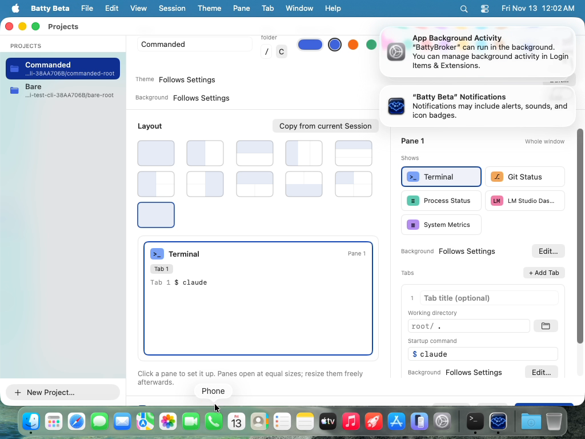

# 0597 — The Project Editor's footer falls below the window on a 768-point-tall screen when the Layout grid has a Custom tile

| | |
|---|---|
| **Status** | resolved |
| **Module** | Projects / Testing |
| **Platform** | macOS |
| **First seen** | 2026-11-12 |
| **Closed** | 2026-11-12 |
| **Branch** | `issue/0597` |

## Description

On a 1024x768 screen (the UI-test VM), the Project Editor's content needs more height than its window gets, so the footer (the run-startup-commands toggle, Cancel, Save, Save & Open) sits partly below the window's bottom edge. Clicks aimed at the footer land outside the window, on the Dock. This is an app layout bug: the footer should always stay inside the window.

It shows for a Project whose layout matches no preset. That Project gets an 11th Custom tile (`project-editor.layout.custom`), which adds a third row to the Layout grid. The Theme row added by #0584 (`ProjectThemeRow`, about 32 pt above the Background row) is the most likely change that tipped this case over the window height: the test passed at `a8c6f33b`, the last green full run.

Failing test: `BattyUITests/ProjectsEditorTests/testCommandsOffHintTracksTheToggleWhenCommandsExist`

- Full-suite run `20261112-153459-89425` (main `0cd7d2fb`) and isolated re-run `20261112-160020-98936`, both failing the same way:
  > XCTAssertTrue failed - the hint did not return when the toggle went off again
- Bundles: `build/ui-tests/<run-id>/UITests.xcresult`.

## Root cause

`ProjectEditorMain` stacked the header, Theme and Background rows, the Layout/Inspector `HStack` and the footer in a plain `VStack`. `ProjectLayoutSection` is rigid (the tile grid plus `PanePreview`'s 220 pt minimum), so with a Custom tile's third grid row the content's minimum height exceeded the ~652 pt window content on a 768 pt screen. `NSHostingView` centred the overflowing content, cutting off the Name field at the top and the footer at the bottom. Hypothesis from the evidence and arithmetic; not reproduced on a short screen here.

## Fix

As planned: the Layout column is wrapped in `ViewThatFits(in: .vertical)` with the unchanged section first and a `ScrollView` (`.scrollBounceBehavior(.basedOnSize)`) copy second, and the header, Theme, Background and footer rows get `.fixedSize(horizontal: false, vertical: true)` so the `HStack` absorbs the slack. Pure layout; no observed-state writes. No deviations.

## Verification

- `./build.sh` → `CHECK BUILD: PASSED`
- `./build.sh ui-typecheck` → `CHECK UI-TYPECHECK: PASSED`
- `./build.sh unit` → `CHECK UNIT: PASSED (3844 tests)`
- VM run `20261112-163023-28086` (orchestrator) with `ProjectsEditorTests/testCommandsOffHintTracksTheToggleWhenCommandsExist`, `testFooterStaysInsideTheWindowWithACustomLayout`, `testSavedSessionProjectHasTheRunToggleOn`, `testCancelLeavesTheStoredProjectUnchanged` → `CHECK UI: PASSED (4 tests)`.
- Reviewer re-run on the branch: `./build.sh` → `CHECK BUILD: PASSED`; `./build.sh ui-typecheck` → `CHECK UI-TYPECHECK: PASSED`; `./build.sh unit` → `CHECK UNIT: PASSED (3844 tests)`.

## Files changed

- `BattyKit/Sources/BattyKit/Views/ProjectEditorView.swift` — `ProjectEditorMain`: scrolling fallback for the Layout column; pinned rows at natural height.
- `BattyUITests/ProjectsEditorTests.swift` — new `testFooterStaysInsideTheWindowWithACustomLayout`.

## Gotchas

- Visual sign-off on a real short screen (or the window at its minimum height) is the user's: footer fully visible, Name field not cut off, Layout column scrolls; on a tall window the Pane preview still stretches.
- The new test resolves the window as `app.windows["project-editor"]`, falling back to the window containing `project-editor.save`; the VM run passed with it.
- `ViewThatFits` switches branches when a live resize crosses the fit threshold. That recreates `ProjectLayoutSection`, so `PanePreview`'s `@FocusState` resets. `ProjectLayoutSection` holds only `@Binding`s and has no `onAppear`/`task`, so nothing else resets or re-runs.

## Resolution notes

> 🟢 Resolved 2026-11-12 — the Layout column falls back to a ScrollView on short windows and the pinned rows keep their natural height, so the footer stays inside the window.

## Review

Approved first pass. Checked: pure layout, no observed-state writes; `ViewThatFits` renders only the chosen child, so no duplicate accessibility identifiers or side effects (the section has no `@State`, `onAppear` or `task`); the first branch is the unchanged section, so a tall window lays out as before; the new test's frame-containment assertion would fail on the evidence's pre-fix geometry (footer at y 705–729 in a window ending at y 710). The code comment matches the behaviour.

## Plan

Planned 2026-11-12 against `main` `c23465a0`.

### Premises checked

- Confirmed: `ProjectEditorMain` (`BattyKit/Sources/BattyKit/Views/ProjectEditorView.swift`) is a plain `VStack` of `ProjectHeaderFields`, `ProjectThemeRow`, `ProjectBackgroundRow` (when `showsBackground`), the `ProjectLayoutSection` / `PaneInspector` `HStack`, and `ProjectEditorFooter`. Only `PaneInspector` is in a `ScrollView`.
- Confirmed: `ProjectLayoutSection` is rigid. It has 32 pt of vertical padding, the header row, the `LazyVGrid` of 64x44 tiles, `PanePreview` with `.frame(minHeight: 220, maxHeight: .infinity)`, and the caption, with 14 pt spacing between them. At the VM's 1024 pt width, the column left after the 220 pt list and the 340 pt inspector holds 5 tiles per row. The 10 presets fill 2 rows, and the Custom tile (`project-editor.layout.custom`, shown only when `draft.layout.preset == nil`) starts a 3rd row, about 54 pt more.
- Confirmed: the window (`ProjectEditorWindowController.prepare`) asks for a 1120x740 content size and sets `contentMinSize` 960x620. AppKit already limited the frame to the visible screen (680 pt in the evidence), so the window size is not what's wrong. The SwiftUI content's minimum height is larger than the window's ~652 pt content height, so `NSHostingView` centres the content and it overflows at both ends. That is why the Name field is cut off at the top and the footer at the bottom, as the issue describes. `hosting.sizingOptions = []`, so the content never pushes the window size.
- The Theme row from #0584 (~32 pt) is the plausible tipping change. It doesn't matter for the fix, which removes the rigid minimum rather than shaving points off it.

### Approach (app layout only)

1. **`ProjectEditorView.swift`, `ProjectEditorMain`.** Let the Layout column give way when the window height is short, instead of the whole stack overflowing:
   ```swift
   ViewThatFits(in: .vertical) {
       ProjectLayoutSection(model: model, pendingPreset: $pendingPreset, pendingCopy: $pendingCopy)
       ScrollView(.vertical) {
           ProjectLayoutSection(model: model, pendingPreset: $pendingPreset, pendingCopy: $pendingCopy)
       }
       .scrollBounceBehavior(.basedOnSize)
   }
   ```
   in place of the bare `ProjectLayoutSection` inside the `HStack`.
   - When there is room, the first branch stays exactly as it is today: `PanePreview` stretches to fill the space (its ideal height is its 220 pt minimum, so `ViewThatFits` picks it whenever that minimum fits).
   - When there isn't room, the column scrolls. Inside a `ScrollView`, `PanePreview` gets a nil height proposal and settles at its 220 pt minimum, so the same view works in both branches. No new parameter is needed.
   - `ProjectLayoutSection` holds only `@Binding`s. `PanePreview`'s `@FocusState` resets if the branch switches during a live resize, which is acceptable. This is pure layout with no observed-state writes, so `docs/swiftui-observation-rules.md` is satisfied.
   - Precedent: `ViewThatFits` is already used in `LMStudioCompletionTable.swift` and `LMStudioDashboardView.swift`.
2. **Same struct: keep the pinned rows at their natural height.** Add `.fixedSize(horizontal: false, vertical: true)` to `ProjectHeaderFields`, `ProjectThemeRow`, `ProjectBackgroundRow` and `ProjectEditorFooter` at their call sites in `ProjectEditorMain` (or `.layoutPriority(1)` on the footer if `fixedSize` disturbs the header's `maxWidth` text field). The `HStack` then absorbs all the slack, and the footer always sits at the window's bottom edge.
   - Check by arithmetic: the pinned rows come to about 200 pt (header ~70, theme ~32, background ~32 to 50, footer ~48, dividers). At the 620 pt `contentMinSize` that leaves about 400 pt for the scrolling column and the inspector. So the footer fits at every height the window allows, which is the issue's expected behaviour.
3. **No change to `ProjectEditorWindowController`.** The window frame was already within the screen. Don't touch `contentMinSize` either: 620 stays reachable once the column scrolls.

### Tests

- **Unit:** none. This is a SwiftUI layout constraint with no model change, and BattyKit has no hosting-geometry harness for the editor. The guards for the editor model are the existing `ProjectEditorTests` / `ProjectBackgroundEditorTests` suites, which must still pass in the full `./build.sh unit`.
- **UI, existing:** `BattyUITests/ProjectsEditorTests/testCommandsOffHintTracksTheToggleWhenCommandsExist` needs no change. Its Project ("Commanded", a single terminal Pane with no `preset`) is exactly the Custom-tile case.
- **UI, new:** `ProjectsEditorTests.testFooterStaysInsideTheWindowWithACustomLayout`.
  - Store one Project built like "Commanded" (`ProjectFixture.terminal()`, no `preset`), open the editor with `openEditorFromFileMenu`, and click its list row.
  - Wait for `project-editor.layout.custom`.
  - Take the editor window as `app.windows["project-editor"]`, the `NSWindow.identifier`. If that query doesn't resolve in the type-check or VM run, fall back to the window that contains `project-editor.save`.
  - Assert that the window's `frame` contains the frames of `project-editor.run-commands`, `project-editor.cancel`, `project-editor.save` and `project-editor.save-open`.
  - Add it as a new method only. Use the existing `ProjectsUITestCase` helpers as they are and change none of them, because #0598, #0599 and #0600 edit this file and its helpers in parallel. Run `./build.sh ui-typecheck`.

### Verification

- **Tier: UI confirmation.** The issue was filed from a daily-run failure.
- Host checks: `./build.sh` → `CHECK BUILD: PASSED`, `./build.sh ui-typecheck` → `CHECK UI-TYPECHECK: PASSED`, `./build.sh unit` → `CHECK UNIT: PASSED (N tests)`.
- VM run (commit first): `tools/run-ui-tests-vm.sh` with these filters:
  - `BattyUITests/ProjectsEditorTests/testCommandsOffHintTracksTheToggleWhenCommandsExist`
  - `BattyUITests/ProjectsEditorTests/testFooterStaysInsideTheWindowWithACustomLayout` (new)
  - `BattyUITests/ProjectsEditorTests/testSavedSessionProjectHasTheRunToggleOn` (footer toggle and Save)
  - `BattyUITests/ProjectsEditorTests/testCancelLeavesTheStoredProjectUnchanged` (footer Cancel)
- `testEditorCreatesAProjectAndSaveAndOpenOpensIt` (#0598), `testCustomTabBackgroundIsWrittenToTheProject` (#0599) and `testSidebarSaveAsProjectRoundTripsTheSessionShape` (#0600) are owned by those issues. Don't add them here. A failure in them isn't this issue's to fix unless the failure is about the footer's position.

### User checklist

- On a small display, or with the Projects window resized to its minimum height, open File > Edit Projects… on a Project whose layout matches no preset (the Custom tile is showing). The footer (the toggle, Cancel, Save, Save & Open) stays fully visible. The Layout column scrolls, and the Name field is not cut off at the top.
- On a large window, the Pane preview still stretches to fill the height, as it did before.

### Open questions

None.

## Evidence

- The app UI hierarchy captured at the failure (re-run `20261112-160020-98936`) gives the editor window `{{0, 30}, {1024, 680}}`, so its bottom edge is y = 710. The footer controls are at `project-editor.run-commands` `{{241, 708}, {308, 17}}`, `project-editor.cancel` / `save` / `save-open` at y = 705, height 24. Their centres (about y = 716) are below the window. The toggle's value is still `1`: the second click, meant to turn it off, never reached it.
- The final video frame (attached) shows the editor's header scrolled up and cut off (the Name field is half hidden), the Layout grid with the third-row Custom tile, the footer hidden behind the Dock, and the pointer over the Dock's Phone icon, where the click landed.
- The Project in this test, "Commanded", is a single terminal Pane with no `preset`. The other three failing ProjectsEditorTests use preset layouts, and their final frames show the footer inside the window at y about 690.

## Steps to reproduce

1. Use a 1024x768 display (or the VM).
2. Store a Project with a single terminal Pane and no `preset`, then open File > Edit Projects… and select it.
3. Look at the bottom of the window.

## Expected behavior

The footer stays fully inside the window at every window height the window allows. Content that doesn't fit scrolls or compresses instead of pushing the footer out.

## Actual behavior

The footer sits at y 705 to 729 in a window that ends at y 710.

## Attachments



## Notes

- Code: `ProjectEditorMain` in `BattyKit/Sources/BattyKit/Views/ProjectEditorView.swift` stacks `ProjectHeaderFields`, `ProjectThemeRow`, `ProjectBackgroundRow`, the Layout/Inspector `HStack` and `ProjectEditorFooter` in a `VStack` with no scroll view around the left column. `ProjectLayoutSection`'s `PanePreview` has `.frame(minHeight: 220)`, and the window content is `.frame(minWidth: 960, minHeight: 620)`. Only the right-hand `PaneInspector` scrolls.
- Suspected commits since the last green run: `8d30d895` (#0584, the Theme row). `6ea4abcb` (#0585) and `1770d42b` (#0589) changed the same view but add height only inside the scrolling inspector.
- Fix is likely in the app (keep the footer pinned and let the upper content give way, for example by letting the Layout section shrink or scroll). The test needs no change once the footer is inside the window.

## Work log

| Date | Phase | Model | Effort | Wall | Build | Unit | UI | Turns | Output | Cache read | Cache write | Haiku | Cost | Outcome |
|---|---|---|---|---|---|---|---|---|---|---|---|---|---|---|
| 2026-11-12 | File (#0597-#0600) | claude-opus-5-5 | high | 4m | — | — | — | 36 | ~6,786 | 3,325,807 | 128,532 | — | $1.44 | filed |
| 2026-11-12 | Plan | claude-opus-5-5 | medium | 2m | — | — | — | 12 | ~3,176 | 719,705 | 63,914 | — | $0.53 | planned |
| 2026-11-12 | Implement | claude-opus-5-5 | low | 4m | 2 (1.7m) | 1 (1.3m) | — | 8 | ~2,073 | 411,609 | 42,184 | — | $0.33 | implemented |
| 2026-11-12 | Review | claude-opus-5-5 | medium | 1m | 2 (0.5m) | 1 (0.3m) | — | 7 | ~1,390 | 319,433 | 60,541 | — | $0.39 | resolved |

**Total: $2.69**
