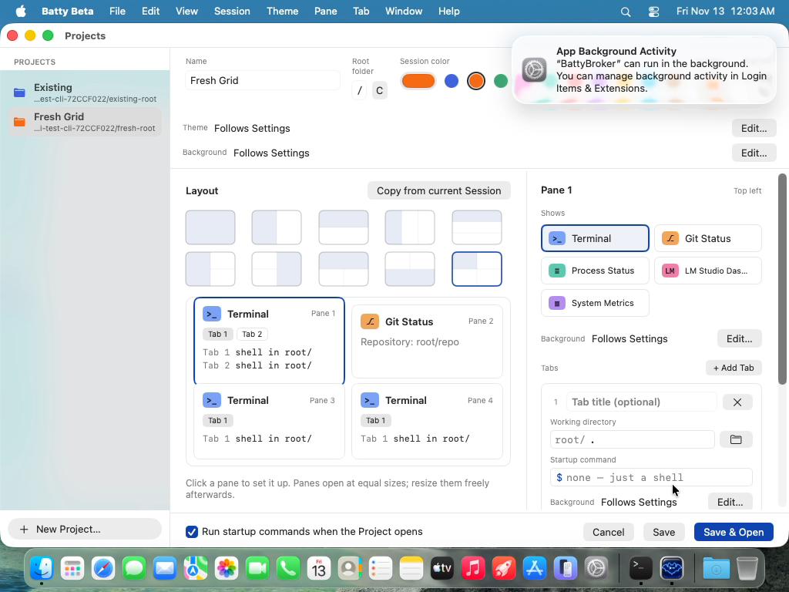

# 0598 — testEditorCreatesAProjectAndSaveAndOpenOpensIt types into Tab 2's title while it sits below the Pane inspector's visible area

| | |
|---|---|
| **Status** | open |
| **Module** | Testing / Projects |
| **Platform** | macOS |
| **First seen** | 2026-11-12 |

## Description

`ProjectsEditorTests/testEditorCreatesAProjectAndSaveAndOpenOpensIt` adds a second Tab to Pane 1 and types "Second" into `project-editor.tab.2.title`. The new Tab card is now below the visible part of the Pane inspector's scroll view, and the test doesn't scroll to it, so the click and the typing miss the field.

The inspector is taller since the last green run. #0589 added a Pane Background row (`PaneBackgroundRow`, `project-editor.pane.background.*`) above the Tabs, and #0585 added a Background row to every Tab card (`project-editor.tab.N.background.*`). Tab 1's card now fills the inspector's visible area down to the footer on a 768-pt screen.

This is a stale test, not an app bug: the inspector scrolls for a user, and the editor works. Once Tab 2 is scrolled into view, the test's steps are still valid.

Failing test: `BattyUITests/ProjectsEditorTests/testEditorCreatesAProjectAndSaveAndOpenOpensIt`

- Full-suite run `20261112-153459-89425` (main `0cd7d2fb`) and isolated re-run `20261112-160020-98936`, both failing the same way:
  > XCTAssertTrue failed - project-editor.tab.2.title holds Optional(), expected Second
- Bundles: `build/ui-tests/<run-id>/UITests.xcresult`.

## Evidence

The final video frame of the re-run (attached) shows Pane 1's preview card with "Tab 1" and "Tab 2" (the add worked). The inspector shows Pane 1's Shows grid, Background row, Tabs header and Tab 1's card down to its Background row at y about 650, where the visible area ends. Tab 2's card is out of view. The footer is visible and inside the window: this Project uses the 2x2 preset, so #0597's overflow doesn't apply.

## Expected behavior

The test brings Tab 2's card into view before it clicks the title field, and goes on to check that Save & Open opens the Project with a Tab titled Second in `sub`.

## Actual behavior

The click misses the field, so `tab.2.title` stays empty.

## Attachments

## Notes

- Test code: `BattyUITests/ProjectsEditorTests.swift`, the `replaceText(in: "project-editor.tab.2.title" …)` and `tab.2.directory` lines. The helper is `replaceText` in `BattyUITests/Support/ProjectsHarness.swift`: it calls `field.click()` with no scroll.
- Other tests that edit a lower Tab card, or any field below Tab 1, are exposed the same way. A shared scroll-into-view helper (for example, scrolling the inspector's `ScrollView` until the element is hittable) fixes them all.
- Suspected commits since the last green run (`a8c6f33b`): `6ea4abcb` (#0585, the Tab Background row) and `1770d42b` (#0589, the Pane Background row).
- Fix is in the test.
