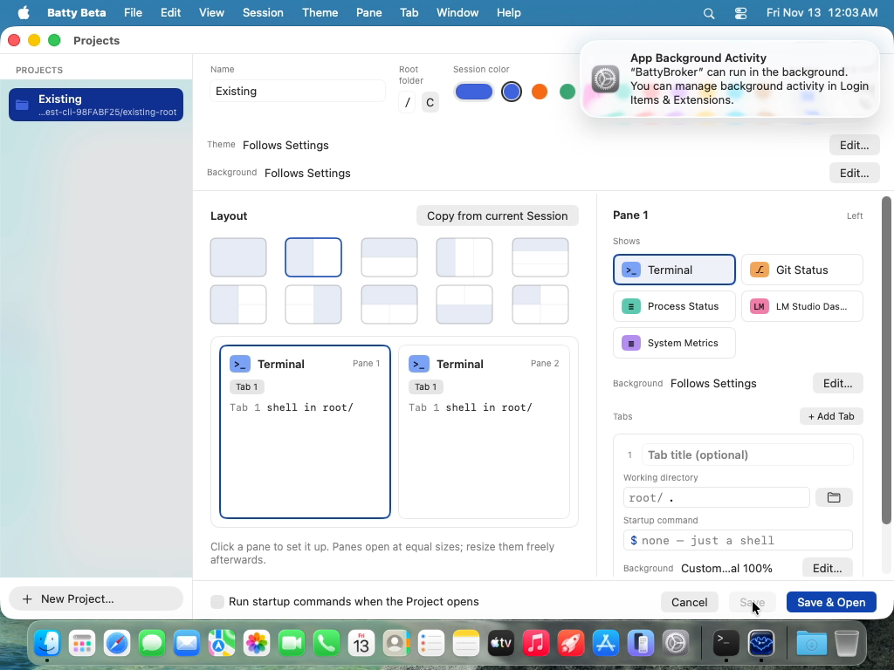

# 0599 — testCustomTabBackgroundIsWrittenToTheProject reads `layout.root.pane` on a split layout, so it can never pass

| | |
|---|---|
| **Status** | resolved |
| **Module** | Testing / Projects |
| **Platform** | macOS |
| **First seen** | 2026-11-12 |
| **Closed** | 2026-11-12 |
| **Branch** | `issue/0599` |

## Description

`ProjectsEditorTests/testCustomTabBackgroundIsWrittenToTheProject` looks for the saved Tab background at `layout.root.pane.tabs[0].background` in `projects.json`. The Project it edits, the shared `existingProject()` fixture, has a horizontal split at its root (`ProjectFixture.split("horizontal", [terminal, terminal])`). That root is encoded as `{"type": "split", "direction": …, "children": […]}` and has no `pane` key. So the predicate is always nil, whatever the app writes.

This is a test bug, not an app bug. The test was added by #0585 (`6ea4abcb`) after the last green full run (`a8c6f33b`), and its first VM run is this one.

Failing test: `BattyUITests/ProjectsEditorTests/testCustomTabBackgroundIsWrittenToTheProject`

- Full-suite run `20261112-153459-89425` (main `0cd7d2fb`) and isolated re-run `20261112-160020-98936`, both failing the same way:
  > XCTAssertTrue failed - Save did not write the Tab's background
- Bundles: `build/ui-tests/<run-id>/UITests.xcresult`.

## Resolution notes

> 🟢 Resolved 2026-11-12 — the test now reads the Tab background from the split root's first Pane, and passes in the VM.

## Review

- Round 1: approved first pass. The predicate's path (`layout.root.children[i].pane.tabs[0].background`) matches `ProjectLayoutNode.encode` and `ProjectTab.encode`; `fit` encodes as its raw value `"cover"` and `terminalOpacity` defaults to 1 (`TerminalBackgroundSettings`). Non-vacuous: `ProjectFixture.tab()`/`terminal()` write no `background`, and the predicate also requires its absence on Pane 1 and on Pane 2's Tab. No new comments.

## Root cause

Test bug, confirmed. `existingProject()` has a horizontal split at its root, encoded as `{"type":"split","children":[…]}` with no `pane` key, so the predicate's `root["pane"]` was always nil regardless of what Save wrote.

## Fix

Only the predicate of `testCustomTabBackgroundIsWrittenToTheProject` changed, per the plan. It reads `layout.root.children[0].pane` / `children[1].pane` and passes only when Tab 1 of the first Pane has a `background` dict with `terminalOpacity == 1`, `fit == "cover"` (the `TerminalBackgroundSettings` init defaults) and no `imagePath`, the first Pane has no `background`, and the second Pane's first Tab has no `background`. No deviation from the plan; fixture and shared helpers untouched.

## Verification

- `./build.sh` → `CHECK BUILD: PASSED`
- `./build.sh ui-typecheck` → `CHECK UI-TYPECHECK: PASSED`
- `./build.sh unit` → `CHECK UNIT: PASSED (3844 tests)` (`unit-20261112-161427-20052`). An earlier run reported `CHECK UNIT: FAILED (1 test)`; this change touches only a UI test file, so that was a flaky BattyKit test, and the immediate re-run passed.
- VM (orchestrator): `tools/run-ui-tests-vm.sh BattyUITests/ProjectsEditorTests/testCustomTabBackgroundIsWrittenToTheProject`, run `20261112-162804-27262` → `CHECK UI: PASSED (1 test)`
- Reviewer: `./build.sh` → `CHECK BUILD: PASSED`; `./build.sh ui-typecheck` → `CHECK UI-TYPECHECK: PASSED`

## Files changed

- `BattyUITests/ProjectsEditorTests.swift`: `testCustomTabBackgroundIsWrittenToTheProject` reads the split root's children and asserts the saved Tab background's values and its absence elsewhere.

## Gotchas

- One unrelated BattyKit unit test failed once and passed on re-run; not identified (the full log was not read, per the rules).

## Plan

**Premise check.** Confirmed against the code at `c23465a0`:
- `existingProject()` (`BattyUITests/ProjectsEditorTests.swift`) builds `ProjectFixture.split("horizontal", [terminal(), terminal()])`, stored as `{"type":"split","direction":…,"children":[{"type":"pane","pane":{…}}, …]}` (`BattyUITests/Support/ProjectsHarness.swift`). The root has no `pane` key, so the current predicate is always nil. Test bug.
- The editor opens with `selectedSlot = 0` (`ProjectEditorViewModel`), and slots follow `ProjectLayout.panes` (`children.flatMap(\.panes)`, depth-first). So `project-editor.tab.1` is Tab 1 of `children[0]`.
- App side is correct. "Custom" calls `BackgroundOverrideEditor.selectCustom()`, which writes the effective value. The Tab target's effective value comes from the Tab, then the Pane, then the Project, then the app-wide setting. Here that is the app-wide setting. `ProjectTabBackgroundTarget.setBackgroundOverride` calls `setTabBackground(slot:tabID:)`. `ProjectTab.encode` writes `background` with `encodeIfPresent`, and `TerminalBackgroundSettings.encode` always writes `fit`, `position`, `imageOpacity`, `terminalOpacity` and `opacityAffectsCells`, and writes `imagePath` only when set. `BattyKitTests/ProjectBackgroundEditorTests/tabEditMakesTheDraftDirtyAndSaveStoresIt` already proves that Save stores a Tab background. This is not an app bug.

**Files**
- `BattyUITests/ProjectsEditorTests.swift`: change only `testCustomTabBackgroundIsWrittenToTheProject`'s predicate. Leave the fixture and the UI steps as they are. Parallel issues #0597, #0598 and #0600 edit other tests in this file, so don't touch `existingProject()` or any shared helper.
  - Read `layout["root"]["children"]` as `[[String: Any]]` and take `children[0]["pane"]` and `children[1]["pane"]`.
  - Inside `waitFor`, return true only when all of these hold:
    1. `pane0.tabs[0]["background"]` is a `[String: Any]`.
    2. Its `terminalOpacity` is `1` (as `Double`/`NSNumber`) and its `fit` is `"cover"`. These match the app-wide default the Custom choice seeds from, and the attached frame shows "…Terminal 100%".
    3. It has no `imagePath` key.
    4. `pane0["background"] == nil`, so the value went to the Tab, not the Pane.
    5. `pane1.tabs[0]["background"] == nil`, so only the edited Tab changed.
  - This is not vacuous. The fixture's tabs (`ProjectFixture.tab()`) and panes carry no `background` key, so every key the predicate requires can only come from Save.
  - Optional: a short file-private helper `paneJSON(_ node:)` / inline casts. Keep it inside the test or as a `private` func next to it, not in `ProjectsHarness.swift`.
  - If the implementer finds the app-wide default is not off inside the VM (the assertion on `terminalOpacity`/`fit` fails while `background` exists), drop the value checks to "a dict containing `terminalOpacity` and `fit`" and record that in `## Fix`. Don't weaken checks 4 and 5.

**Tests**
- Changed: `BattyUITests/ProjectsEditorTests/testCustomTabBackgroundIsWrittenToTheProject`.
- Guards on the app side, unchanged: `BattyKitTests` `ProjectBackgroundEditorTests` (`tabEditMakesTheDraftDirtyAndSaveStoresIt`, `tabCustomSeedsFromTheProjectValue`).

**Verification: UI confirmation tier** (filed from a daily UI run failure)
- `./build.sh` → `CHECK BUILD: PASSED`
- `./build.sh ui-typecheck` → `CHECK UI-TYPECHECK: PASSED`
- `./build.sh unit` → `CHECK UNIT: PASSED`
- Commit, then run `tools/run-ui-tests-vm.sh BattyUITests/ProjectsEditorTests/testCustomTabBackgroundIsWrittenToTheProject`. It must pass.

**User checklist**
- None by hand. Optionally, in Batty Beta, set a Custom Tab background on Tab 1 of a split Project, Save, and check that `projects.json` holds it under `layout.root.children[0].pane.tabs[0].background`.

**Open questions:** none.

## Evidence

- The final video frame of the re-run (attached) shows Tab 1's Background summary "Custom…al 100%". Save is disabled, with the pointer on it. A Save button that goes disabled after the click means the editor isn't dirty any more: the save went through. (`canSave` requires `isDirty || isNewDraft`, and a successful `save()` calls `load(stored)`, which makes the stored Project the new baseline.)
- `ProjectFixture.split` and `ProjectFixture.terminal` in `BattyUITests/Support/ProjectsHarness.swift` give the shapes above. The sibling test `testCustomBackgroundIsWrittenToTheProject`, which checks the Project-level `background`, passes in the same runs.

## Expected behavior

The test finds Tab 1 of the first Pane in the stored layout, for example `layout.root.children[0].pane.tabs[0]`, or it uses a fixture with a single terminal Pane at the root, and passes when the app writes the Tab's background.

## Actual behavior

The predicate reads `root["pane"]`, which is nil for a split root.

## Attachments

## Notes

- The planner should confirm the app side once the path is right. The Save-disabled frame is good evidence that the write happened, but nothing in these runs reads the stored value.
- Suspected commit: `6ea4abcb` (#0585), which added the test.
- Fix is in the test.

## Work log

| Date | Phase | Model | Effort | Wall | Build | Unit | UI | Turns | Output | Cache read | Cache write | Haiku | Cost | Outcome |
|---|---|---|---|---|---|---|---|---|---|---|---|---|---|---|
| 2026-11-12 | Plan | claude-opus-5-5 | medium | 1m | — | — | — | 12 | ~2,460 | 644,546 | 52,009 | — | $0.44 | planned |
| 2026-11-12 | Implement | claude-opus-5-5 | low | 4m | — | 1 (0.5m) | — | 9 | ~1,516 | 430,168 | 36,035 | — | $0.30 | implemented |
| 2026-11-12 | Review | claude-opus-5-5 | medium | 52s | 2 (0.4m) | — | — | 8 | ~1,350 | 397,339 | 62,793 | — | $0.42 | resolved |

**Total: $1.16**
