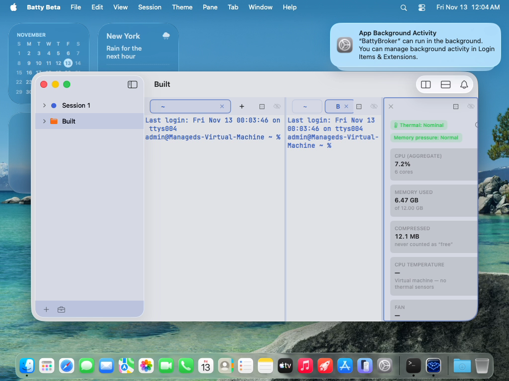

# 0600 — testSidebarSaveAsProjectRoundTripsTheSessionShape still expects a reopened Project to open at equal sizes, but #0589 restores Split sizes

| | |
|---|---|
| **Status** | resolved |
| **Module** | Testing / Projects |
| **Platform** | macOS |
| **First seen** | 2026-11-12 |
| **Closed** | 2026-11-12 |
| **Branch** | issue/0600 |

## Description

`ProjectsEditorTests/testSidebarSaveAsProjectRoundTripsTheSessionShape` drags a divider to make the Session's Panes unequal, saves the Session as a Project, closes it, reopens the Project, and then requires the reopened Panes to be equal (width spread < 12 pt). Its comment says "Split ratios are not captured by Save as Project."

That stopped being true with #0589. The user decided (`issues/0589.md`, "User decisions (2026-11-12)") that a Project is a full snapshot, and that Save as Project and Update Project capture everything a Session holds, Split sizes included. `Concepts.md` now says: "**Pane sizes:** stored as each Split's child fractions, captured by Update Project and restored at open (#0589)." `issues/0589.md` also notes that the unit test `SessionProjectRoundTripTests/aHandResizedSessionOpensAsTheSameShapeAtEqualSizes` encoded the old rule.

So the app now does what was decided, and this test encodes the old behaviour. It's a stale test, not an app bug.

Failing test: `BattyUITests/ProjectsEditorTests/testSidebarSaveAsProjectRoundTripsTheSessionShape`

- Full-suite run `20261112-153459-89425` (main `0cd7d2fb`) and isolated re-run `20261112-160020-98936`, both failing the same way:
  > XCTUnwrap failed: expected non-nil value of type "CLITopology" - the reopened Project did not open at equal sizes
- Every earlier assertion passes: Pane kinds, Tab counts and the renamed "Build" Tab survive the round trip.
- Bundles: `build/ui-tests/<run-id>/UITests.xcresult`.

## Resolution notes

> 🟢 Resolved 2026-11-12 — The round-trip UI test now requires the reopened Project to restore the dragged Split widths (per Pane, within 8 pt) and stay unequal, matching #0589's snapshot rule.

## Review

Approved first pass. Checked: the new wait is non-vacuous (the drag must reach a > 40 pt spread, so equal reopened widths miss the 8 pt per-Pane tolerance by > 12 pt, and the explicit spread > 20 assertion fails independently); nil-width matching keeps the view Pane aligned by index, as `kinds` is already compared by index; the edited comment makes no capture claim; no sleeps added, only `waitForTopology` waits. The extra `waitForTopology { _ in true }` for the failure message runs on success too, costing one CLI call; harmless.

## Root cause

The test encoded the pre-#0589 rule that Save as Project does not capture Split sizes, so it waited for the reopened Panes to be equal. Since #0589 a Project restores Split fractions, so the reopened Panes keep the dragged widths and the wait never matched.

## Fix

Test-only, per the plan: the comment no longer claims ratios are not captured; the pre-save drag must now produce a width spread > 40 pt; the widths before saving are recorded per Pane (nil for the view Pane) and the reopened Session must match them index by index within 8 pt (20 s wait), with the failure message printing before and last-observed widths; then the reopened spread must exceed 20 pt. No deviations.

## Verification

- `./build.sh` -> `CHECK BUILD: PASSED`
- `./build.sh ui-typecheck` -> `CHECK UI-TYPECHECK: PASSED`
- `./build.sh unit` -> `CHECK UNIT: PASSED (3844 tests)`
- VM re-run of `BattyUITests/ProjectsEditorTests/testSidebarSaveAsProjectRoundTripsTheSessionShape` (orchestrator, run `20261112-161431-20183`) -> `CHECK UI: PASSED (1 test)`
- Reviewer: `./build.sh` -> `CHECK BUILD: PASSED`; `./build.sh ui-typecheck` -> `CHECK UI-TYPECHECK: PASSED`

## Files changed

- `BattyUITests/ProjectsEditorTests.swift` — `testSidebarSaveAsProjectRoundTripsTheSessionShape` asserts restored Split sizes instead of equal sizes.

## Plan

Written 2026-11-12 against `issue/0600` at `c23465a0`. Test-only change; no app code.

**Premises checked.** The test (`BattyUITests/ProjectsEditorTests.swift:108-180`) waits for a reopened width spread < 12 pt (`:175-178`) and its comment (`:119-120`) says ratios are not captured. #0589's User decisions make a Project a full snapshot including Split sizes (`ProjectLayout.splitFractions`, restored by `ProjectTreeBuilder`). Grep of `BattyUITests` and `BattyKit/Tests` for "equal sizes" / "EqualSizes" / "not captured by Save" finds only this test, so no other test needs the same fix. The system-metrics Pane is a view Pane and reports no `frame`, so the widths compared are the two terminal Panes'.

**File:** `BattyUITests/ProjectsEditorTests.swift`, only inside `testSidebarSaveAsProjectRoundTripsTheSessionShape`. Do not touch other tests or shared helpers (#0597, #0598, #0599 edit the same file in parallel).

**Approach.**
1. Comment at `:119-120`: replace with one line saying Panes open at equal sizes, so the drag makes sizes that a restore can be told apart from equal. Drop "Split ratios are not captured by Save as Project."
2. Non-vacuity: keep the drag, but raise the `unequal` wait from `spread($0) > 20` to `spread($0) > 40` (the drag moves the divider 60 pt, so equal-vs-dragged differ by well over the match tolerance below). Keep its failure message.
3. After `before` is captured, record `let beforeWidths = before.panes.map { $0.frame?.width }` (index-aligned with Pane order; nil for the view Pane). Pane order already round-trips, since `kinds` is compared by index at `:171`.
4. Replace the `sized` wait (`:175-179`) with a wait (`includeDimensions: true`, timeout 20) for a topology where the reopened session's `panes.map { $0.frame?.width }` has the same count and nil positions as `beforeWidths`, and every non-nil pair differs by at most 8 pt. The reopened Session opens in the same app window, so absolute widths are comparable; 8 pt covers divider rounding and the 4-decimal fraction rounding. Failure message: "the reopened Project did not restore the Split sizes captured before saving: before \(beforeWidths), after <last observed widths>" (fetch one `BattyCLI.waitForTopology(includeDimensions: true) { _ in true }` for the message, or just print `beforeWidths`).
5. Then assert explicitly that the restored layout is not equal: `XCTAssertGreaterThan(spread over the reopened session's widths, 20, "the reopened Panes are equal; sizes were not restored")`. Write a small local `spread(of widths: [CGFloat])` or generalize the existing `spread` to take a session id; keep it local to the test. Keep `XCTAssertEqual(...panes.count, 3)`.

Why this fails if sizes are not restored: equal reopened widths differ from `beforeWidths` by spread/2 > 20 pt (step 2), well over the 8 pt tolerance, and step 5 independently fails at spread < 20.

**Tests:** no new tests; the one test above is updated.

**Verification tier: UI confirmation** (a UI test is the change). Implementer: `./build.sh` and `./build.sh ui-typecheck` pass, `./build.sh unit` pass (fast tier), commit, then VM re-run with filter `BattyUITests/ProjectsEditorTests/testSidebarSaveAsProjectRoundTripsTheSessionShape` via `tools/run-ui-tests-vm.sh`. Reviewer re-runs the same filter.

**User checklist:** none beyond the VM run passing; no app behaviour changes.

## Evidence

The final video frame of the re-run (attached) shows the reopened Project "Built" with the hand-dragged, unequal Pane widths restored. The leftmost terminal Pane is visibly wider than the other terminal Pane.

## Expected behavior

The test asserts the #0589 rule: the reopened Panes have the same widths as the `before` topology captured after the drag (within a small tolerance), not equal widths. The stale comment goes.

## Actual behavior

The test waits for equal widths, which the app no longer produces, and the unwrap fails.

## Attachments

## Notes

- Suspected commit: `1770d42b` (#0589, "Capture and restore a whole Session in its Project"). The decision is recorded in `09c62064`.
- `ProjectsOpenTests` and other UI tests that assert "opens at equal sizes" after a capture may carry the same stale expectation. They didn't fail in this run, but the planner should grep for them.
- Fix is in the test.

## Work log

| Date | Phase | Model | Effort | Wall | Build | Unit | UI | Turns | Output | Cache read | Cache write | Haiku | Cost | Outcome |
|---|---|---|---|---|---|---|---|---|---|---|---|---|---|---|
| 2026-11-12 | Plan | claude-opus-5-5 | medium | 45s | — | — | — | 6 | ~1,698 | 288,524 | 41,120 | — | $0.30 | planned |
| 2026-11-12 | Implement | claude-opus-5-5 | low | 4m | 2 (3.0m) | — | — | 8 | ~1,492 | 402,123 | 40,322 | — | $0.31 | implemented |
| 2026-11-12 | Review | claude-opus-5-5 | medium | 49s | 2 (0.4m) | — | — | 6 | ~989 | 293,959 | 42,110 | — | $0.29 | resolved |

**Total: $0.90**
