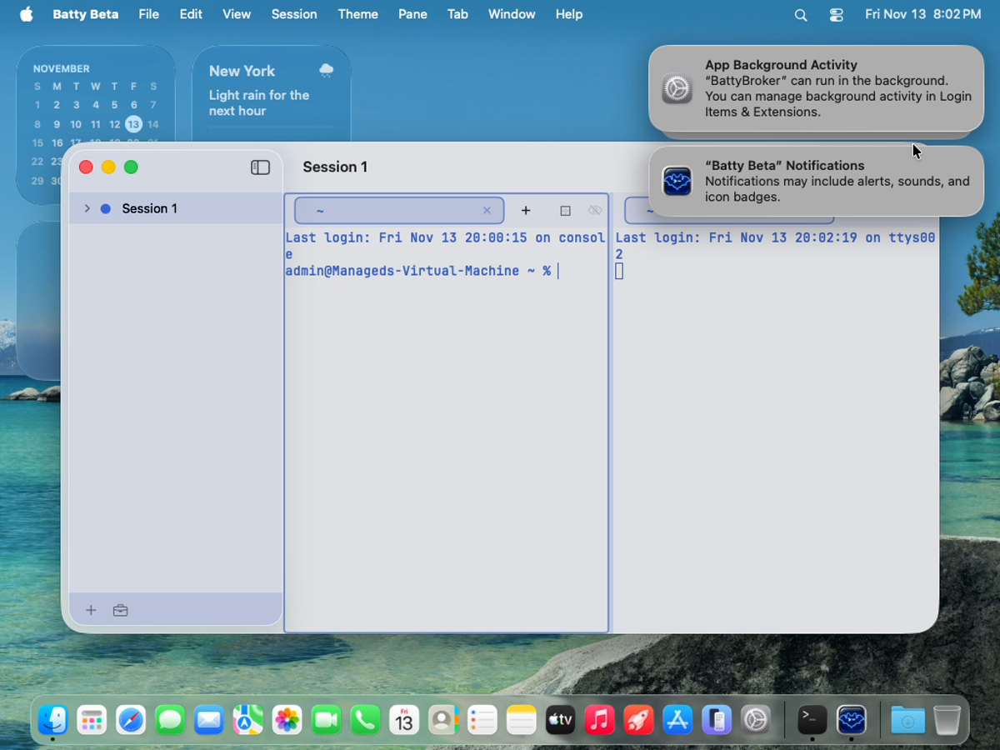

# 0622 — First-launch macOS banners in the fresh UI-test VM cover the window's top-right toolbar, so the first test to click there can hit a banner instead of the button

| | |
|---|---|
| **Status** | resolved |
| **Module** | Testing |
| **Platform** | macOS |
| **First seen** | 2026-11-13 |
| **Priority** | medium |

## Description

**Related to #0620 and #0609.** Each UI-test VM is a fresh clone. Two persistent macOS banners appear at the top right of the guest's screen, over the Batty window's trailing toolbar, where the Bell Feed button sits:

- "App Background Activity: 'BattyBroker' can run in the background…". It is raised when `tools/vm-guest-broker.sh` bootstraps the broker LaunchAgent, just before the tests run.
- "'Batty Beta' Notifications: Notifications may include alerts, sounds, and icon badges." It is raised on the app's first launch, when `AppStateStore.installNotifier()` calls `BellNotifier.ensureAuthorization()` (`UNUserNotificationCenter.requestAuthorization`).

Both stay up until someone closes them. In VM run `20261113-115957-4796` (on the since-removed `issue-0609` worktree), `BellFeedTests/testBellByteProducesFeedEntry` ran first. `BattyScreen.openBellFeed(in:)` clicked `app.toolbars.buttons["Bell Feed"]`, the click landed on a banner, and the test failed. The frame below, taken from that test's screen recording, shows both banners covering the toolbar's right end.

Goal: no test's first toolbar click can land on a first-launch banner. The runner or guest setup should clear these banners, or keep them from appearing, before any test runs, so individual test classes don't each need their own workaround.

## Plan

Written 2026-11-13 against `issue/0622` at `27c47657`. Test-side only (option 1): no runner, guest or golden-image change, no app change.

### Premises checked

- Confirmed: `BattyUITestHarness.launchBatty` (both overloads, `Support/BattyUITestHarness.swift:24-52`) holds the target's only two `app.launch()` calls. `BattyCLI.launchConnected`, `ProjectsUITestCase.launchApp` and every class's private `launch…` helper go through it, so it is the one shared launch path.
- Confirmed: two near-identical `dismissBanners()` copies with the same predicate and the same hover → `AXNotificationListItems` Close → swipe fallback: `ViewGalleryTests.swift:197-212` (private, returns `Bool`, ends with `pause(1.5)`) and `Support/ProjectsHarness.swift:433-444` (instance method on `ProjectsUITestCase`, used by `ProjectsSymbolTests`, `ProjectsSharingTests` and `DemoSceneTests`). `DemoSceneTests.launchScene` (`:143-147`) also loops `dismissBanners(); beat(1.0)` six times because the banner "arrives a few seconds after launch".
- Confirmed: `BattyScreen.openBellFeed(in:)` (`Support/BattyCLIHarness.swift:376-387`) clicks `app.toolbars.buttons["Bell Feed"]` with no banner handling. `SessionReminderTests` has its own `openBellFeed` that uses Cmd-Shift-B, so it is not exposed.
- Confirmed: the notifications banner comes from `AppStateStore.installNotifier()` → `BellNotifier.ensureAuthorization()` → `requestAuthorization`, guarded only by a per-process flag. So **every** app launch requests authorization. Whether macOS shows the banner again on a later launch after it was closed without a choice is unknown (see Gotchas). The design below covers both cases without paying a wait on every launch.
- The other `toolbars.buttons[...]` clicks in the target are `"Appearance"` in Settings windows (top left/centre, not under the banners). They are covered by the launch-path sweep anyway.
- Confirmed stale: `docs/ui-testing-vm.md` "The golden image" (`:106-137`) names `batty-uitest-golden`, cloned from Changeover's, with a rebuild recipe, while `tools/run-ui-tests-vm.sh:96-145` resolves the one shared golden with `tart-golden require --xcode 27.0`. The runner's own failure message at `tools/run-ui-tests-vm.sh:272` still says `tart clone changeover-uitest-golden $GOLDEN`, which is stale too.

### Files

1. **New `BattyUITests/Support/GuestBanners.swift`** (`// GuestBanners.swift` header; the target is a synchronized folder, no pbxproj edit).
   `nonisolated enum GuestBanners` with:
   - `static let predicate`: the existing `NSPredicate` (`label CONTAINS 'can run in the background' OR label CONTAINS 'Notifications may include' OR title CONTAINS 'App Background Activity'`), plus a `notificationsPredicate` for the `'Notifications may include'` banner alone.
   - `@MainActor @discardableResult static func dismissAll() -> Bool`: the merged loop body of the two copies. Up to 4 passes: find `firstMatch` in `XCUIApplication(bundleIdentifier: "com.apple.notificationcenterui")`; `guard banner.exists else break`; hover; click `center.groups["AXNotificationListItems"].buttons["Close"].firstMatch` if it appears within 2 s, else `swipeRight()`; then `BattyUITestHarness.waitFor({ !banner.exists }, timeout: 5)`. Return whether anything was dismissed. **No `pause`.** The only waits are predicate waits that return as soon as the banner is gone or the Close button exists. Each is bounded as a failure guard.
   - `@MainActor private static var firstLaunchSettled = false`.
   - `@MainActor static func settleAfterLaunch()`: if `!firstLaunchSettled`, wait up to 10 s with `BattyUITestHarness.waitFor` for the notifications banner to exist (it returns the moment it appears), then set `firstLaunchSettled = true` whether or not it appeared. Then always call `dismissAll()`. Result: the first launch in a runner process pays at most 10 s, once. Each later launch pays only an immediate query when no banner is up. The background-activity banner is already up before the tests start, so the immediate sweep catches it.
   - Doc comment: the *why*. Both banners are persistent, they sit over the trailing toolbar, the golden image is shared and not ours to change, and the notifications banner arrives asynchronously after the first launch. No issue numbers in the explanation. Grep every claim.
2. **`BattyUITests/Support/BattyUITestHarness.swift`**
   - In both `launchBatty` overloads, call `GuestBanners.settleAfterLaunch()` right after `app.launch()`, before `return app`.
   - In the `extension XCTestCase` forwarders (`:222-236`), add `@MainActor @discardableResult func dismissBanners() -> Bool { GuestBanners.dismissAll() }`, so existing call sites compile unchanged.
3. **`BattyUITests/Support/ProjectsHarness.swift`**: delete `dismissBanners()` and its `// MARK: - Banners` block (`:429-444`). Calls in `ProjectsSymbolTests`, `ProjectsSharingTests` and `DemoSceneTests` resolve to the `XCTestCase` forwarder.
4. **`BattyUITests/ViewGalleryTests.swift`**: delete the private `dismissBanners()` (`:190-212`). `capture` keeps its calls: the first `dismissBanners()` and the `for _ in 0..<5 { if !dismissBanners() { break } }` loop now hit the forwarder, which returns `Bool`.
5. **`BattyUITests/DemoSceneTests.swift:143-147`**: replace the six-pass `dismissBanners(); beat(1.0)` loop and its comment with one `dismissBanners()`. `launchApp` → `launchBatty` has already settled the banners.
6. **`BattyUITests/Support/BattyCLIHarness.swift` `BattyScreen.openBellFeed`**: call `GuestBanners.dismissAll()` after the `bell.waitForExistence` assertion and before `bell.click()`. This catches a banner that shows up late, or again on a later launch. When no banner is up it is one cheap query.
7. **`docs/ui-testing-vm.md`**
   - "The golden image": change the Name/Made rows to say the runner resolves one shared golden for every project on this host with `tart-golden require --xcode 27.0` (Homelab `protocols/tart-golden/PROTOCOL.md`), not a literal name. Agents never build, rebuild or modify it. Replace the "Rebuilding" block with a pointer to that protocol (a user action). Mark the remaining rows (guest OS, CPU/memory, disk, hardening) as recorded 2026-09-23 for the earlier per-project image, or drop the rows that no longer apply. Fix the "never touch another project's golden" paragraph so it doesn't imply Batty has its own clone.
   - "Banners" bullet (`:227-229`): every launch goes through `GuestBanners.settleAfterLaunch()` (from `launchBatty`), which waits once per runner process for the notifications banner and closes any banner up. `BattyScreen.openBellFeed` sweeps again before its click. Tests call `dismissBanners()` before clicks of their own near the top right.
8. **`tools/run-ui-tests-vm.sh:272`** (tools/, not the restricted `scripts/`): change the failure text's `tart clone changeover-uitest-golden $GOLDEN` hint to point at `tart-golden` / `docs/ui-testing-vm.md`. Message text only, no logic.

### Tests

- No new unit tests (no BattyKit change). No new UI test class. The fix is harness code exercised by every launch, and its acceptance check is the issue's repro run.
- Guards: `BellFeedTests` (all three tests use `BattyScreen.openBellFeed`), `BellFeedRatingTests`, `CLIBackgroundSessionTests`, `ProjectsSymbolTests`, `ProjectsSharingTests` (previous helper users). `ViewGalleryTests` and `DemoSceneTests` are on request only and not part of the confirmation.

### Verification

- Host: `./build.sh` → `CHECK BUILD: PASSED`, `./build.sh ui-typecheck` → `CHECK UI-TYPECHECK: PASSED`, `./build.sh unit` → `CHECK UNIT: PASSED (N tests)` (fast tier, mandatory even with no BattyKit change).
- UI confirmation, **run by the orchestrator** (one VM at a time; commit first, since the runner tests `git archive HEAD`):
  1. `tools/run-ui-tests-vm.sh BattyUITests/BellFeedTests/testBellByteProducesFeedEntry`: the issue's repro, a fresh clone with that test as the first toolbar click. Must pass.
  2. `tools/run-ui-tests-vm.sh BattyUITests/BellFeedTests BattyUITests/ProjectsSymbolTests BattyUITests/ProjectsSharingTests`: several launches in one process, covering the second-launch path and the consolidated helper's earlier users.
  Quote each run id, `==> RESULT:` and `CHECK UI:` line. If a recording is available, check run 1's first frames show the banners closing before the click.

### Gotchas to record

- Unknown whether the notifications banner reappears on later launches after being closed without a choice. The `openBellFeed` sweep covers the Bell Feed case. Run 2 shows whether later classes still see it. If they do and another top-right click fails, the follow-up is calling `dismissBanners()` in that helper, not a per-launch wait.
- Dropping `pause(1.5)` from the gallery copy means a gallery screenshot could, in principle, catch the banner's slide-out animation. The gallery is on request only. Note it rather than adding a fixed wait back.
- A 10 s first-launch cost per runner process when the banner never appears (e.g. on a guest where authorization was already decided).

### User checklist

- Nothing visual in the app changes. Optionally look at run 1's recording: the banners close before the Bell Feed click.
- Decide separately whether to pre-grant notifications or background items in the shared golden (user action, affects other projects). Not needed for this fix.

### Open questions

None blocking.

## Resolution

New `BattyUITests/Support/GuestBanners.swift` merges the two `dismissBanners()` copies into `GuestBanners.dismissAll()` (bounded predicate waits only, no `pause`). Both `launchBatty` overloads call `GuestBanners.settleAfterLaunch()` after `app.launch()`: the first launch per runner process waits up to 10 s for the notifications banner (returns as soon as it appears), then every launch sweeps any banner that is up. `BattyScreen.openBellFeed` sweeps again before its click. An `XCTestCase.dismissBanners()` forwarder keeps existing call sites; the private copies in `ViewGalleryTests` and `ProjectsHarness` are gone, and `DemoSceneTests.launchScene`'s six-pass loop is one call. `docs/ui-testing-vm.md` "The golden image" now describes the shared `tart-golden` lookup instead of `batty-uitest-golden`, and its "Banners" bullet describes the new flow; the runner's missing-golden message no longer suggests `tart clone changeover-uitest-golden`.

The predicates are computed properties because a stored `static let NSPredicate` is rejected as non-Sendable global state.

## Verification

- `./build.sh`: CHECK BUILD: PASSED
- `./build.sh ui-typecheck`: CHECK UI-TYPECHECK: PASSED
- `./build.sh unit`: CHECK UNIT: PASSED (4050 tests)
- VM runs (plan's runs 1 and 2): pending, run by the orchestrator.

## Review notes

Reviewed 2026-11-13 (`git diff main...HEAD`). Resolved.

- `GuestBanners.dismissAll()` uses only bounded predicate waits (2 s for Close, 5 s for the banner to go, at most 4 passes) and queries/clicks only inside `com.apple.notificationcenterui`, so it cannot click the app window. With no banner up it is one query and returns.
- `settleAfterLaunch()` is called from both `launchBatty` overloads; the 10 s wait runs once per runner process and is not repeated when no banner appears.
- The removed copies had no behaviour the helper lacks except the gallery's `pause(1.5)` and DemoSceneTests' six 1 s re-sweeps after every launch. The first launch is now covered by the one-time wait; later DemoScene launches rely on the per-launch sweep (DemoSceneTests is on request only; same gotcha as the notifications-reappearance unknown below).
- Doc and runner message text checked: the script change is message text only. `AGENTS.md` ("UI test automation") still says VMs are cloned "from the `batty-uitest-golden` image"; left as-is since AGENTS.md is binding guidance outside this issue's scope, worth a one-line follow-up.
- Re-ran: `./build.sh` CHECK BUILD: PASSED; `./build.sh ui-typecheck` CHECK UI-TYPECHECK: PASSED; `./build.sh unit` CHECK UNIT: PASSED (4050 tests). VM confirmation runs are the orchestrator's, before merge.

## Gotchas

- Unknown whether the notifications banner reappears on later launches after being closed without a choice; the `openBellFeed` sweep covers the Bell Feed case.
- With the gallery's `pause(1.5)` dropped, a gallery screenshot could in principle catch the banner's slide-out animation (gallery is on request only).
- First launch per runner process costs up to 10 s if the notifications banner never appears.

## Steps to reproduce

1. Run `tools/run-ui-tests-vm.sh BattyUITests/BellFeedTests/testBellByteProducesFeedEntry` (a fresh clone, with that test as the first one to touch the toolbar).
2. Watch the recording or the failure screenshot.

## Expected behavior

The Bell Feed toolbar button receives the click and the Bell Feed opens.

## Actual behavior

The two banners cover the top-right of the screen. The click hits a banner, the Bell Feed doesn't open, and `openBellFeed`'s "the Bell Feed did not open" assertion fails. Whether this happens depends on test order: only the first toolbar click after the banners appear is at risk, until someone closes them.

## Attachments

## Notes

- **The workaround exists today, but only per class.** Two copies of a `dismissBanners()` helper hover each banner in `com.apple.notificationcenterui` and click Close (with a swipe as fallback): a private one in `BattyUITests/ViewGalleryTests.swift`, and `BattyUITests/Support/ProjectsHarness.swift`'s, used by `ProjectsSharingTests` and `ProjectsSymbolTests`. `docs/ui-testing-vm.md` ("View gallery screenshots", "Banners") documents that both banners are persistent. `BattyScreen.openBellFeed` and the shared launch path (`BattyCLI.launchConnected`) do not dismiss them. Any test that clicks the trailing toolbar first is exposed.
- **The golden image is out of scope for agents.** `tools/run-ui-tests-vm.sh` resolves one shared golden for every project on this host through `tart-golden require --xcode 27.0`, per the Homelab `protocols/tart-golden/PROTOCOL.md`. `AGENTS.md` authorizes agents to clone and delete `batty-uitest-*` VMs only, not to modify the golden. Pre-granting notifications or pre-approving background items in the image itself is a user action, and it would affect other projects. The fix should be runner-side or test-side unless the user decides otherwise. (`docs/ui-testing-vm.md` still says the golden is `batty-uitest-golden`, cloned from Changeover's. That is stale next to the runner's `tart-golden` lookup.)
- **Options for the planner** (not yet evaluated):
  1. Consolidate the two `dismissBanners()` copies into one shared harness helper. Call it once per app launch from the common launch path (or at least from `BattyScreen.openBellFeed` and the other trailing-toolbar helpers) after the window appears. This needs no change to the runner or the guest.
  2. A runner step after `vm-guest-broker.sh` that closes the background-activity banner before `test-without-building`. `docs/ui-testing-vm.md` notes that `osascript` to System Events hangs on an Automation prompt in the guest, so this would need a different mechanism. The notifications banner only appears when the app first launches, which happens inside the test run, so a runner step cannot clear it beforehand unless the app is launched once ahead of the tests.
  3. Pre-grant notification authorization for `co.sstools.Batty.beta` in the disposable clone before the tests (runner-side, in the guest only). Notification permissions live in `usernoted`'s private store, which has no supported command-line interface, so this is likely fragile. Don't turn off the guest's notification settings: `docs/ui-testing-vm.md` (step 3 of "What the runner does") says their defaults are part of what the suite runs against, and some tests post real banners (`CLIBackgroundSessionTests`, `BellFeedTests`).
- Verification: a VM run that puts `BellFeedTests/testBellByteProducesFeedEntry` first on a fresh clone (the filter above), plus `./build.sh ui-typecheck` if `BattyUITests` changes.

## Work log

| Date | Phase | Model | Effort | Wall | Build | Unit | UI | Turns | Output | Cache read | Cache write | Haiku | Cost | Outcome |
|---|---|---|---|---|---|---|---|---|---|---|---|---|---|---|
| 2026-11-13 | plan | claude-opus-5-5 | medium | 2m | — | — | — | 12 | ~4,305 | 776,422 | 96,076 | — | $0.72 | done |
| 2026-11-13 | implement | claude-opus-5-5 | low | 5m | 4 (3.7m) | 1 (0.5m) | — | 11 | ~3,284 | 675,975 | 55,630 | 1 ($0.002) | $0.48 | done |
| 2026-11-13 | review | claude-opus-5-5 | medium | 2m | 2 (0.9m) | 1 (0.5m) | — | 7 | ~1,110 | 391,668 | 52,945 | — | $0.37 | resolved |

**Total: $1.57**
