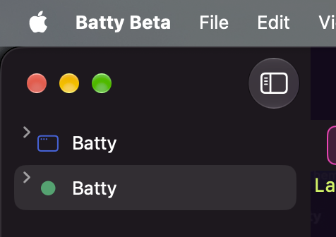

# 0627 — Sidebar disclosure chevrons moved to the row's top-left edge after the NSOutlineView rewrite

| | |
|---|---|
| **Status** | resolved |
| **Module** | Sidebar |
| **Platform** | macOS |
| **First seen** | 2026-11-13 |
| **Priority** | high |
| **Closed** | 2026-11-13 |
| **Branch** | issue/0627 |

## Description

The Sidebar's disclosure chevrons are in the wrong place since #0619 (`bc956752`), which replaced the SwiftUI `List` + `DisclosureGroup` with an `NSOutlineView` of `NSHostingView` cells. The user, verbatim: "That chevron placement is totally wrong. That should not have changed."

In the screenshot each Session row's chevron sits at the far-left edge of the row, above its vertical centre, roughly level with the top of the title text. It is at or past the leading edge of the selection highlight instead of centred in the row. This is a user-reported 1.4.0 regression.

**Requirement:** chevron placement — horizontal position, vertical centring, indentation and size — must match the pre-#0619 Sidebar exactly. Rows must match too. No change to row height or spacing was approved: `issues/0619.md` only lists the new row heights and indentation under Gotchas as "Needs the user's visual sign-off" (User checklist item 1: "row heights and indentation close to before"). There is no "tighter rows" approval in `issues/0619.md` or in any other issue (`grep -il "tighter row" issues/*.md` finds nothing). This report is the user withholding that sign-off.

The fix must also confirm that nothing else in the Sidebar's look changed versus pre-#0619, and list every difference found (see "Look audit" below).

## Steps to reproduce

1. Build and run Batty Beta at `main` (any commit since `bc956752`).
2. Open two Sessions, one of them Project-backed so it shows a symbol icon.
3. Look at the Sidebar rows, collapsed and expanded, selected and unselected.
4. Compare with a build of `bc956752^` (pre-#0619).

## Expected behavior

The chevron is where the pre-#0619 `List(.sidebar)` + `DisclosureGroup` drew it: same x offset, vertically centred on the row, same size, inside the row's selection highlight, with the same indentation for the Session label and Pane child rows.

## Actual behavior

The chevron sits at the row's top-left: about level with the top of the title text, and at the leading edge of the selection highlight (see the selected second row in the screenshot).

## Attachments

## Notes

### What changed in #0619

Pre-#0619 (`git show bc956752^:BattyKit/Sources/BattyKit/Views/SessionSidebarView.swift`):

- `List(selection:)` at line 78, `.listStyle(.sidebar)` at line 105, `.scrollContentBackground(...)` at line 106.
- `SessionSidebarRow.body` (around lines 300-380) was a `DisclosureGroup(isExpanded: $session.isPaneListExpanded)` whose label was `HStack(spacing: 4) { SessionRow; ReminderBadge }`. SwiftUI's sidebar `List` laid out the chevron, indentation, row height, insets, font and selection itself.
- Pane rows had `.listRowInsets(EdgeInsets(top: 2, leading: 12, bottom: 2, trailing: 8))` and `.selectionDisabled()`. Session rows used the default sidebar insets.
- Themed/see-through rows used `SidebarRowBackground` (`.listRowBackground` of fill + tint).

Now (`BattyKit/Sources/BattyKit/Views/SessionSidebarOutline.swift`, `makeNSView`):

- `outline.style = .sourceList`, `outline.rowSizeStyle = .default`, `headerView = nil`, one column, `columnAutoresizingStyle = .firstColumnOnlyAutoresizingStyle`.
- No `rowHeight`, `indentationPerLevel`, `indentationMarkerFollowsCell`, `heightOfRow` delegate method, `usesAutomaticRowHeights`, or `frameOfOutlineCell(atRow:)` override anywhere in `BattyKit/Sources` (grep finds none). `SessionSidebarOutlineView` is an empty subclass.
- Cells are `SidebarCellHostingView` (`NSHostingView<SidebarCellRoot>`) with `sizingOptions = []`, so the outline sets the cell frame and the SwiftUI content gets no intrinsic-size constraints. It is not an `NSTableCellView` and has no `textField` or `imageView`.
- `SessionSidebarRow` (now in `SessionSidebarView.swift`) is the same `HStack(spacing: 4) { SessionRow; ReminderBadge }` with `.frame(maxWidth: .infinity, alignment: .leading)`, without the `DisclosureGroup`. `PaneRow` lost its `listRowInsets`.
- `SidebarCellRoot` forces `.foregroundStyle(Color.white)` and `\.backgroundProminence = .increased` when the row is selected and emphasized. `SidebarOutlineRowView` draws its own fill and tint when a themed or see-through fill is set, otherwise the native source-list row.

### Hypotheses (unverified; measure before fixing)

1. **Top hypothesis: the disclosure button is laid out for a different row height than the row actually has.** Nothing sets `rowHeight`, and `rowSizeStyle = .default` with `.sourceList` lets AppKit pick the effective row height from the system sidebar size. If the outline places its disclosure button using the `rowHeight` property (NSTableView's default is 17 pt for a programmatically created table) or a cell-based metric while the row view is taller, the button lands near the top of the row, as in the screenshot. Check by logging `outline.rowHeight`, `outline.effectiveRowSizeStyle`, `outline.rect(ofRow:)`, `outline.frameOfOutlineCell(atRow:)` and the disclosure button's frame for row 0. The pre-#0619 `List` is itself an `NSOutlineView`, so the same values from a `bc956752^` build (found through the view hierarchy) give the exact targets.
2. **The outline aligns the chevron to a cell it can't read.** Source-list outlines are designed around `NSTableCellView` with a `textField` and `imageView`. The hosting cell exposes neither, so AppKit may fall back to a default vertical position instead of centring on the text. Check whether a view-based outline repositions the disclosure button from the cell view (for example by baseline) and whether `NSHostingView` with `sizingOptions = []` reports a usable `firstBaselineOffsetFromTop`.
3. **Horizontal offset and indentation are AppKit's defaults, not SwiftUI's.** `indentationPerLevel` and `indentationMarkerFollowsCell` are left at their defaults, and the cell's content starts at the cell's leading edge with no inset. SwiftUI's sidebar `List` adds its own leading inset and row padding inside the selection highlight; that may be why the chevron now sits at the highlight's leading edge. If the fix needs custom geometry, `SessionSidebarOutlineView` exists for a `frameOfOutlineCell(atRow:)` override (the #0619 plan says so), but an override must reproduce the pre-#0619 numbers, not approximate them.

### Look audit (required as part of the fix)

Compare a `bc956752^` build with the fixed build, plain window and themed/see-through window, light and dark, collapsed and expanded, selected and unselected, and record each item as "same" or the measured difference:

- Chevron: x offset, vertical centre, size, rotation animation.
- Row height of Session rows and Pane rows (Pane rows lost the 2 pt top/bottom `listRowInsets`, so they are likely taller now).
- Leading and trailing insets of Session rows and Pane rows; indentation of Pane rows under their Session.
- Icon position and size (`SessionRowIconView`, 18 pt wide; plain Sessions use `.imageScale(.small)`), the bell-count capsule and the background-problem triangle.
- Title font and size: a hosting cell does not inherit the sidebar `List`'s row font environment, so the text may be a different size or weight.
- Selection highlight: shape, corner radius, inset from the sidebar edges, colour, and its emphasized vs. unemphasized states (window key vs. not key).
- Text colour in the selected row: now forced to white when emphasized by `SidebarCellRoot`; pre-#0619 SwiftUI chose it.
- Themed/see-through fill and the selected-row tint (#0135).

Every difference not approved by the user is part of this issue.

### Tests

Existing coverage of the outline is in `BattyKit/Tests/BattyKitTests/SessionSidebarOutlineTests.swift` (none of its tests check geometry). A unit test can pin the measured geometry: for a hosted outline at a fixed sidebar width, the disclosure button's frame is vertically centred in `rect(ofRow:)` and its x offset and the cell's x offset equal the pre-#0619 values. The UI tests that touch the chevron are in `BattyUITests/PaneSidebarTests.swift`.

## Plan

### Measurements (host, unit-test harness, no UI scripting)

A throwaway BattyKit test hosted two trees in a titled `LayoutConvergenceProbe` window (800×500, `NavigationSplitView` with the sidebar at `navigationSplitViewColumnWidth(240)`), with two Sessions, the second split in two, both expanded, Session 0 selected:

- **Old:** `List(selection:)` + `.listStyle(.sidebar)` + `DisclosureGroup` per Session, rebuilt as at `bc956752^` (label = today's `SessionSidebarView.sessionCell` content, children = `paneCell` content with `.selectionDisabled()` and `.listRowInsets(EdgeInsets(top: 2, leading: 12, bottom: 2, trailing: 8))`).
- **New:** today's `SessionSidebarView` (the `SessionSidebarOutline`).

It read the `NSOutlineView` in each and rendered each cell and disclosure button with `cacheDisplay` to find the drawn pixels (1x, top-down y). The window never became key, so every selected row was unemphasized.

| Property | Old (`SwiftUIOutlineListView`) | New (`SessionSidebarOutlineView`) |
|---|---|---|
| `style` / `effectiveStyle` | `.sourceList` / `.sourceList` | same |
| `rowSizeStyle` / `effectiveRowSizeStyle` | `.medium` (2) / `.medium` | **`.default` (-1)** / `.medium` |
| `rowHeight` | 32 | 32 |
| `usesAutomaticRowHeights` | true | false (all rows 32 pt in both) |
| `indentationPerLevel` | **12** | **13** |
| `indentationMarkerFollowsCell` | true | true |
| `intercellSpacing` | (3, 0) | (3, 0) |
| Session row `rect(ofRow:)` | (0, y, 240, 32) | same |
| Session `frameOfOutlineCell(atRow:)` | (12, y, 13, 32) | same |
| Disclosure button frame (in row view) | (12, 0, 13, 32) | same |
| Disclosure image (`NSButtonImageView`) frame in button | **(0, 10, 13, 13)**: centred | **(0, 2, 13, 13)**: at the top (the bug) |
| Chevron drawn pixels in button | x 2…10, **y 15…19** | x 2…10, **y 7…11** |
| Session cell `firstBaselineOffsetFromTop` | **20.92** | **12.92** |
| Session `frameOfCell(atColumn: 0, row:)` | (25, y, 199, 32) | same |
| Session content: icon run starts at | **x 8** | **x 4** |
| Session content, 60-char title: drawn x-range | **8…189** (width 181) | **4…185** (width 181) |
| Pane `frameOfCell` | **(37, y, 187, 32)** | **(38, y, 186, 32)** |
| Pane cell `firstBaselineOffsetFromTop` | 19.5 | 12.5 |
| Pane content drawn x-range (in cell) | **12…176**; buttons at x 137 and 161 | **0…183**; buttons at x 144 and 168 |
| Pane / Session text vertical extent | y 11…21 | y 11…21 |
| Unselected title glyphs ("Session 1") | regular, 53 px wide | same |
| Selected Session title glyphs | **bold** (runs match a `Text(...).bold()` reference exactly, 57 px) | **regular** (53 px) |
| Selection highlight | `NSVisualEffectView` (10, 0, 220, 32) in the row view | same |
| Pane row height | 32 (2 pt insets didn't change it) | 32 |

**Cause of the chevron bug.** AppKit places the disclosure image from the cell view's `firstBaselineOffsetFromTop` (image y = baseline − 10.92). `SidebarCellHostingView` has `sizingOptions = []`, and `NSHostingView` then reports the baseline of its content laid out at its *ideal* height (16 pt Session, 18 pt Pane), as if top-aligned, instead of where the content is drawn (centred in 32 pt). An experiment confirmed it: wrapping the cell content in `.frame(maxHeight: .infinity)` makes the reported baselines 20.92 / 19.5 and the chevron pixels y 15…19, exactly the old values, with the drawn text unchanged. A `firstBaselineOffsetFromTop` override is not needed (and `fittingSize` is 0 with `sizingOptions = []`, so it can't compute the offset anyway).

### Differences and fixes (all to be restored; issues/0619.md approved none of them)

1. **Chevron vertical position.** `SessionSidebarOutline.swift`, `SidebarCellRoot.body`: apply `.frame(maxHeight: .infinity)` to `content` in both branches (put it on the root once, e.g. build `let base = content.frame(maxHeight: .infinity)` and decorate that). No other change to the button.
2. **Indentation.** `makeNSView`: `outline.indentationPerLevel = 12`. This moves Pane cells to x 37, width 187.
3. **Row size style.** `makeNSView`: `outline.rowSizeStyle = .medium` (was `.default`), matching the old property. Effective style and 32 pt row height are unchanged on this host; the explicit value also matches the old List if the system Sidebar icon size is changed (unverified, see Gotchas).
4. **Session content leading inset.** The old sidebar List drew Session content 4 pt further right with the same available width. In `SessionSidebarView.sessionCell`, wrap the returned row in `.padding(EdgeInsets(top: 0, leading: 4, bottom: 0, trailing: -4))`. Target: icon run starts at x 8; a 60-char title draws 8…189 in a 199-pt cell.
5. **Pane content insets.** In `SessionSidebarView.paneCell`, restore the old horizontal `listRowInsets`: `.padding(EdgeInsets(top: 0, leading: 12, bottom: 0, trailing: 8))` (vertical 2 pt insets had no visible effect: row height and text y are identical). Target: content 12…176 in the 187-pt cell, buttons at x 137 and 161.
6. **Selected Session title is bold.** The old sidebar List drew the selected row's text bold whether or not the window was key. Add `selected: Bool` to `SidebarCellRoot` and `SidebarCellHostingView` (rendered like `emphasized`, re-render only on change). `SidebarOutlineRowView.syncCellEmphasis()` sets `cell.selected = isSelected` alongside `emphasized`, for every fill (themed or not). `SidebarCellRoot` applies `.bold()` (`View.bold(_:)`) when `selected`. Pane rows are never selected, so they're unaffected. Keep the existing `emphasized` white foreground and `backgroundProminence` as they are (not measurable here, see Gotchas).

No other code changes. Keep `usesAutomaticRowHeights = false`: the row heights already match and the hosting cells have no intrinsic size.

### Tests

New file `BattyKit/Tests/BattyKitTests/SessionSidebarOutlineLayoutTests.swift`, `@MainActor struct SessionSidebarOutlineLayoutTests`. The fixture is `SessionDetailFixture.standard()`. Set `sessions[0].title` and `sessions[1].title` to `"Session 1"`, expand every Session, settle twice (as `SessionSidebarOutlineTests.settled`), and find the `SessionSidebarOutlineView`. Read the disclosure button as the row view's subview with identifier `NSOutlineViewDisclosureButtonKey`, and its image as the button's first subview. Pixel extents use a small `cacheDisplay` helper: leftmost and rightmost columns with any pixel alpha > 0.3, and the top and bottom rows. Compare in points, with ±0.5 pt tolerance on pixel values.

- `outlineMetricsMatchPre0619List()`: `indentationPerLevel == 12`, `rowHeight == 32`, `rowSizeStyle == .medium`, `intercellSpacing == NSSize(width: 3, height: 0)`, and every row's `rect(ofRow:).height == 32`.
- `disclosureChevronIsVerticallyCentredOnSessionRows()`: for every Session row, `frameOfOutlineCell(atRow:)` has `minX == 12`, `width == 13`, and `midY == rect(ofRow:).midY`. The button's frame in the row view is `(12, 0, 13, 32)`. The image view's `frame.midY` equals the button's `bounds.midY` (the image frame is (0, 10, 13, 13)), and the cell's `firstBaselineOffsetFromTop` is 20.92 ± 0.5. This test fails on today's code, where the image is at y 2.
- `paneCellsIndentAndInsetLikePre0619List()`: Pane row `frameOfCell(atColumn: 0, row:).minX == session cell minX + 12` (25 → 37). Drawn content starts at 12 pt and ends at least 8 pt before the cell's trailing edge (drawn right edge ≤ width − 8).
- `sessionCellContentStartsAtPre0619Inset()`: the unselected Session cell's leftmost drawn column is 8 pt.
- `selectedSessionTitleIsBold()`: the selected and the unselected Session cell (same title) are rendered. The selected cell's title width (rightmost drawn column minus the first column after the icon) equals the width of a reference `NSHostingView` render of `Text(verbatim: "Session 1").bold()`, and the unselected width equals the plain `Text(verbatim: "Session 1")` reference. Each is ±1 pt and the two must differ. Selection changes must re-bold: select Session 1 through `windowRuntime.selectSession(at: 1)`, settle, then assert the bold moved.

No sleeps: every wait is `probe.settle()`.

### Verification tier

`./build.sh` and `./build.sh unit` (whole suite; the new suite plus `SessionSidebarOutlineTests`, `SidebarSelectionGuardTests`, `SessionDetailLayoutConvergenceTests` must stay green). No VM run.

### Gotchas to record at resolution (user's visual sign-off)

- Emphasized (key-window) selected-row text colour, themed or see-through fill and tint, dark mode, and the chevron rotation animation weren't measurable: the probe window never became key. The new code keeps #0619's white emphasized text. The user should compare it with pre-#0619 in the real app.
- `rowSizeStyle = .medium` matches the old List's measured property at the default system Sidebar icon size. Behaviour at Small or Large icon size is unverified.

## Resolution

`SidebarCellRoot` now wraps its content in `.frame(maxHeight: .infinity)`, so `NSHostingView` reports the baseline where the content is drawn and AppKit centres the disclosure chevron (image y 10, not 2). The outline uses `indentationPerLevel = 12` and `rowSizeStyle = .medium`. Session cells get the old 4 pt leading shift, and Pane cells get the old 12/8 pt horizontal insets. A new `selected` flag on `SidebarCellRoot`/`SidebarCellHostingView`, set by `SidebarOutlineRowView.syncCellEmphasis()`, bolds the selected Session title.

## Tests

`SessionSidebarOutlineLayoutTests` (5 tests) failed before the fix and passes after it: outline metrics, chevron centring and baseline, Pane indent and insets, Session leading inset, and the bold selected title, which follows a selection change. `./build.sh` passed. `./build.sh unit` passed: 4070 tests, 1 skipped.

## Gotchas

- Pane content ink: at the production 240 pt sidebar width the reviewer measured old and new side by side and both draw at x 12…177 in a 37/187 cell, identical. The 13 pt seen in `SessionSidebarOutlineLayoutTests` comes from that fixture's narrower (144 pt) sidebar, where the Pane row lays out differently; it is not a difference from pre-#0619. The test's 1 pt tolerance covers only that fixture effect.
- Not measurable headless, so the user needs to check visually: emphasized (key-window) selected-row text colour, themed or see-through fill and tint, dark mode, and the chevron rotation animation. #0619's white emphasized text is kept.
- `rowSizeStyle = .medium` matches the old List at the default system Sidebar icon size. Small and Large are unverified.

## Verification

Reviewer: `./build.sh` → `CHECK BUILD: PASSED`; `./build.sh unit` → `CHECK UNIT: PASSED (4070 tests)` (1 skipped). A throwaway side-by-side probe (deleted, not committed) hosted the pre-#0619 `List(.sidebar)` + `DisclosureGroup` with the old Pane `listRowInsets` and the fixed outline, both at a 240 pt sidebar: Pane cells (37, 187), ink 12…177 in both; row height 32 in both; Pane baseline 19.5 in both; Session cell baseline 20.92 (new) vs 21.0 (old, plain-`Text` label, so not comparable to the real row).

## Resolution notes

> 🟢 Resolved 2026-11-13 — the chevron is centred again and the indentation, Session and Pane insets and bold selected title match the pre-#0619 Sidebar.

## Review

Approved first pass. The reviewer checked the implementer's 1 pt Pane tolerance: at the production width there is no difference (see Gotchas). `.frame(maxHeight: .infinity)` sits on the cell root, outside `PaneRow`'s accessibility identifier and the padding, and the outline sets row heights itself (`usesAutomaticRowHeights` false), so row height (32) and the `pane-row.*` element frames are unchanged. The bold follows `isSelected` alone, so it holds when the window is not key, as the old List did. `indentationPerLevel == 12` and `rowSizeStyle == .medium` are non-default and the chevron test fails on the old code; `rowHeight == 32` and `intercellSpacing` are already true by default and only guard against drift.

## Work log

| Date | Phase | Model | Effort | Wall | Build | Unit | UI | Turns | Output | Cache read | Cache write | Haiku | Cost | Outcome |
|---|---|---|---|---|---|---|---|---|---|---|---|---|---|---|
| 2026-11-13 | file | claude-opus-5-5 | medium | 1m | — | — | — | 11 | ~3,116 | 646,314 | 60,571 | — | $0.49 | filed |
| 2026-11-13 | plan | claude-opus-5-5 | medium | 8m | — | — | — | 20 | ~6,852 | 1,631,441 | 95,296 | — | $0.94 | planned |
| 2026-11-13 | implement | claude-opus-5-5 | low | 4m | 1 (0.7m) | 3 (2.4m) | — | 11 | ~3,788 | 582,701 | 45,988 | 2 ($0.005) | $0.43 | implemented |
| 2026-11-13 | review | claude-opus-5-5 | medium | 3m | 1 (0.6m) | 1 (0.6m) | — | 12 | ~2,396 | 774,258 | 60,669 | — | $0.51 | resolved |

**Total: $2.37**
