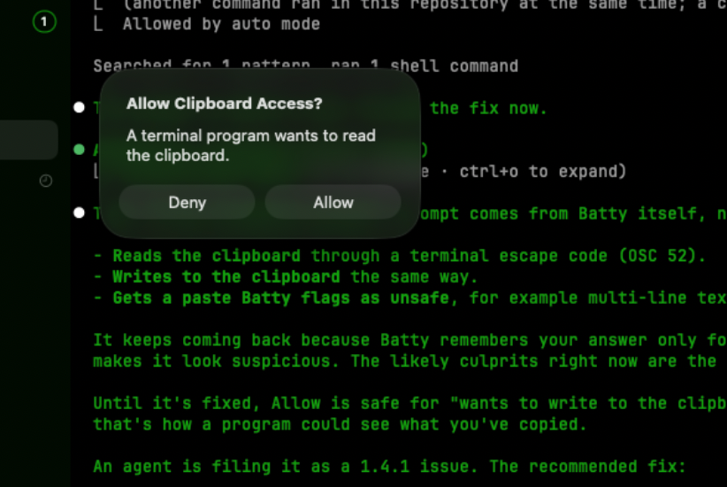

# 0674 — The "Allow Clipboard Access?" prompt keeps reappearing, names no program or Pane, and has no setting or lasting answer

| | |
|---|---|
| **Status** | open |
| **Module** | Session / GhosttyKit / Settings |
| **Platform** | macOS |
| **First seen** | 2026-11-18 |
| **Target** | 1.4.1 |

## Description

The user keeps seeing an "Allow Clipboard Access?" dialog with Allow and Deny buttons. It comes back again and again during a working session, and they can't tell what is asking or why. In their words: "I keep seeing a strange permission prompt asking for me to approve or deny access to the clipboard. What the hell?!" Their setup is Claude Code and several other agents running in Batty Panes.

**Confirmed trigger: an OSC 52 clipboard read (`.osc52Read`) from a program, not a paste or a write.** The user's screenshot shows "Allow Clipboard Access? — A terminal program wants to read the clipboard." on top of the Pane that runs the orchestrating Claude Code session. Claude Code was printing output at the time, and the user had not pasted anything. The program sending the read is most likely Claude Code itself.

This is Batty's own dialog, not a macOS prompt. It appears when libghostty asks the host to confirm a protected clipboard operation. Batty passes no clipboard settings to libghostty, has no Settings control for clipboard access, and keeps the answer only for one Session until relaunch. Pressing Escape or switching Sessions is not remembered at all. The message says only "A terminal program wants to read the clipboard." It does not name the Session, the Pane or the program.

## Steps to reproduce

1. Open a Session and, in a Pane, run a program that sends an OSC 52 clipboard read, for example `printf '\e]52;c;?\a'`. Editors and TUIs that use an OSC 52 clipboard provider, and agent CLIs that query the clipboard, do this too.
2. The "Allow Clipboard Access?" dialog appears.
3. Press Escape, or switch to another Session while the dialog is up.
4. Repeat step 1 in the same Session. The dialog appears again.
5. Answer Allow, then open a new Session (or relaunch Batty) and repeat step 1. The dialog appears again.

## Expected behavior

The recommended default:

1. **Clipboard settings.** Add a "Clipboard" section next to the existing "Paste Confirmation" section (`BattyKit/Sources/BattyKit/Views/SettingsView.swift:66`). Each control is rendered into every Tab's Ghostty configuration and applied live:
   - "Programs can read the clipboard (OSC 52)": Ask / Allow / Never. Default **Ask**. Maps to `clipboard-read = ask|allow|deny`.
   - "Programs can write to the clipboard (OSC 52)": Allow / Ask / Never. Default **Allow**, as in Ghostty. Maps to `clipboard-write`.
   - "Warn before pasting unsafe text": on/off. Default on. Maps to `clipboard-paste-protection`. Its relationship to the Cmd-V "Paste Confirmation" picker is stated in the help text (see Notes), so the two don't look like duplicates.
2. **A clearer dialog.** The title or message names the kind ("read the clipboard", "write to the clipboard", "paste text that may run commands"), the Session title and Pane, and the program name when it can be found from the Pane's foreground process. Program name is best effort, and the dialog falls back to the Session and Pane names. Buttons: **Allow Once**, **Always Allow**, **Deny Once**, **Always Deny**. "Always" writes that kind's Setting (Allow or Never). With the default Allow for writes, a write never prompts.
3. **App-wide answers.** An "Always" answer applies to every Session and survives relaunch, because it is stored in the Setting. "Once" answers keep today's per-Session, per-kind memory. Escape still denies once without remembering.
4. **Security.** An OSC 52 read lets any program in a Pane, including one on a remote host over `ssh`, read whatever is on the pasteboard, such as passwords and tokens. That is an exfiltration path, so the read default stays **Ask**, and "Always Allow" for reads needs a confirming second step or a warning line. A Setting of Never denies silently, with no dialog.

## Actual behavior

- The dialog has only Allow and Deny (`BattyKit/Sources/BattyKit/Views/SessionDetailView.swift:181-195`). The messages are generic, with no Session, Pane or program (`BattyKit/Sources/BattyKit/Commands/PendingClipboardConfirmation.swift:24-36`).
- The answer is remembered per Session and per kind, in memory only (`BattyKit/Sources/BattyKit/Runtime/SessionRuntime.swift:107-146`). Every new Session and every relaunch asks again.
- Escape or click-outside denies and is **not** remembered (`SessionRuntime.swift:180-191`, binding at `SessionDetailView.swift:363-373`). So does switching Sessions while a request is pending (`BattyKit/Sources/BattyKit/Runtime/WindowRuntime.swift:1158-1164`). The same Session asks again on the program's next request.
- A request from a Session that isn't selected waits without being shown, and the dialog appears when the user switches to that Session (`SessionDetailView.swift:162-166`). It seems to come from nowhere and isn't linked to anything on screen.
- A second request while one is pending denies the first and replaces it (`SessionRuntime.swift:161`).
- There are no clipboard Settings.

## Attachments

## Notes

**Config Batty passes.** None of `clipboard-read`, `clipboard-write`, `clipboard-paste-protection` or `clipboard-paste-bracketed-safe` is set. The Tab configuration (`BattyKit/Sources/BattyKit/Runtime/TabRuntime.swift:414-487`) and `withSharedPreferences` (`BattyKit/Sources/BattyKit/Settings/SettingsPreferences.swift:418` onward) set neither. libghostty's defaults apply: `clipboard-read = ask`, `clipboard-write = allow`, and paste protection on. These come from the pinned package's guide, `BattyKit/.build/checkouts/libghostty-spm/AGENTS.md:436-438`. Batty uses no other Ghostty defaults, but the planner should confirm the bracketed-safe default against the pinned ref with `ghostty +show-config --default`.

**Which kind repeats: the OSC 52 read.** The screenshot confirms it (see Attachments). The code agrees. With `clipboard-write = allow`, libghostty calls `writeClipboard` with `confirm == false`, and the write lands at once with no prompt (`libghostty-spm/Sources/GhosttyTerminal/Controller/TerminalController+Callbacks.swift:68-76, 102-105`). Under today's config, `.osc52Write` never prompts. `.paste` is also unlikely. Batty's Cmd-V goes through `PasteDispatcher` → `tab.terminal.send` → `ghostty_surface_text` (`BattyKit/Sources/BattyKit/Views/PasteConfirmation.swift:71-114`, `TerminalSurface.swift:56`), not through libghostty's `paste_from_clipboard` binding (`AppTerminalView+Input.swift:122-130`), which is where paste protection prompts. Whether `ghostty_surface_text` applies paste protection at the pinned ref is unverified; confirm it. That leaves `clipboard-read = ask`. Likely senders include:
- agent CLIs (Claude Code, Codex) and other TUIs that send an OSC 52 read query `ESC ] 52 ; c ; ? BEL`, for example to check clipboard support or to read the clipboard on paste;
- neovim with an OSC 52 clipboard provider (`vim.ui.clipboard.osc52`), which reads on every `"+p`;
- tmux with `set-clipboard on`, or programs inside tmux, forwarding a read;
- anything on a remote host over `ssh`.

To find which program sends the read, and to keep a record afterwards, add a log line with the kind and the tab id in `TerminalDelegateProxy.resolveClipboardConfirmationRoute` (`BattyKit/Sources/BattyKit/Runtime/TerminalDelegateProxy.swift:269-279`). `TerminalDebugLog` only `print`s and is off by default (`libghostty-spm/Sources/GhosttyTerminal/Debug/TerminalDebugLog.swift`), so the kind can't be recovered from logs today.

**Check this SwiftUI ordering.** "Deny" uses `role: .cancel` in a `.confirmationDialog` whose `isPresented` setter cancels the request (`SessionDetailView.swift:191`, `:363-373`). If SwiftUI sets `isPresented = false` before it runs the button action, the request is cancelled and not remembered, and the button's answer then does nothing because of the identity check. Deny would then never be remembered, and Allow could be turned into a deny. Pin the actual order with a test or a log before relying on the remembered answer.

**Paste protection vs. Batty's Paste Confirmation.** They are separate. Batty's `PasteStrictness` (`SettingsPreferences.swift:290`, default `.never`, `:43`) shows `PasteConfirmationSheet` on Cmd-V for multi-line text. libghostty's `clipboard-paste-protection` raises `.paste` only on its own paste path (`paste_from_clipboard`), for text it judges unsafe, such as newlines sent to a program without bracketed paste. The new paste-protection toggle needs help text that says which path it covers, or the planner may fold it into the existing picker if Batty's Cmd-V path turns out to skip libghostty's protection entirely.

**Program name.** The upstream `TerminalClipboardConfirmationRequest` has no requesting-program field (`PendingClipboardConfirmation.swift:14-18`). Get it from the Pane's foreground process, using the same source the Tab auto-name uses (`AppStateStore.updateTabAutoName`), at the time the request arrives.

**Related.** #0390 added this dialog and the per-Session, per-kind memory, and its review notes explain why the answers are kept per kind (B1), why a stale tap resolves by identity (B2), and why a Session switch denies (B3). Keep all three.

## Acceptance criteria

- Settings has the three Clipboard controls with the defaults above. They are stored in `UserDefaults` (isolated in tests, per `docs/isolate-userdefaults-in-tests.md`) and rendered into every Tab's config as `clipboard-read`, `clipboard-write` and `clipboard-paste-protection`. A change reaches open Tabs without a relaunch.
- With the defaults, an OSC 52 write never shows a dialog, and an OSC 52 read shows it once per Session until the user picks "Always".
- The dialog names the kind, the Session and the Pane, and the program when it can be found.
- "Always Allow" or "Always Deny" writes that kind's Setting. No Session asks again for that kind, including after relaunch. Changing the Setting back to Ask brings the prompt back.
- A Setting of Never denies with no dialog. A Setting of Allow allows with no dialog.
- **OSC 52 read, specifically:** after "Always Deny" (or with the read Setting at Never), every later read is denied with no dialog, in every Session and after relaunch. A program that sends reads while printing output, like the Claude Code case in the screenshot, never interrupts the user again. A "Deny Once" stops prompts for the rest of that Session for reads.
- The dialog names the Pane (Session title and Pane or Tab name) and the program whose read raised it, so a prompt over a busy agent Pane can be traced to its source.
- Reads keep their extra confirmation before "Always Allow".
- Escape, switching Sessions and a displaced request still deny and still never allow.

## Tests

- `SettingsPreferencesTests`: `clipboardReadDefaultsToAsk`, `clipboardWriteDefaultsToAllow`, `pasteProtectionDefaultsOn`, and `clipboardSettingsRenderIntoTabConfiguration`. The last uses non-default values and checks that the rendered lines go through the real `ghostty_config` pipeline with zero diagnostics, as `SplitTreeTargetedSplitTests` does.
- `SessionRuntimeClipboardTests`: `alwaysAllowPersistsToSettingAndCoversNewSession`, `alwaysDenyPersistsToSettingAndCoversNewSession`, `onceAnswerStaysPerSession`, `settingNeverDeniesWithoutPrompt`, `settingAllowAllowsWithoutPrompt`, `alwaysOnReadDoesNotAuthorizeWrite` (keeps #0390 B1), and `dismissStillDeniesWithoutRemembering`.
- `PendingClipboardConfirmationTests`: `messageNamesKindSessionAndPane` and `messageNamesProgramWhenKnown`.
- A test that settles the confirmation dialog's Deny/`isPresented` ordering described in Notes.
- New UI test (VM only), checked with `./build.sh ui-typecheck`: `ClipboardConfirmationTests/testAlwaysAllowSuppressesLaterPrompts`. It sends an OSC 52 read with `printf`, picks Always Allow, opens a new Session, sends again and checks that no dialog appears.

## Work log

| Date | Phase | Model | Effort | Wall | Build | Unit | UI | Turns | Output | Cache read | Cache write | Haiku | Cost | Outcome |
|---|---|---|---|---|---|---|---|---|---|---|---|---|---|---|
| 2026-11-18 | file | claude-opus-5-5 | medium | 4m | — | — | — | 26 | ~5,817 | 2,000,850 | 79,515 | — | $0.91 | filed |

**Total: $0.91**
